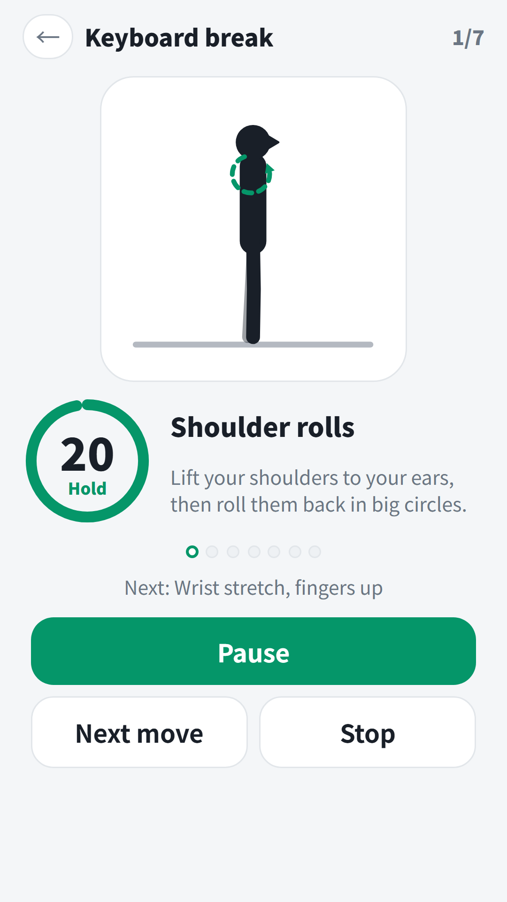
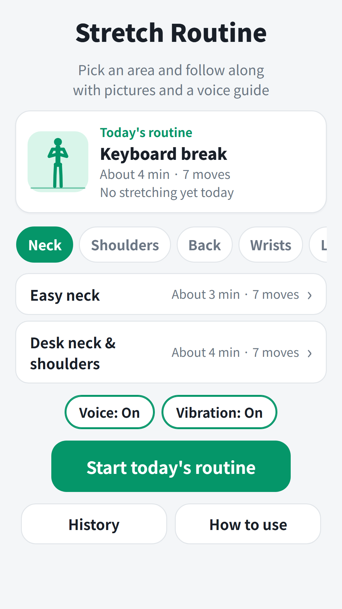
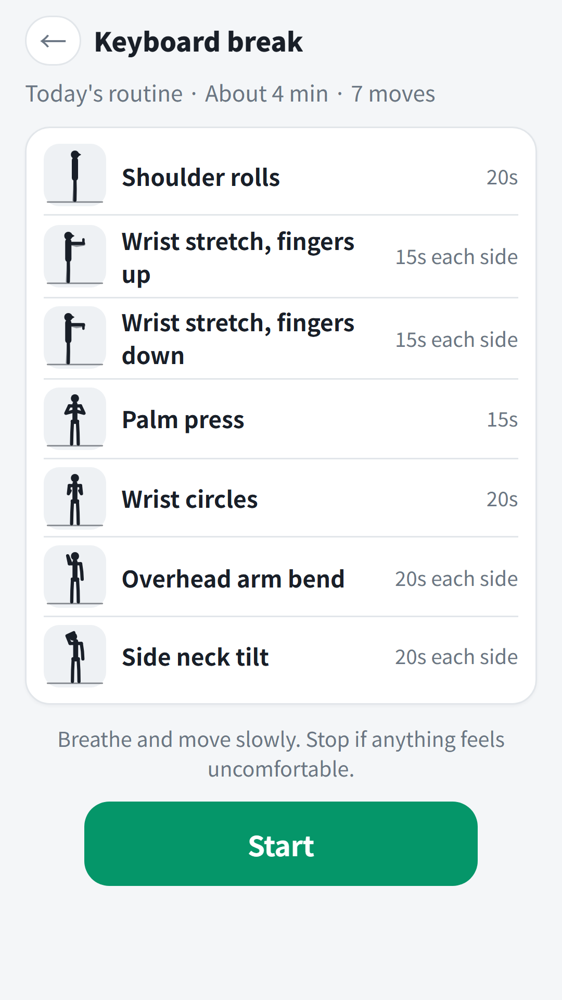
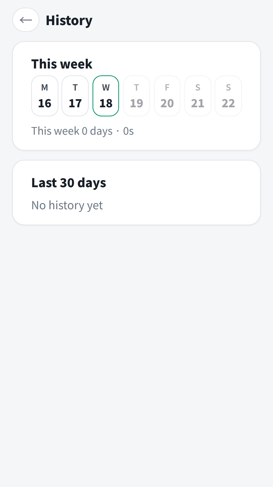

## Info
> **Stretch Routine - Voice Guide** — follow 3-to-5-minute stretching routines by body area with pose illustrations and voice cues. Free on Google Play, with ads (banner and optional rewarded ads).
{: .prompt-info }

## What it is
Stretch Routine guides you through 3-to-5-minute stretching sessions across 6 body areas—neck, shoulders, back, wrists, legs, and full body—with 14 routines and 28 poses. A countdown ring and spoken prompts announce each pose, switch sides for left-right moves, and count down the final 3–2–1 seconds so you do not have to keep watching the screen.

## How it works
- **Daily Routine**: Start a fresh 3-to-5-minute routine directly from the home screen each day
- **14 routines across 6 areas**: Preview the poses and tips before starting any routine
- **Pose illustrations & voice cues**: Step-by-step pose art with movement arrows, one-line form tips, Korean & English voice prompts, and optional vibration
- **Flexible controls**: Pause, skip to the next pose, or stop anytime while the screen stays awake
- **Local tracker**: Weekly 7-day checkmarks, streak counter, and recent 30-day log saved only on your device

## Good to know
- Free to use with no sign-up required
- Supports Korean and English UI and voice cues
- This app is a general fitness reference, not a medical device, and is not intended to diagnose, treat, cure, or prevent any condition. Stop immediately if you feel any discomfort

Contains ads (banner and optional rewarded ads). The Daily Routine starts right away without watching a rewarded ad.

{: w="360" }
{: w="360" }
{: w="360" }
{: w="360" }

## Gameplay Video


## Download
- Google Play: <https://play.google.com/store/apps/details?id=com.fadongkwon.stretch_routine>

{: w="200" .normal }

## You might also like
- [Health Life](/posts/hub-health/) — Home Workout Counter, Stretch Routine, and Korean Food Calorie Guide in one hub
- [Rep Counter Voice](/posts/exercise-count/) — counts your reps, sets, and rest time out loud

Follow along on this blog and on [Instagram (@fadongkwon.soft)](https://www.instagram.com/fadongkwon.soft/).
