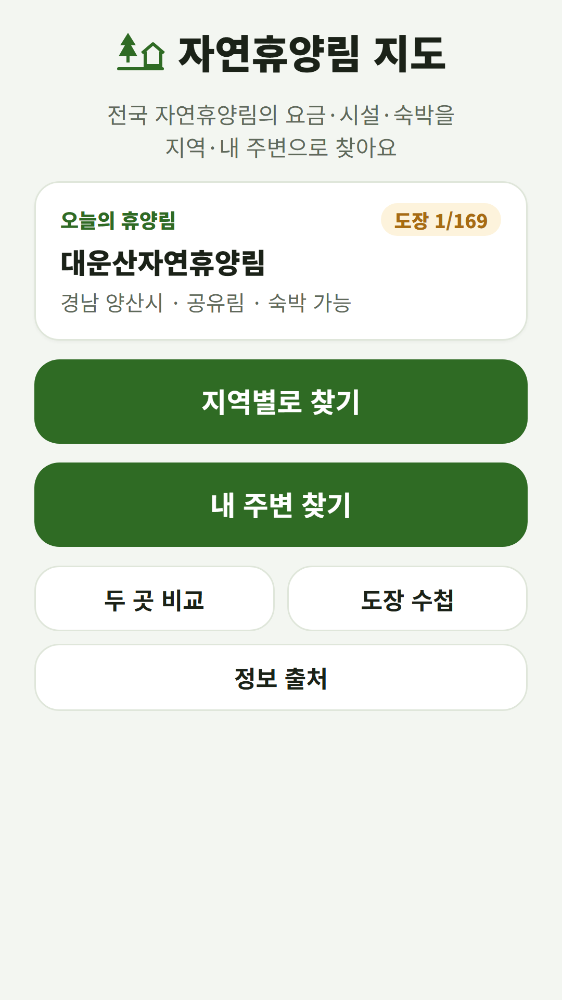
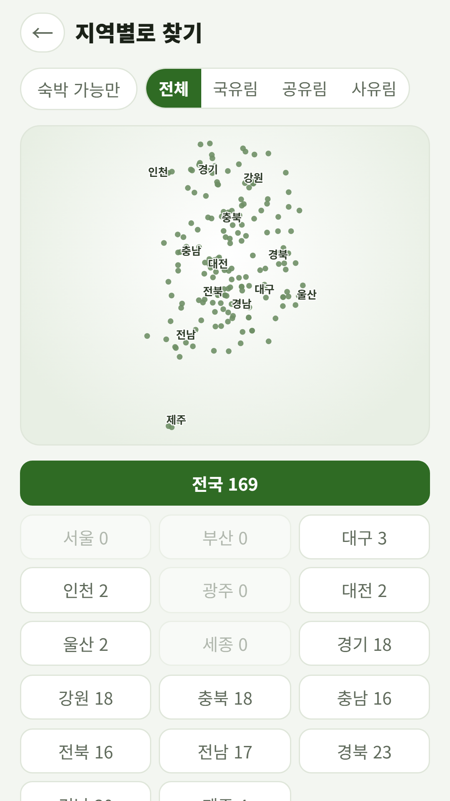
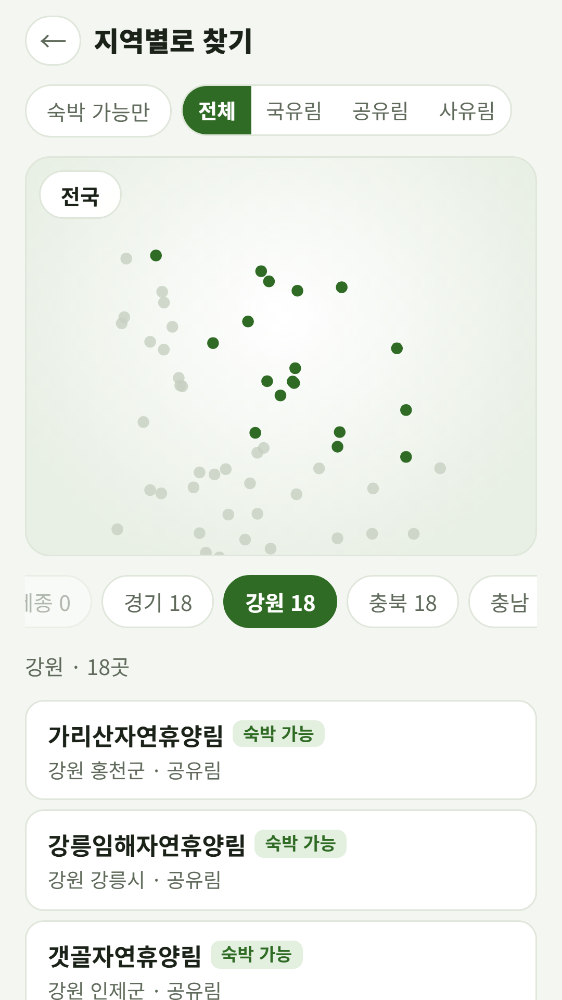
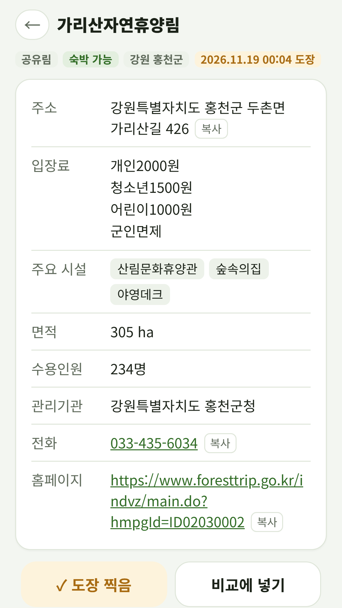
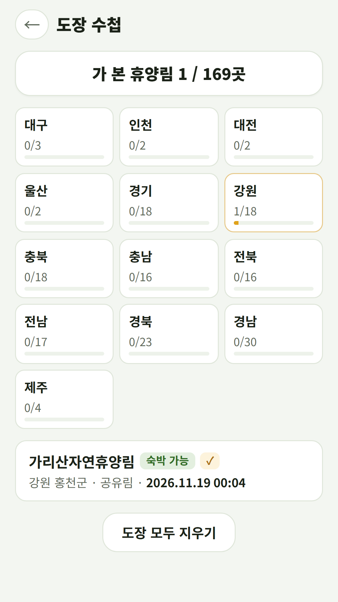

## Info
> **Korea Forest Map - Stamps** — find 169 natural recreation forests across Korea by region or near you, check admission fees and lodging, compare two forests, and stamp the places you visit. Free on Google Play, with ads (banner and optional rewarded ads).
{: .prompt-info }

## What it is
Built exclusively from Korea's Open Data Portal "National Recreational Forest Standard Data" (Dataset ID `15013111`), the app bundles 169 natural recreation forests (156 with lodging) locally so the dot map and lists open right away with no external map service.

## How it works
- **Browse by region**: Filter the dot map by province, lodging availability, or forest category
- **Forests near you**: Approximate location is requested only when you tap the button and is never stored or sent
- **Forest details**: Category, lodging availability, address, admission fee, main facilities, area, capacity, and contact info
- **Side-by-side comparison**: Compare two forests across fees, facilities, and straight-line distance
- **Stamp book & Forest of the Day**: Stamp visited forests with dates and discover one recommended forest each day

## Good to know
- The app interface, forest names, and addresses are in Korean. No sign-up needed
- This app does not represent any government entity; it is an independent app by Fadongkwon Soft and does not provide booking or reservation services
- Reference dates vary by entry, so please check fees and operating hours before visiting

Contains ads (banner and optional rewarded ads). Browsing, forest details, and stamping work without watching a rewarded ad.

{: w="360" }
{: w="360" }
{: w="360" }
{: w="360" }
{: w="360" }

## Gameplay Video


## Download
- Google Play: <https://play.google.com/store/apps/details?id=com.fadongkwon.forest_map>

{: w="200" .normal }

## Data source
Open Data Portal of Korea (data.go.kr) "National Recreational Forest Standard Data" (Dataset ID 15013111, downloaded November 2026).

## You might also like
- [Korea Museum Map](/posts/museum-map/) — Find 1,024 museums and galleries across Korea by region or nearby
- [Weekend Life](/posts/hub-weekend/) — Travel timing, Korea Museum Map, and Rep Counter Voice in one hub

Follow along on this blog and on [Instagram (@fadongkwon.soft)](https://www.instagram.com/fadongkwon.soft/).
