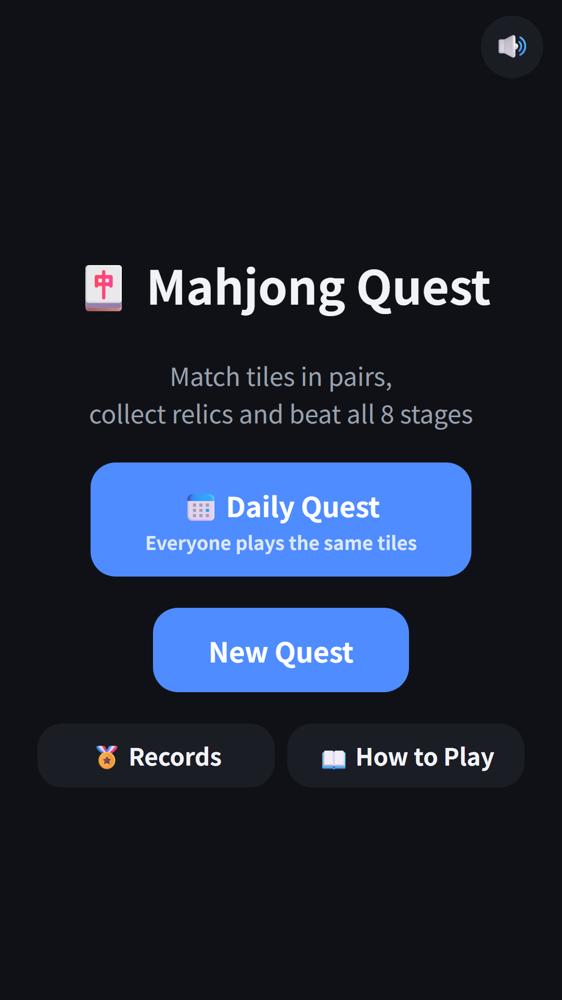
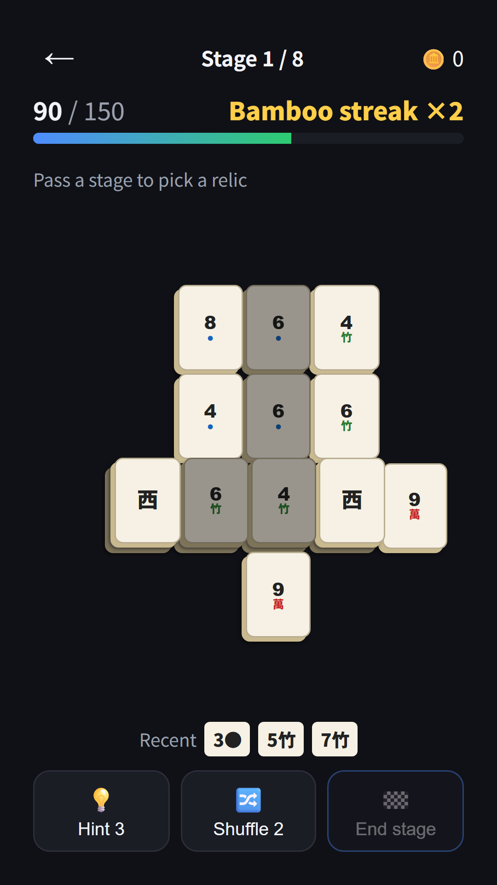
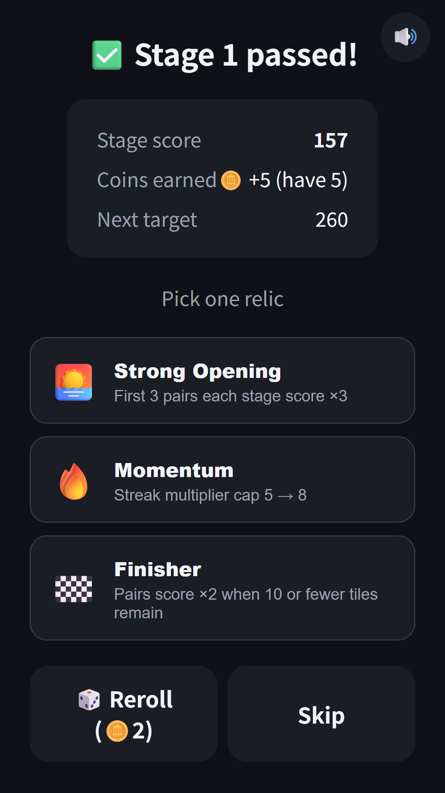
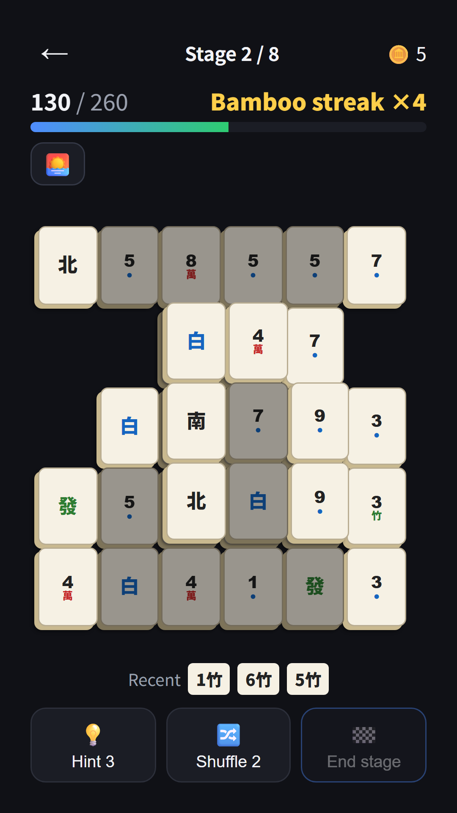
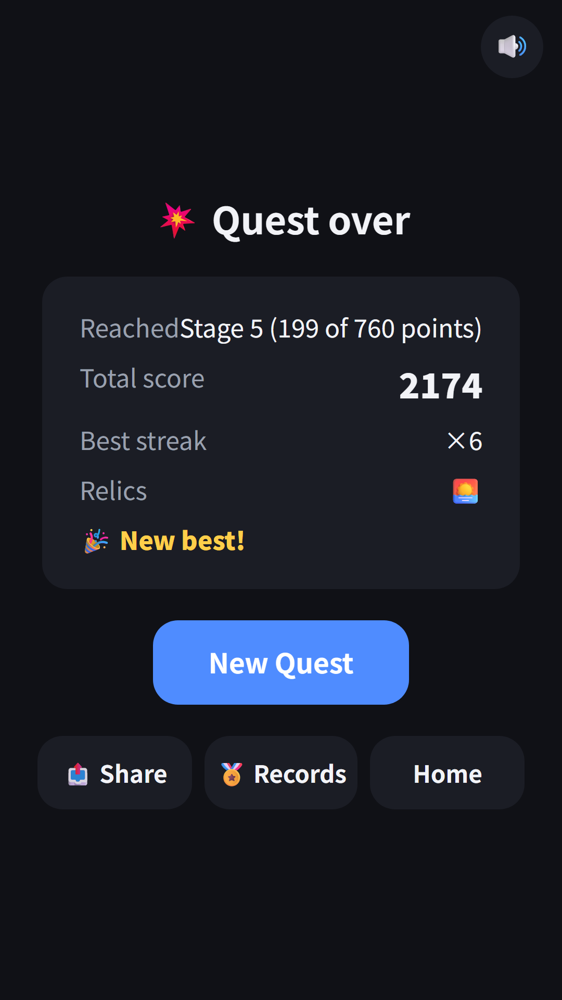

## Info
> **Mahjong Quest** — A puzzle game that mixes mahjong solitaire with a roguelike run. Free on Google Play, with ads (banner and rewarded). On Toss, play it inside [FDK Puzzle Cafe](/posts/hub-puzzle/).
{: .prompt-info }

## About the Game
You solve each board like mahjong solitaire, then carry relics from stage to stage like a roguelike. Only tiles with nothing on top and an open left or right side can be picked, and tapping two matching tiles removes them. Every stage has a target score you must beat to move on. After each stage you pick 1 of 3 relics that change how scoring works, and clearing all 8 stages completes the quest.

## How to Play
- Tap two matching tiles that have nothing on top and an open left or right side to remove them
- Score is chips times a multiplier. Number tiles give their number plus 2 chips, winds give 10 and dragons give 12
- Matching the same suit (characters, dots, bamboo, winds, dragons) in a row raises the multiplier 1, 2, 3 up to 5
- If your last three pairs are consecutive numbers of one suit, like 3-4-5 of characters, you get a 30 chip sequence bonus
- Beat the target score to pass, and clear the whole board for an extra bonus
- When you are stuck, shuffle (2 per stage). Hints are free 3 times per stage

## Features
- 8 stages that grow from a 6 by 4 board with 2 layers to an 8 by 6 board with 4 layers, with rising target scores
- 18 relics such as Character Collector, Wind Road, Dragon Scale, Momentum, Sequence Master and Piggy Bank, stacking until the quest ends
- Coins earned after each stage buy a relic reroll (2 coins) or an extra shuffle (3 coins)
- A new board can always be solved from the start (shuffling afterwards has no such guarantee)
- Daily Quest: everyone gets the same board on the same day
- Continue where you left off, a Top 10 of your best scores, and quests played, quests won, best stage and daily streak stats
- Plays in 9 languages, no sign-up needed

Optional rewarded ads can give you extra hints or shuffles, and a banner ad sits at the bottom of the screen. Contains ads (banner and rewarded).

{: w="360" }
{: w="360" }
{: w="360" }
{: w="360" }
{: w="360" }

## Gameplay Video


## Download
- Google Play: <https://play.google.com/store/apps/details?id=com.fadongkwon.mahjong_rogue>
- Toss: Mahjong Quest inside [FDK Puzzle Cafe](/posts/hub-puzzle/)

{: w="200" .normal }

## You May Also Like
- [FDK Puzzle Cafe](/posts/hub-puzzle/) — Block escape, Mahjong Quest and more brain-teasing puzzles in one hub

Follow updates on this blog and on [Instagram (@fadongkwon.soft)](https://www.instagram.com/fadongkwon.soft/).
