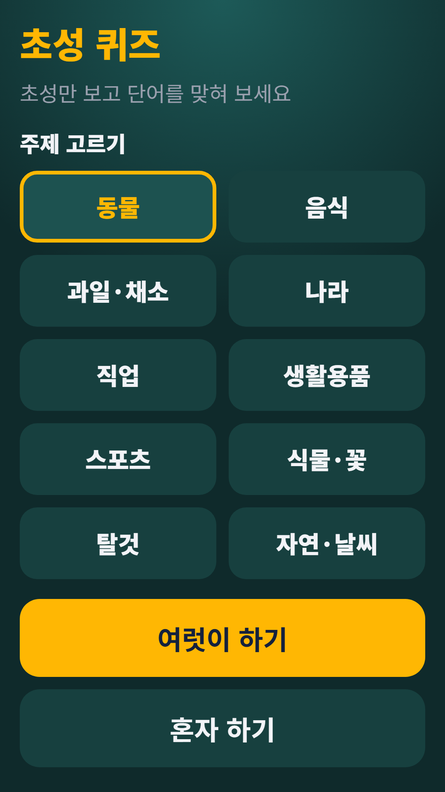
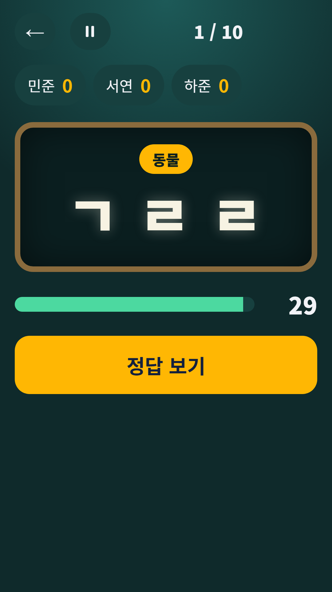
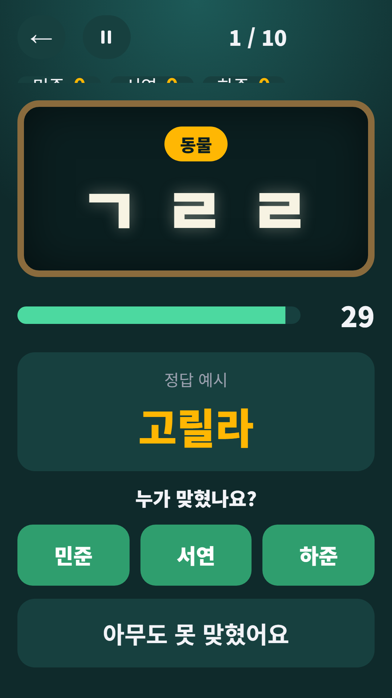

## Info
> **Chosung Quiz: Korean Initials** — Guess Korean words from their initial consonants. Play solo or with a group. The words are in Korean. Free to play on Google Play, with ads.
{: .prompt-info }

## 이런 게임입니다
초성만 보고 단어를 맞혀 보세요! 친구들과 폰 하나로 모여서, 또는 혼자서 연습해요.

## 어떻게 하나요
- 홈에서 주제를 고르고 **여럿이 하기**나 **혼자 하기**를 눌러요
- 여럿이 하기는 문제 수(5·10·15)와 제한 시간(15·30·60초)을 고르고 팀이나 사람 이름을 입력해요. 정답 보기를 누른 뒤 '누가 맞혔나요?'에서 맞힌 사람에게 점수를 줘요. 순위, 공동 순위, 공동 우승이 표시돼요
- 혼자 하기는 10문제, 문제당 20초예요. 초성이 같고 주제 목록에 있는 단어를 입력하면 정답이에요(같은 초성의 다른 단어도 괜찮아요). 힌트는 점수가 깎이고, 넘기기도 할 수 있어요
- 오답은 이유를 알려 주고, 시간 안에 다시 입력할 수 있어요

## 특징
- 10가지 주제: 동물, 음식, 과일·채소, 나라, 직업, 생활용품, 스포츠, 식물·꽃, 탈것, 자연·날씨
- 속도 보너스 점수, 주제별 최고 점수 저장
- 언제든 일시정지
- 칠판 느낌의 큰 글자로 읽기 편해요

무료로 즐길 수 있고 광고가 포함되어 있습니다.

{: w="360" }
{: w="360" }
{: w="360" }

## 플레이 영상


## Download
- Google Play: <https://play.google.com/store/apps/details?id=com.fadongkwon.chosung_quiz>

{: w="200" .normal }

## 함께 출시된 앱
같은 날 Google Play에 함께 나온 앱들입니다.

- [파동권 복불복](/ko/posts/hub-party/) — 룰렛, 사다리, 제비뽑기 등 모임 도구 7종
- [사다리타기](/ko/posts/ladder/) — 이름과 결과를 적고 사다리 타기
- [제비뽑기](/ko/posts/draw-lots/) — 폰을 돌려 가며 제비 뽑기
- [벌칙 룰렛](/ko/posts/penalty-roulette/) — 돌려서 벌칙 정하기
- [파동권 하루상식](/ko/posts/hub-edu/) — 한국사, 경제, 맞춤법 등 하루 한 문제 6과목

소식은 이 블로그와 [인스타그램(@fadongkwon.soft)](https://www.instagram.com/fadongkwon.soft/)에서 전해드립니다.
