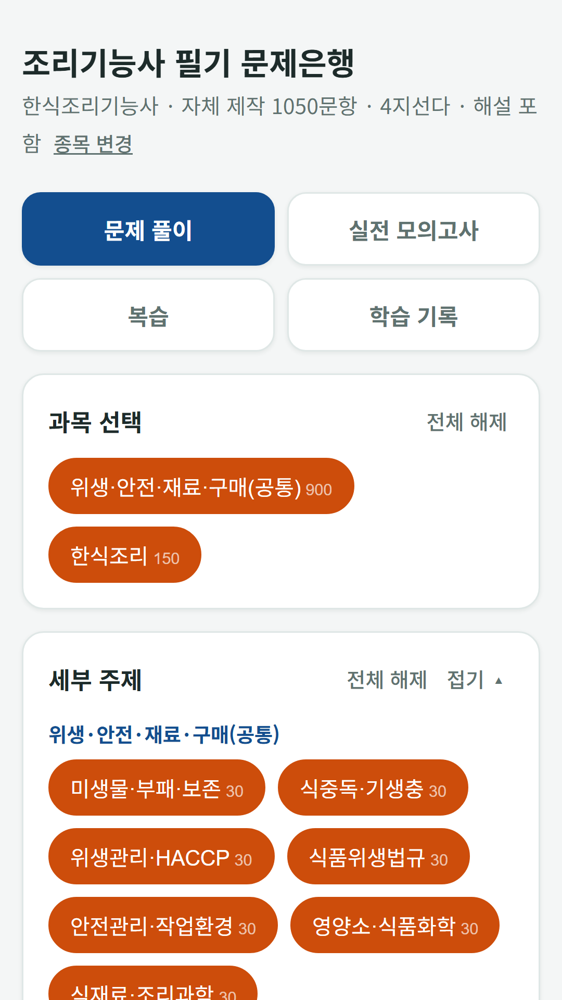
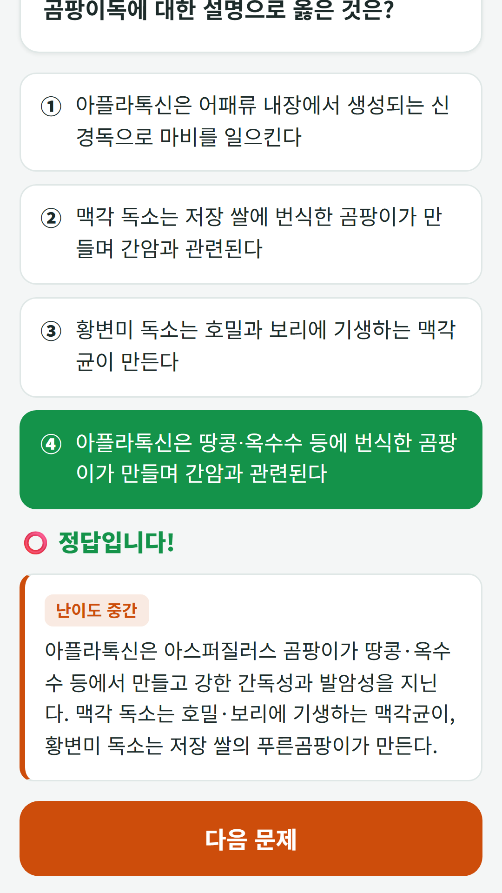
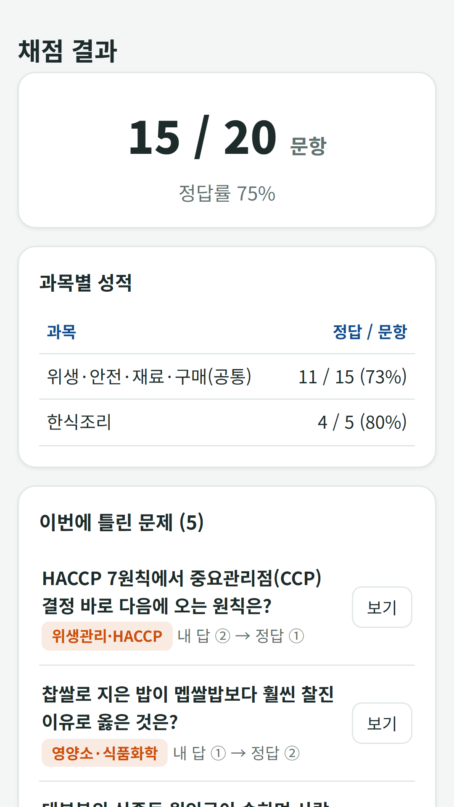

## Info
> **Korean Cook Exam Bank** is a free question bank for the Korean cook license (Korean, Western, Chinese, Japanese) written exam: 1,500 questions with explanations and a 60-question, 60-minute mock exam. Free with ads on Google Play. Korean language only.
{: .prompt-info }

## 이런 앱입니다
조리기능사 필기시험을 준비하는 분을 위한 문제은행이에요. 2026년부터 적용되는 새 출제기준을 바탕으로 만든 4지선다 1,500문항으로 공통 과목과 종목별 과목을 연습하세요.

- **종목 선택** — 한식, 양식, 중식, 일식 조리기능사
- **공통 문항과 종목별 문항** — 위생·안전·재료·구매 관리 공통 문항에 종목별 조리 문항을 더해요
- **실전 모의고사** — 60문항 60분, 100점 만점에 60점 이상이면 합격으로 판정해요

## 어떻게 하나요
- **문제 풀이** — 과목·세부 주제·난이도를 골라 원하는 범위만 연습하고, 바로 정답과 해설을 확인해요
- **실전 모의고사** — 실제 시험과 같은 문항 수·제한 시간·합격 판정으로 풀어요. 바로 채점과 종료 후 채점 중에서 고를 수 있어요
- **복습** — 틀린 문제는 오답노트에 자동으로 저장되고, 별표로 다시 볼 문제를 모을 수 있어요
- **학습 기록** — 누적 정답률, 과목별 정답률, 회차별 기록을 봐요

## 특징
- 최근에 푼 문제는 다시 나오지 않게 골고루 출제해요
- 글자 크기 조절(보통·크게·아주 크게)

무료로 이용할 수 있고 광고가 포함되어 있습니다(25문제마다 광고 1회, 배너 광고).

문항과 해설은 공개된 출제기준과 법령·교재를 바탕으로 자체 제작했으며, 실제 시험 문제가 아닙니다. 해설에 오류가 있을 수 있으니 참고용으로 활용하세요. 시험 주관 기관과 관계없는 학습용 앱입니다.

{: w="360" }
{: w="360" }
{: w="360" }

## Download
- Google Play: <https://play.google.com/store/apps/details?id=com.fadongkwon.cook_quiz>

{: w="200" .normal }

## 함께 출시된 앱
같은 날 Google Play에 함께 나온 앱들입니다.

- [요양보호사 모의 문제은행](/ko/posts/care-quiz/) — 요양보호사 시험 대비 1,500문항과 모의고사
- [미용사 필기 문제은행](/ko/posts/beauty-quiz/) — 미용사 필기 1,800문항과 모의고사
- [제과제빵기능사 필기 문제은행](/ko/posts/bake-quiz/) — 제과기능사·제빵기능사 필기, 계산 문제 포함
- [지게차 굴착기 필기 문제은행](/ko/posts/heavy-quiz/) — 지게차·굴착기 운전기능사 필기
- [운전면허 학과시험 문제은행](/ko/posts/drive-quiz/) — 공개 문제은행 965문항과 모의고사

소식은 이 블로그와 [인스타그램(@fadongkwon.soft)](https://www.instagram.com/fadongkwon.soft/)에서 전해드립니다.
