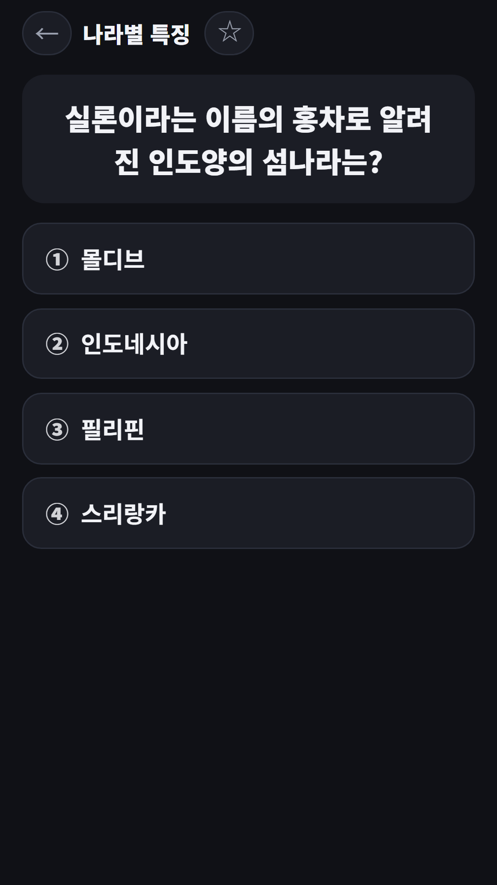
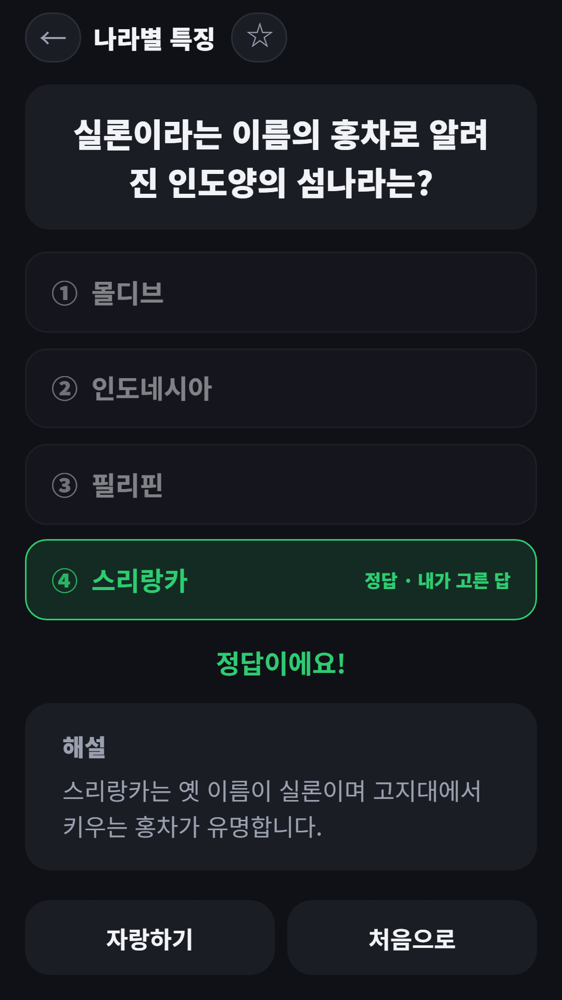
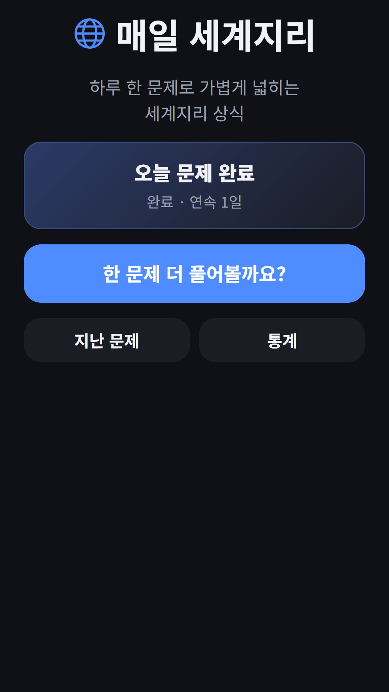

## Info
> **Daily World Geography Quiz (Korean)** — One world geography question a day with a short explanation. Korean language only. Free to play on Google Play, with ads.
{: .prompt-info }

## 이런 게임입니다
하루 한 문제로 세계지리를 익히는 퀴즈예요. 보기 4개 중 고르면 바로 정답과 짧은 해설이 나와요. 더 풀고 싶으면 이어서 계속 풀 수 있어요.

## 어떻게 하나요
- 홈에서 **오늘의 문제**를 풀어요. 오늘의 문제는 모두에게 같은 문제이고, 풀면 연속 출석 기록이 쌓여요
- 보기 4개 중 하나를 고르면 바로 채점하고 해설을 보여 줘요
- **한 문제 더 풀기**로 이어서 풀어요
- **지난 문제**에서 오늘의 문제 기록, 오답노트, 별표 즐겨찾기를 볼 수 있어요
- **통계**에서 현재·최장 연속, 푼 문제, 정답률, 범주별 정답률을 봐요
- **자랑하기**로 오늘의 결과를 공유할 수 있어요

## 특징
- 자체 창작 270문항, 7개 범주: 수도·국기·대륙과 바다·산과 강·기후·나라별 특징·세계 유산
- 채점 즉시 해설
- 오답노트와 별표 즐겨찾기
- 연속 출석과 범주별 정답률 통계

무료로 즐길 수 있고 광고가 포함되어 있습니다.

{: w="360" }
{: w="360" }
{: w="360" }

## 플레이 영상


## Download
- Google Play: <https://play.google.com/store/apps/details?id=com.fadongkwon.daily_geo>

{: w="200" .normal }

## 함께 출시된 앱
같은 날 Google Play에 함께 나온 앱들입니다.

- [파동권 하루상식](/ko/posts/hub-edu/) — 한국사, 경제, 맞춤법 등 하루 한 문제 6과목
- [초성 퀴즈](/ko/posts/chosung-quiz/) — 초성만 보고 단어 맞히기
- [요양보호사 모의 문제은행](/ko/posts/care-quiz/) — 요양보호사 시험 대비 1,500문항과 모의고사
- [운전면허 학과시험 문제은행](/ko/posts/drive-quiz/) — 공개 문제은행 965문항과 모의고사

소식은 이 블로그와 [인스타그램(@fadongkwon.soft)](https://www.instagram.com/fadongkwon.soft/)에서 전해드립니다.
