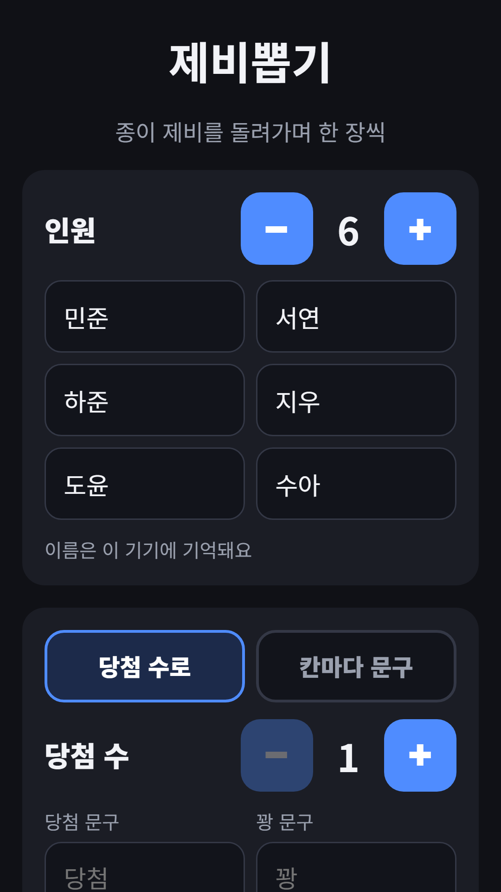
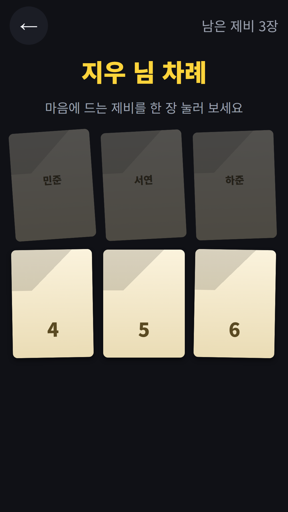
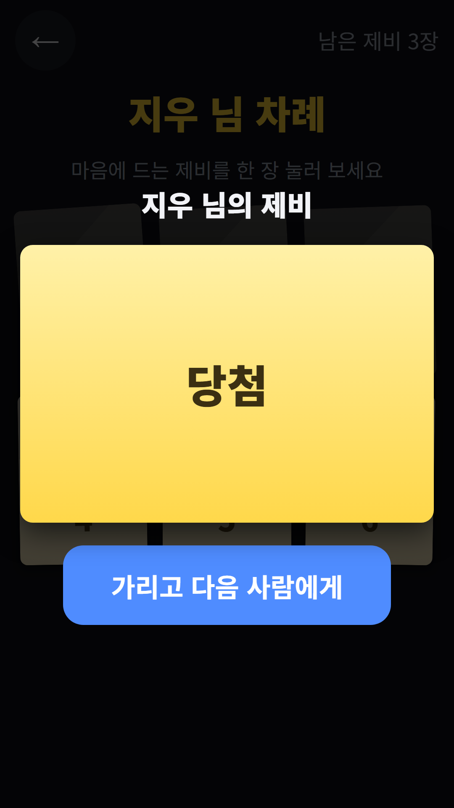
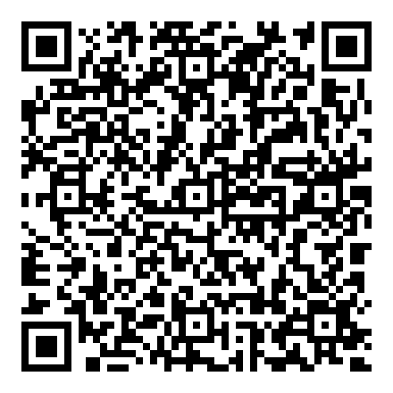

## Info
> **Draw Lots: Pick Who Wins** — Pass the phone and pick a slip. Draw winners, dares or turn order. Free to play on Google Play, with ads. 9 languages.
{: .prompt-info }

## 이런 게임입니다
폰을 돌려 가며 접힌 제비를 한 장씩 뽑아요. 당첨자, 벌칙, 순서 정하기에 딱이에요.

## 어떻게 하나요
- 2~20명의 이름을 적어요. 입력한 이름은 이 기기에 기억돼요
- 방식은 두 가지예요. 당첨 수로 정하거나(당첨 1명부터), 칸마다 문구를 직접 적어요
- 제비를 누르면 종이가 펼쳐지며 결과가 나와요. 당첨은 금색 종이예요
- '가리고 다음 사람에게'를 누르면 화면을 덮어 다음 결과를 미리 볼 수 없어요
- 마지막에 결과 표가 나오고, '다시 하기'를 누르면 제비를 새로 섞어요

## 특징
- 한 번 뽑은 제비는 다시 뽑을 수 없어 공평해요
- 가볍게 웃고 넘길 벌칙 채우기 목록(술 없음)
- 2~20명까지 지원
- 9개 언어 지원

무료로 즐길 수 있고 광고가 포함되어 있습니다.

{: w="360" }
{: w="360" }
{: w="360" }

## 플레이 영상


## Download
- Google Play: <https://play.google.com/store/apps/details?id=com.fadongkwon.draw_lots>

{: w="200" .normal }

## 함께 출시된 앱
같은 날 Google Play에 함께 나온 앱들입니다.

- [사다리타기](/ko/posts/ladder/) — 이름과 결과를 적고 사다리 타기
- [벌칙 룰렛](/ko/posts/penalty-roulette/) — 돌려서 벌칙 정하기
- [파동권 복불복](/ko/posts/hub-party/) — 룰렛, 사다리, 제비뽑기 등 모임 도구 7종
- [초성 퀴즈](/ko/posts/chosung-quiz/) — 초성만 보고 단어 맞히기

소식은 이 블로그와 [인스타그램(@fadongkwon.soft)](https://www.instagram.com/fadongkwon.soft/)에서 전해드립니다.
