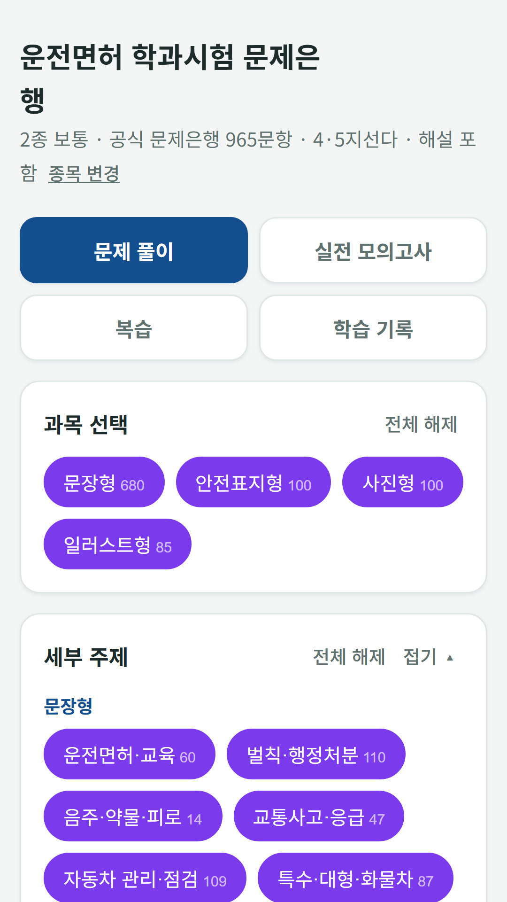
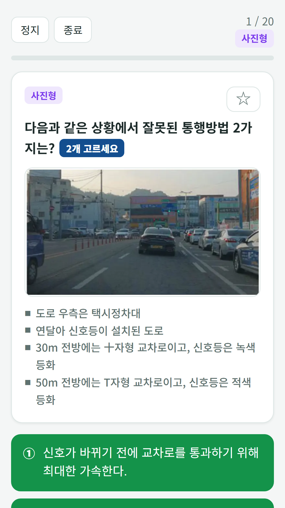
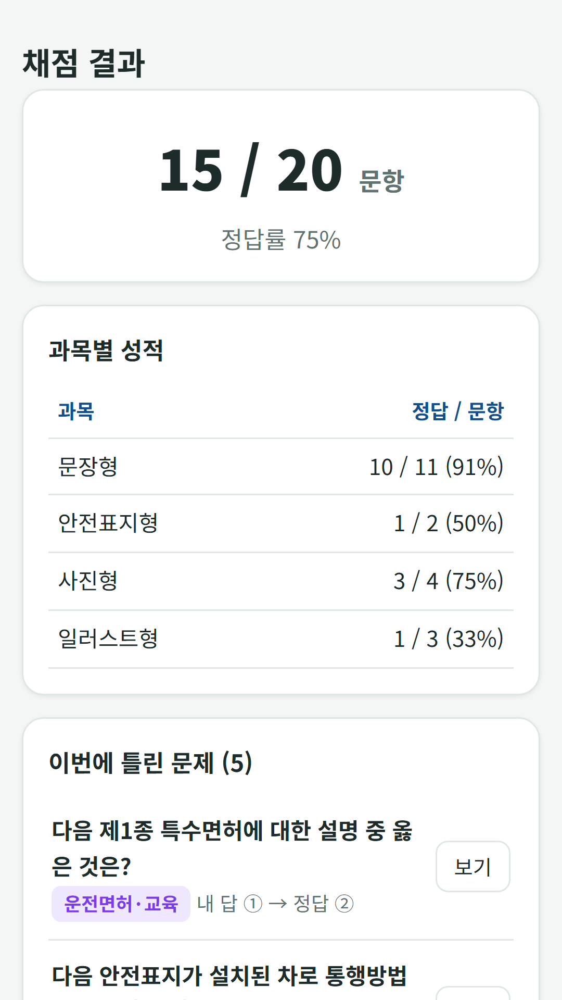

## Info
> **Korean Driving Test Bank** is a free question bank for the Korean driver's license written test: 965 items from the public question bank with explanations, plus a mock exam with the real time limit. Free with ads on Google Play. Korean language only.
{: .prompt-info }

## 이런 앱입니다
운전면허 학과시험(필기)을 준비하는 분을 위한 문제은행이에요. 2026년 3월 9일부터 시행된 도로교통공단 공개 문제은행 문항을 정답·해설과 함께 그대로 담았어요. 영상이 필요한 동영상형 35문항은 제외했어요.

- **965문항** — 문장형 680, 안전표지형 100, 사진형 100, 일러스트형 85
- **문항 형식** — 4지·5지선다, '2개 고르기' 문항은 실제처럼 두 개를 모두 골라야 정답이에요
- **실전 모의고사** — 40문항 구성(동영상형 1문항 제외) 40분, 100점으로 환산해 채점해요
- **종목별 합격선** — 1종 보통·대형·특수 70점, 2종 보통 60점

## 어떻게 하나요
- **문제 풀이** — 유형과 세부 주제를 골라 연습하고, 정답과 해설을 확인해요
- **실전 모의고사** — 실제 시험과 같은 구성과 제한 시간으로 풀고, 100점으로 환산해 채점해요
- **복습** — 틀린 문제는 오답노트에 자동으로 저장되고, 별표로 다시 볼 문제를 모을 수 있어요
- **학습 기록** — 누적 정답률, 유형별 정답률, 회차별 기록을 봐요

## 특징
- 문장형, 안전표지형, 사진형, 일러스트형 네 가지 유형
- 정답·해설이 함께 담긴 공개 문제은행 문항
- 글자 크기 조절(보통·크게·아주 크게)

무료로 이용할 수 있고 광고가 포함되어 있습니다(25문제마다 광고 1회, 배너 광고).

문제 출처: 한국도로교통공단 운전면허 학과시험 문제은행(2026.3.9. 시행), 공공데이터포털 공개 자료. 이 앱은 도로교통공단과 관계없는 학습용 앱입니다.

{: w="360" }
{: w="360" }
{: w="360" }

## Download
- Google Play: <https://play.google.com/store/apps/details?id=com.fadongkwon.drive_quiz>

{: w="200" .normal }

## 함께 출시된 앱
같은 날 Google Play에 함께 나온 앱들입니다.

- [요양보호사 모의 문제은행](/ko/posts/care-quiz/) — 요양보호사 시험 대비 1,500문항과 모의고사
- [미용사 필기 문제은행](/ko/posts/beauty-quiz/) — 미용사 필기 1,800문항과 모의고사
- [조리기능사 필기 문제은행](/ko/posts/cook-quiz/) — 한식·양식·중식·일식 조리기능사 필기
- [제과제빵기능사 필기 문제은행](/ko/posts/bake-quiz/) — 제과기능사·제빵기능사 필기, 계산 문제 포함
- [지게차 굴착기 필기 문제은행](/ko/posts/heavy-quiz/) — 지게차·굴착기 운전기능사 필기

소식은 이 블로그와 [인스타그램(@fadongkwon.soft)](https://www.instagram.com/fadongkwon.soft/)에서 전해드립니다.
