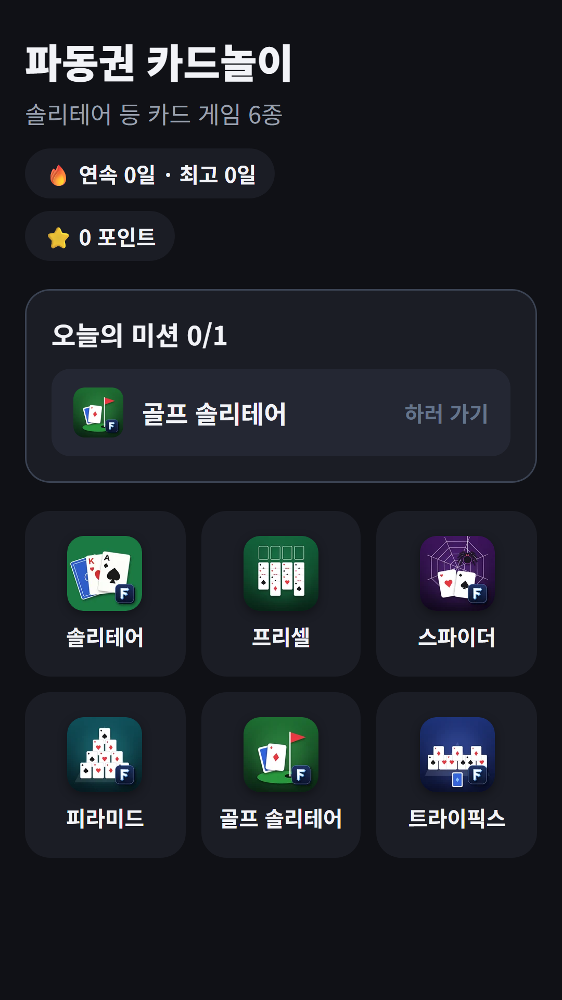
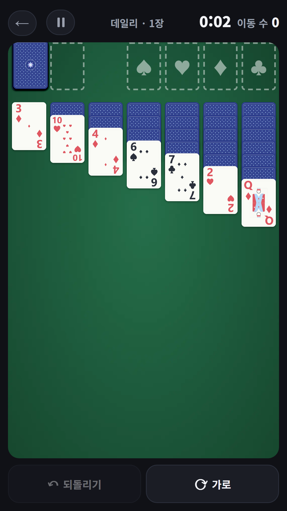
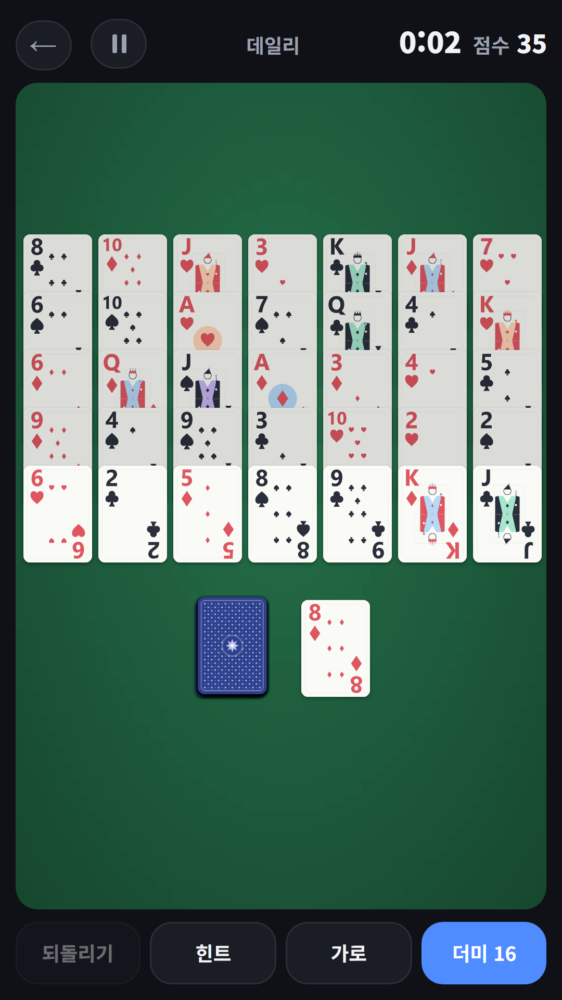

## Info
> **FDK Card Games: Solitaire** — Solitaire, FreeCell, Spider, Pyramid, Golf Solitaire and TriPeaks in one app, with a daily deal. Free to play on Google Play, with ads.
{: .prompt-info }

## 이런 게임입니다
파동권 카드놀이는 솔리테어(클론다이크), 프리셀, 스파이더, 피라미드, 골프 솔리테어, 트라이픽스 여섯 가지 클래식 카드 게임을 한곳에 모은 앱이에요. 게임마다 앱을 따로 설치하지 않아도 홈에서 골라 바로 할 수 있어요.

매일 모두에게 같은 카드 배열이 주어지는 오늘의 판과 자유 판이 있어요. 클리어 시간과 점수로 기록에 도전해 보세요.

## 어떻게 하나요
- 홈에서 하고 싶은 카드 게임을 눌러요
- **오늘의 판**은 모두에게 같은 카드 배열이에요. 자유 판으로도 즐길 수 있어요
- 프리셀은 판 번호를 골라 같은 판을 다시 풀 수 있어요
- 스파이더는 무늬 1벌, 2벌, 4벌 중에서 난이도를 골라요
- 피라미드는 합이 13이 되는 카드 짝을 맞춰요
- 골프 솔리테어와 트라이픽스는 숫자가 하나 크거나 작은 카드를 걷어 내요. 풀 수 있는 판만 나와요

## 특징
- 카드 게임 6종을 한 앱에서
- 매일 같은 배열의 오늘의 판과 자유 판
- 클리어 시간과 점수로 기록 도전
- 가로 모드, 4색 덱, 이어하기 지원
- 홈에서 오늘의 미션, 연속 기록, 포인트 확인

## 수록된 게임 6종
솔리테어, 프리셀, 스파이더, 피라미드는 따로 소개 글이 있어요.

- [솔리테어](/ko/posts/solitaire/) · [프리셀](/ko/posts/freecell/) · [스파이더](/ko/posts/spider/) · [피라미드](/ko/posts/pyramid/) · 골프 솔리테어 · 트라이픽스

무료로 즐길 수 있고 광고가 포함되어 있습니다.

{: w="360" }
{: w="360" }
{: w="360" }

## 플레이 영상


## Download
- Google Play: <https://play.google.com/store/apps/details?id=com.fadongkwon.hub_card>

{: w="200" .normal }

## 함께 출시된 앱
같은 날 Google Play에 함께 나온 앱들입니다.

- [파동권 복불복](/ko/posts/hub-party/) — 룰렛, 사다리, 제비뽑기 등 모임 도구 7종
- [파동권 행운연구소](/ko/posts/hub-fortune/) — 사주·로또·타로 운세를 한곳에
- [파동권 하루상식](/ko/posts/hub-edu/) — 한국사, 경제, 맞춤법 등 하루 한 문제 6과목
- [매일 세계지리](/ko/posts/daily-geo/) — 하루 한 문제, 세계지리 4지선다

소식은 이 블로그와 [인스타그램(@fadongkwon.soft)](https://www.instagram.com/fadongkwon.soft/)에서 전해드립니다.
