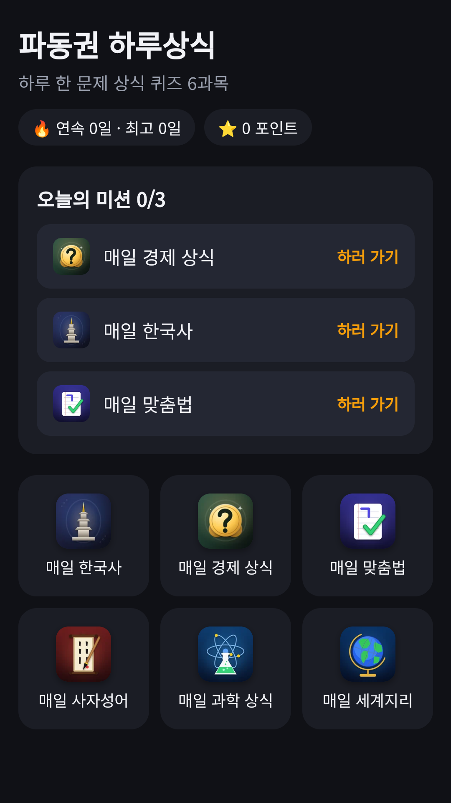
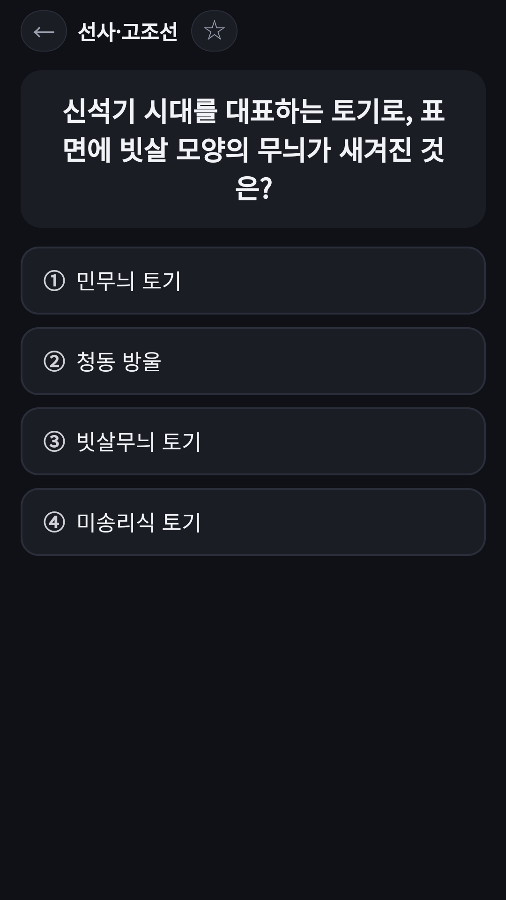
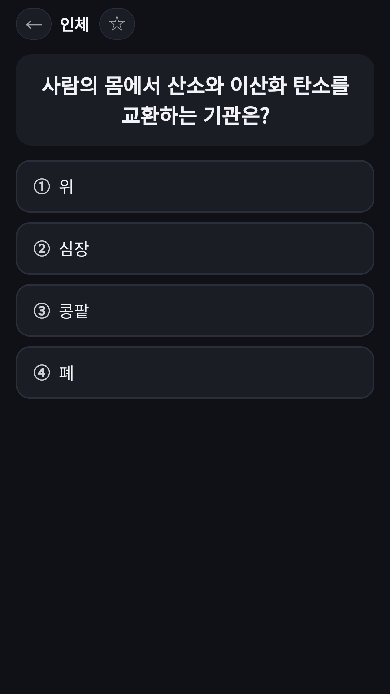

## Info
> **FDK Daily Quiz: Daily Trivia** — One question a day in six subjects, with explanations and a wrong-answer notebook. The questions are in Korean. Free to use on Google Play, with ads.
{: .prompt-info }

## 이런 앱입니다
파동권 하루상식은 매일 한국사, 경제 상식, 우리말 맞춤법, 사자성어, 과학 상식, 세계지리 문제를 한 문제씩 푸는 퀴즈 앱이에요. 과목마다 앱을 따로 설치하지 않아도 홈에서 골라 풀 수 있어요.

학습을 돕는 참고용 콘텐츠이며 공식 시험 문제가 아니에요.

## 어떻게 하나요
- 홈에서 풀고 싶은 과목을 눌러요
- 매일 과목 3개가 오늘의 문제로 정해지고, 모두 풀면 연속 기록이 쌓여요
- 보기에서 답을 고르면 정답과 해설을 바로 확인해요
- 틀린 문제는 오답 노트에서 다시 풀어요

## 특징
- 6과목: 한국사, 경제, 맞춤법, 사자성어, 과학, 세계지리
- 정답과 해설을 바로 확인
- 틀린 문제를 모아 다시 푸는 오답 노트
- 매일 정해지는 오늘의 미션 3과목과 연속 기록

## 수록된 과목 6종
각 과목은 따로 소개 글이 있어요.

- [매일 한국사](/ko/posts/daily-history/) · [매일 경제 상식](/ko/posts/daily-econ/) · [매일 맞춤법](/ko/posts/daily-spelling/) · [매일 사자성어](/ko/posts/daily-idiom/)
- [매일 과학 상식](/ko/posts/daily-science/) · [매일 세계지리](/ko/posts/daily-geo/)

무료로 즐길 수 있고 광고가 포함되어 있습니다.

{: w="360" }
{: w="360" }
{: w="360" }

## 플레이 영상


## Download
- Google Play: <https://play.google.com/store/apps/details?id=com.fadongkwon.hub_edu>
- 앱인토스(토스 미니앱): <https://fadongkwon.com/toss/hub-edu/> — 휴대폰에서 열면 토스 앱으로 바로 연결됩니다.

{: w="200" .normal }

## 함께 출시된 앱
같은 날 Google Play에 함께 나온 앱들입니다.

- [매일 세계지리](/ko/posts/daily-geo/) — 하루 한 문제, 세계지리 4지선다
- [초성 퀴즈](/ko/posts/chosung-quiz/) — 초성만 보고 단어 맞히기
- [요양보호사 모의 문제은행](/ko/posts/care-quiz/) — 요양보호사 시험 대비 1,500문항과 모의고사
- [운전면허 학과시험 문제은행](/ko/posts/drive-quiz/) — 공개 문제은행 965문항과 모의고사
- [파동권 행운연구소](/ko/posts/hub-fortune/) — 사주·로또·타로 운세를 한곳에

소식은 이 블로그와 [인스타그램(@fadongkwon.soft)](https://www.instagram.com/fadongkwon.soft/)에서 전해드립니다.
