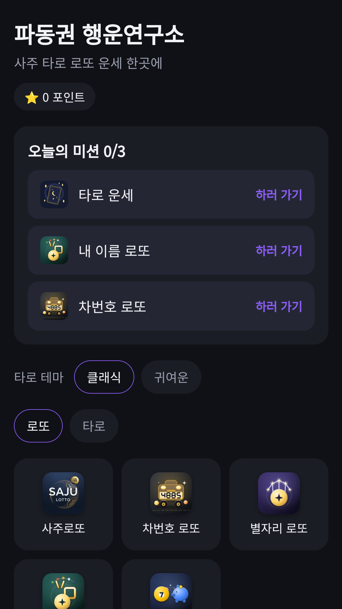
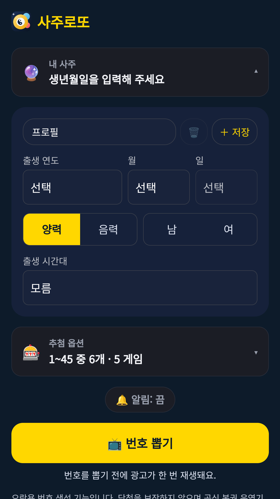

## Info
> **FDK Lucky Lab: Saju & Tarot** — Saju, car number, zodiac and name lotto picks, lotto savings and tarot in one app. For entertainment only. Free to use on Google Play, with ads.
{: .prompt-info }

## 이런 앱입니다
파동권 행운연구소는 사주로또, 차번호 로또, 별자리 로또, 이름 로또, 로또 대신 저축, 타로를 한곳에 모은 운세 모음 앱이에요. 생년월일, 이름, 차번호, 별자리를 한 번만 입력해 두면 모든 메뉴에서 다시 쓸 수 있어요.

재미로 즐기는 콘텐츠예요. 당첨을 보장하지 않으며 로또 번호는 참고용이에요.

## 어떻게 하나요
- 홈에서 쓰고 싶은 메뉴를 눌러요
- 생년월일, 이름, 차번호, 별자리를 한 번만 입력해 두면 모든 메뉴에서 다시 써요
- 사주, 차번호, 별자리, 이름 로또 네 메뉴에서 번호를 추천받아요
- 마음에 드는 번호를 **로또 대신 저축** 계산으로 넘겨 비교해요
- 타로는 클래식 테마와 귀여운 테마를 바꿔 볼 수 있어요

## 특징
- 로또 번호 추천 4종과 로또 대신 저축, 타로를 한 앱에서
- 한 번만 입력하는 공유 프로필
- 운세는 입력으로 계산되는 근거만 보여 주고, 해석 문장을 지어내지 않아요
- 매일 날짜로 정해지는 오늘의 미션과 연속 기록

## 수록된 메뉴 6종
각 메뉴는 따로 소개 글이 있어요.

- [사주로또](/ko/posts/saju-lotto/) · [차번호 로또](/ko/posts/car-lotto/) · [별자리 로또](/ko/posts/star-lotto/) · [이름 로또](/ko/posts/name-lotto/)
- [로또 대신 저축](/ko/posts/lotto-saving/) · [타로 운세](/ko/posts/tarot-fortune/)

무료로 즐길 수 있고 광고가 포함되어 있습니다.

{: w="360" }
{: w="360" }
{: w="360" }

## 플레이 영상


## Download
- Google Play: <https://play.google.com/store/apps/details?id=com.fadongkwon.hub_fortune>
- 앱인토스(토스 미니앱): <https://fadongkwon.com/toss/hub-fortune/> — 휴대폰에서 열면 토스 앱으로 바로 연결됩니다.

{: w="200" .normal }

## 함께 출시된 앱
같은 날 Google Play에 함께 나온 앱들입니다.

- [파동권 카드놀이](/ko/posts/hub-card/) — 솔리테어, 프리셀, 스파이더 등 카드 게임 6종
- [파동권 하루상식](/ko/posts/hub-edu/) — 한국사, 경제, 맞춤법 등 하루 한 문제 6과목
- [파동권 복불복](/ko/posts/hub-party/) — 룰렛, 사다리, 제비뽑기 등 모임 도구 7종
- [매일 세계지리](/ko/posts/daily-geo/) — 하루 한 문제, 세계지리 4지선다

소식은 이 블로그와 [인스타그램(@fadongkwon.soft)](https://www.instagram.com/fadongkwon.soft/)에서 전해드립니다.
