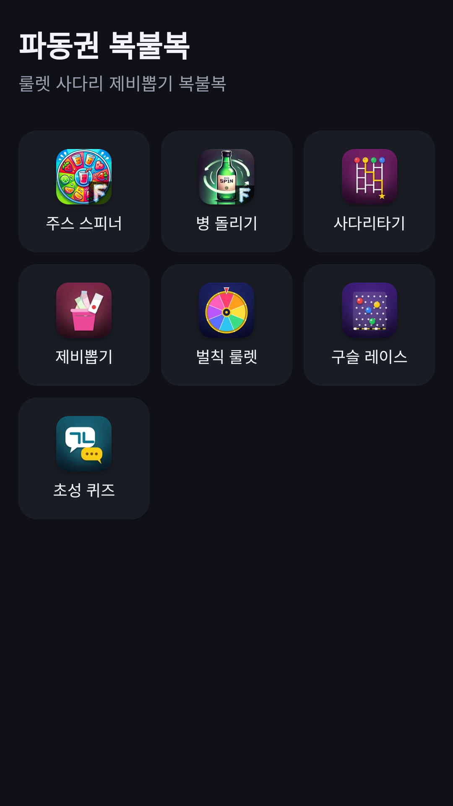
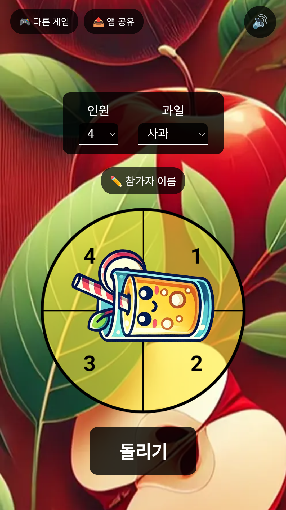
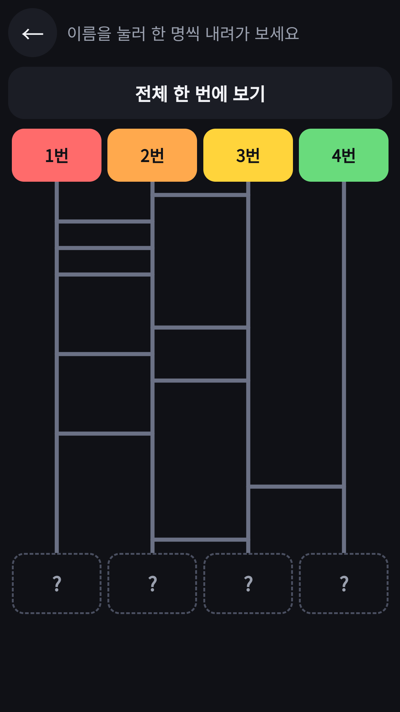

## Info
> **FDK Lucky Pick: Party Games** — Seven party tools to settle who pays, who gets the dare and who goes first. Free to use on Google Play, with ads.
{: .prompt-info }

## 이런 앱입니다
파동권 복불복은 모임에서 바로 쓰는 복불복 도구 7가지를 모은 앱이에요. 오늘 누가 쏠지, 벌칙은 누구인지, 순서는 어떻게 할지 정해 보세요.

재미로 즐기는 놀이용 도구예요.

## 어떻게 하나요
- 홈에서 쓰고 싶은 도구를 눌러요
- 참가자 이름을 한 번 적어 두면 모든 도구에서 같이 써요
- 주스 스피너 룰렛, 병 돌리기, 사다리타기, 제비뽑기, 벌칙 룰렛, 구슬 레이스, 초성 퀴즈 중에서 모임에 맞는 도구를 골라요

## 특징
- 주스 스피너 룰렛과 병 돌리기
- 사다리타기: 이름을 적고 사다리를 타요
- 제비뽑기: 제비를 뽑아 결과를 확인해요
- 벌칙 룰렛: 돌려서 벌칙을 정해요
- 구슬 레이스: 한 명을 뽑는 랜덤 경주
- 초성 퀴즈: 초성만 보고 다 같이 단어 맞히기

## 수록된 도구 7종
각 도구는 따로 소개 글이 있어요.

- [주스 스피너](/ko/posts/juice-spinner/) · [병 돌리기](/ko/posts/spin-the-bottle/) · [사다리타기](/ko/posts/ladder/) · [제비뽑기](/ko/posts/draw-lots/)
- [벌칙 룰렛](/ko/posts/penalty-roulette/) · [구슬 레이스](/ko/posts/marble-race/) · [초성 퀴즈](/ko/posts/chosung-quiz/)

무료로 즐길 수 있고 광고가 포함되어 있습니다.

{: w="360" }
{: w="360" }
{: w="360" }

## 플레이 영상


## Download
- Google Play: <https://play.google.com/store/apps/details?id=com.fadongkwon.hub_party>
- 앱인토스(토스 미니앱): <https://fadongkwon.com/toss/hub-party/> — 휴대폰에서 열면 토스 앱으로 바로 연결됩니다.

{: w="200" .normal }

## 함께 출시된 앱
같은 날 Google Play에 함께 나온 앱들입니다.

- [사다리타기](/ko/posts/ladder/) — 이름과 결과를 적고 사다리 타기
- [제비뽑기](/ko/posts/draw-lots/) — 폰을 돌려 가며 제비 뽑기
- [벌칙 룰렛](/ko/posts/penalty-roulette/) — 돌려서 벌칙 정하기
- [초성 퀴즈](/ko/posts/chosung-quiz/) — 초성만 보고 단어 맞히기
- [파동권 카드놀이](/ko/posts/hub-card/) — 솔리테어, 프리셀, 스파이더 등 카드 게임 6종

소식은 이 블로그와 [인스타그램(@fadongkwon.soft)](https://www.instagram.com/fadongkwon.soft/)에서 전해드립니다.
