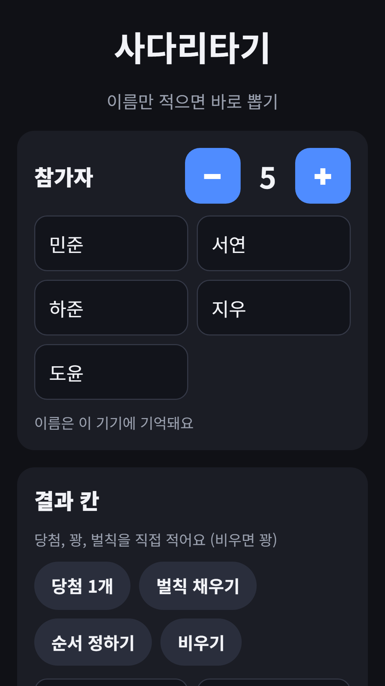
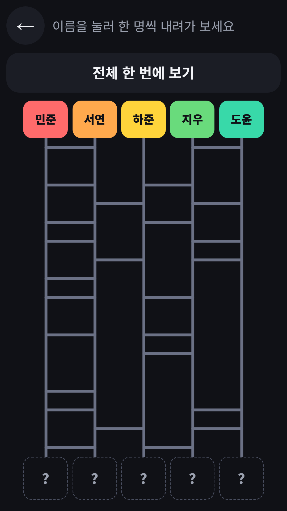
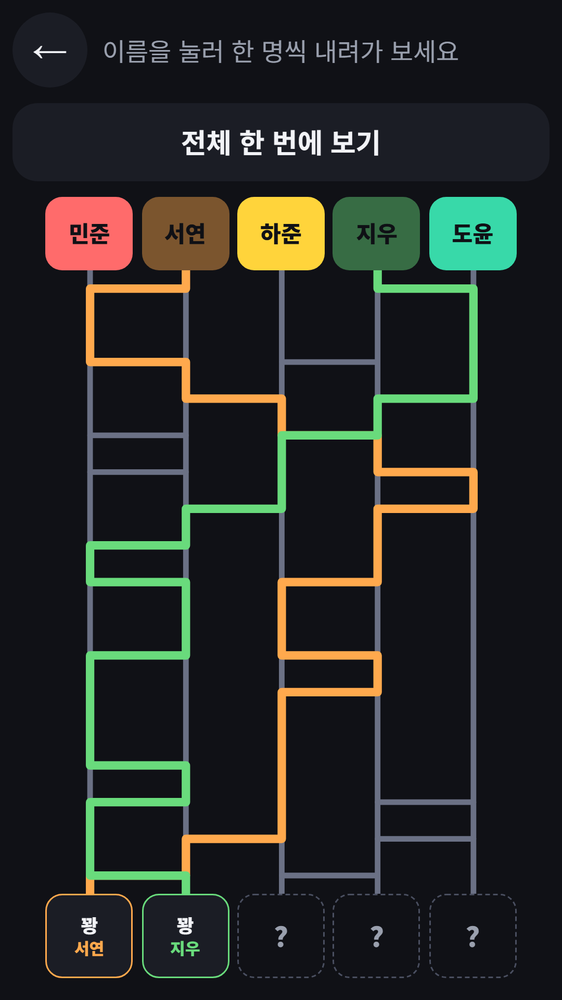
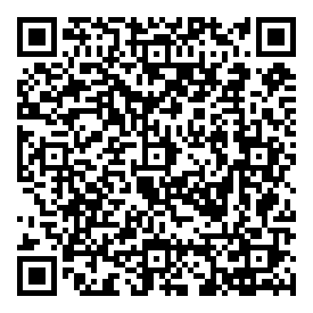

## Info
> **Ladder Game: Random Picker** — Type names and prizes, draw the ladder and see who gets what. Free to play on Google Play, with ads. 9 languages.
{: .prompt-info }

## 이런 게임입니다
누가 당첨일지, 누가 쏠지 사다리로 정해요. 이름과 결과 칸만 적으면 바로 시작해요.

## 어떻게 하나요
- 2~10명으로 − / + 버튼으로 인원을 맞추고 이름을 적어요. 입력한 이름은 이 기기에 기억돼요
- 결과 칸에 당첨, 꽝, 벌칙, 순서 등을 직접 적어요
- 빠른 설정 버튼으로 당첨 1개(위치 무작위), 벌칙 채우기, 순서 정하기, 비우기를 쓸 수 있어요
- 이름을 누르면 그 사람만 사다리를 내려가고, '전체 한 번에 보기'로 모두 한꺼번에 볼 수 있어요
- 마지막에 결과 표가 나오고, '다시 하기'를 누르면 새 사다리가 그려져요

## 특징
- 가로줄이 겹치지 않고 모든 세로줄에 가로줄이 이어지는 무작위 사다리
- 가볍게 웃고 넘길 벌칙 예시만 담았어요(술 없음)
- 9개 언어 지원

무료로 즐길 수 있고 광고가 포함되어 있습니다.

{: w="360" }
{: w="360" }
{: w="360" }

## 플레이 영상


## Download
- Google Play: <https://play.google.com/store/apps/details?id=com.fadongkwon.ladder>

{: w="200" .normal }

## 함께 출시된 앱
같은 날 Google Play에 함께 나온 앱들입니다.

- [제비뽑기](/ko/posts/draw-lots/) — 폰을 돌려 가며 제비 뽑기
- [벌칙 룰렛](/ko/posts/penalty-roulette/) — 돌려서 벌칙 정하기
- [파동권 복불복](/ko/posts/hub-party/) — 룰렛, 사다리, 제비뽑기 등 모임 도구 7종
- [초성 퀴즈](/ko/posts/chosung-quiz/) — 초성만 보고 단어 맞히기

소식은 이 블로그와 [인스타그램(@fadongkwon.soft)](https://www.instagram.com/fadongkwon.soft/)에서 전해드립니다.
