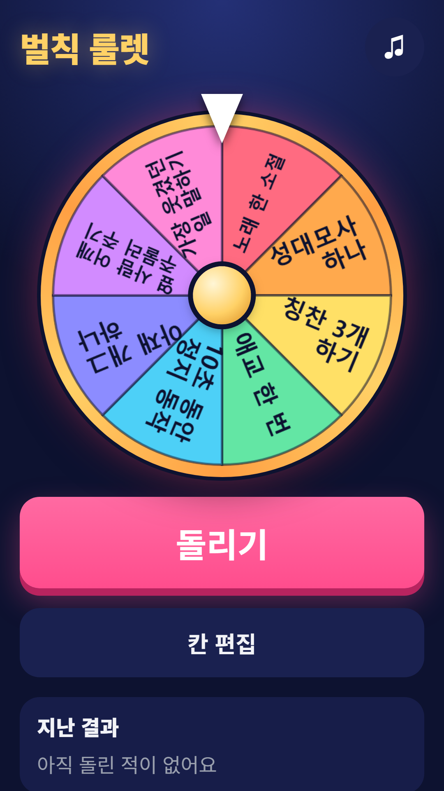
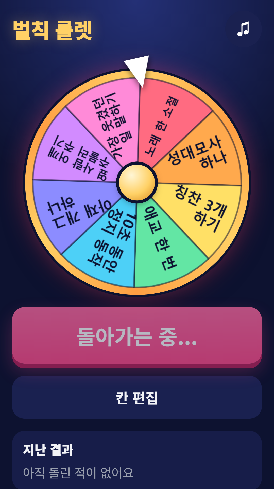
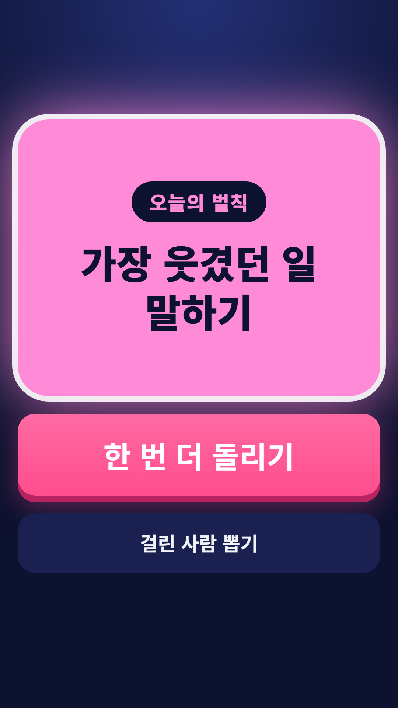
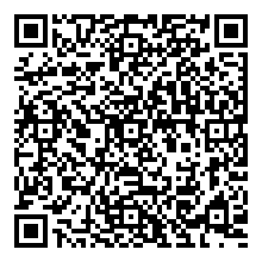

## Info
> **Penalty Wheel: Party Spinner** — Spin the wheel to pick a dare. Edit the slots for your own party games. Free to play on Google Play, with ads. Korean, English, Japanese and Chinese.
{: .prompt-info }

## 이런 게임입니다
룰렛을 돌려 벌칙을 정해요. 준비된 벌칙 세트를 쓰거나 직접 적어서 모임, 여행, 게임 나이트에 써 보세요.

## 어떻게 하나요
- 돌리기 버튼이나 룰렛을 눌러 시작해요. 룰렛은 2~12칸이에요
- 결과는 큰 카드로 나오고, '한 번 더 돌리기'로 이어서 돌려요
- '걸린 사람 뽑기'에서는 이름을 넣어 두면 명단에서 공평하게 한 명을 추첨해요
- '칸 편집'에서 칸 문구를 직접 고쳐요(24자까지). 입력하면 자동 저장돼요
- 지난 결과 목록을 볼 수 있어요

## 특징
- 공정한 회전: 먼저 난수로 칸을 정하고 그 칸에 천천히 멈춰요. 칸을 지날 때마다 소리와 진동이 나와요
- 기본 세트 4개: 가벼운 벌칙, 몸으로 하는 벌칙, 말로 하는 벌칙, 심부름 벌칙(모두 술 없음)
- 한국어, 영어, 일본어, 중국어 지원

무료로 즐길 수 있고 광고가 포함되어 있습니다.

{: w="360" }
{: w="360" }
{: w="360" }

## 플레이 영상


## Download
- Google Play: <https://play.google.com/store/apps/details?id=com.fadongkwon.penalty_roulette>

{: w="200" .normal }

## 함께 출시된 앱
같은 날 Google Play에 함께 나온 앱들입니다.

- [사다리타기](/ko/posts/ladder/) — 이름과 결과를 적고 사다리 타기
- [제비뽑기](/ko/posts/draw-lots/) — 폰을 돌려 가며 제비 뽑기
- [파동권 복불복](/ko/posts/hub-party/) — 룰렛, 사다리, 제비뽑기 등 모임 도구 7종
- [초성 퀴즈](/ko/posts/chosung-quiz/) — 초성만 보고 단어 맞히기

소식은 이 블로그와 [인스타그램(@fadongkwon.soft)](https://www.instagram.com/fadongkwon.soft/)에서 전해드립니다.
