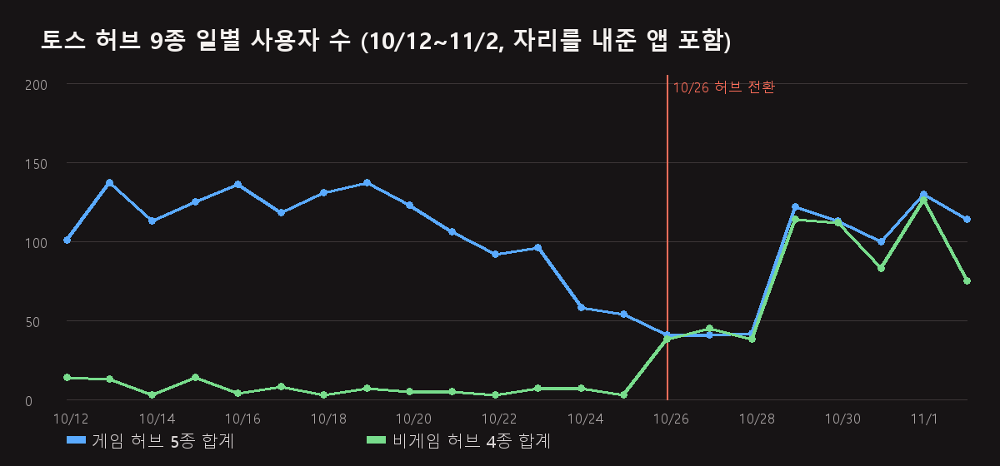

[허브 전환기](/ko/posts/toss-hub-conversion/)에서 "허브로 바뀐 뒤 재방문이 어떻게 움직였는지는 2~3주 수치가 쌓이면 이어서 적겠다"고 했습니다. 아직 1주일하고 하루입니다. 그런데 첫 주 수치가 이미 방향을 보여주고 있어서, 먼저 1주차를 적습니다. 3주차는 11월 중순에 같은 표를 다시 채우겠습니다.

이 글도 금액은 적지 않습니다. 사용자 수, 비율, 광고 노출 수만 적습니다.

## 어떻게 비교했나

앱인토스에서 허브는 새 앱이 아니라 **기존 앱의 앱 정보와 번들을 바꾼 것**입니다. 앱 식별자가 그대로라 콘솔 대시보드에는 자리를 내준 앱의 기록과 허브의 기록이 한 줄로 이어집니다. 그래서 비교가 단순합니다. 같은 앱 식별자의 전환 전과 후를 보면 됩니다.

- **2주 전**: 10월 12일~18일
- **1주 전**: 10월 19일~25일
- **전환 후**: 10월 27일~11월 2일
- 전환일인 10월 26일은 뺐습니다. 비게임 4종은 이날 새벽, 게임 5종은 이날 저녁에 바뀌어서 어느 쪽에도 넣을 수 없습니다.

수치는 앱인토스 콘솔의 활성 사용자·리텐션 대시보드를 11월 3일 밤에 조회한 것이고, 광고 노출 수는 같은 콘솔의 인앱광고 리포트를 매일 적어 두는 [장부](/ko/posts/revenue-ledger-dashboard/)에서 가져왔습니다.

## 한눈에

_게임 허브 5종 합계(파랑)와 비게임 허브 4종 합계(초록). 세로선이 전환일입니다._

| 허브 | 자리를 내준 앱 | 하루 사용자 (2주 전 → 1주 전 → 전환 후) | 혜택탭 비중 (1주 전 → 후) | 다음 날 재방문 (1주 전 → 후) |
|---|---|---|---|---|
| [파동권 퍼즐카페](/ko/posts/hub-puzzle/) | 머지 팝 | 24 → 20 → 16 | 93% → 87% | 1/137 → 1/77 |
| [파동권 뇌나이](/ko/posts/hub-brain/) | 기억력 카드 | 32 → 27 → 19 | 87% → 80% | 6/165 → 1/94 |
| [파동권 오락실](/ko/posts/hub-arcade/) | 가위바위보 | 2 → 2 → 21 | 0% → 75% | 1/7 → 1/116 |
| [파동권 한판승부](/ko/posts/hub-board/) | 해전 | 27 → 21 → 14 | 96% → 74% | 1/138 → 2/75 |
| [파동권 올림픽](/ko/posts/hub-sports/) | 픽셀 탁구 | 37 → 26 → 25 | 74% → 57% | 4/150 → 6/102 |
| [파동권 행운연구소](/ko/posts/hub-fortune/) | 로또 대신 저축 | 1 → 1 → 15 | 0% → 92% | 0/7 → 1/91 |
| [파동권 하루상식](/ko/posts/hub-edu/) | 매일 경제 상식 | 2 → 1 → 27 | 0% → 96% | 0/5 → 3/160 |
| [파동권 복불복](/ko/posts/hub-party/) | 주스 스피너 | 1 → 1 → 23 | 0% → 89% | 0/5 → 4/137 |
| 파동권 자격증 | 간호조무사 모의고사 | 4 → 3 → 19 | 0% → 92% | 0/16 → 0/110 |
| **게임 허브 5종 합계** | | **123 → 95 → 95** | 85% → 73% | 13/597 (2.2%) → 11/464 (2.4%) |
| **비게임 허브 4종 합계** | | **8 → 5 → 85** | 0% → 92% | 0/33 (0.0%) → 8/498 (1.6%) |

다음 날 재방문의 분모는 그 주에 처음 들어온 사용자(유입 코호트)이고, 분자는 그중 다음 날 다시 들어온 사용자입니다. 전환 후 칸의 코호트는 10월 27일~11월 1일 유입분입니다. 11월 2일에 들어온 사람의 다음 날은 아직 집계 중이라 뺐습니다.

9종을 합치면 하루 사용자는 **100명에서 179명**이 됐습니다. 그런데 이 숫자를 그대로 "허브의 효과"로 읽으면 안 됩니다. 아래에 나눠 적습니다.

## 게임 허브 5종: 합계는 그대로, 자리가 바뀌었다

게임 허브 5종의 하루 사용자 합계는 전환 전 1주와 후 1주가 **95명으로 똑같습니다.** 안에서 자리가 바뀌었을 뿐입니다.

- 줄어든 쪽은 **퍼즐카페·뇌나이·한판승부**입니다. 자리를 내준 머지 팝·기억력 카드·해전은 전환 전부터 [1원 프로모션](/ko/posts/toss-one-won-promotion-week1/)이 걸려 있던 앱이라, 유입의 9할이 혜택탭이었습니다. 허브로 바뀌면서 옛 프로모션은 끝났고 허브용 프로모션이 새로 걸렸는데, 그 사이 유입이 줄었습니다.
- 늘어난 쪽은 **오락실**입니다. 자리를 내준 가위바위보는 프로모션이 없던 앱이라 하루 2명이었는데, 허브가 되면서 혜택탭 미션이 처음 생겼고 하루 21명이 됐습니다.
- **올림픽**은 26명에서 25명으로 그대로입니다.

즉 게임 허브 5종에서 움직인 것은 "어느 앱에 혜택탭 미션이 걸려 있나"입니다. 허브 자체가 사용자를 더 데려온 흔적은 첫 주에는 없습니다. 혜택탭 비중이 85%에서 73%로 내려간 것은 위안거리이긴 한데, 그 차이 대부분은 올림픽 한 곳에서 나왔습니다. 올림픽은 전체탭(미니앱 전체 목록)에서 들어오는 사용자가 1주 전 27명에서 52명으로 늘었습니다. 이름이 픽셀 탁구에서 올림픽으로 바뀐 효과인지, 다른 앱들의 '이런 앱도 있어요' 목록에서 [허브를 위로 올린](/ko/posts/hub-promo-position/) 효과인지는 한 주로는 가르지 못합니다.

한 가지 더 적어 둘 것이 있습니다. 게임 허브 자리의 앱들은 전환 전 이틀(10월 24일~25일)부터 이미 혜택탭 유입이 절반으로 줄어 있었습니다. 2주 전 123명에서 1주 전 95명으로 내려간 것이 그것입니다. [노출 개편 뒤 수익이 줄고 있다](/ko/posts/toss-exposure-policy-revenue-drop/)고 적은 글의 감소와 같은 시기입니다. 그래서 "1주 전" 기준선 자체가 이미 내려가 있던 숫자라는 점을 감안해야 합니다.

## 비게임 허브 4종: 하루 5명에서 85명으로

비게임 허브 4종은 하루 5명에서 85명이 됐습니다. 17배입니다. 그런데 이것도 허브의 효과라고 적을 수는 없습니다.

자리를 내준 로또 대신 저축·매일 경제 상식·주스 스피너·간호조무사 모의고사는 **넷 다 프로모션이 없던 앱**입니다. 혜택탭 유입이 0이었습니다. 허브가 되면서 넷 모두에 혜택탭 미션이 걸렸고, 전환 후 유입의 92%가 혜택탭입니다. 그러니까 이 85명은 "허브라서 온 사람"이 아니라 "처음 생긴 1원 미션을 보고 온 사람"입니다. 같은 앱에 허브 전환 없이 프로모션만 걸었어도 비슷한 숫자가 나왔을 가능성이 큽니다.

허브의 몫을 가려내려면 혜택탭이 아닌 유입을 봐야 하는데, 비게임 4종의 혜택탭 외 유입은 전환 후에도 하루 7명 수준입니다. 전환 전 5명과 크게 다르지 않습니다.

## 전환 뒤 사흘의 공백

차트에서 10월 26일~28일 사흘이 바닥입니다. 게임 허브 5종 합계가 하루 41~42명, 비게임 4종이 38~45명이었다가 **10월 29일에 각각 122명, 114명으로 한 번에 올라옵니다.**

허브용 1원 프로모션은 비게임 4종이 10월 26일 새벽, 게임 5종이 같은 날 저녁에 시작했습니다. 그런데 혜택탭 유입이 돌아온 것은 사흘 뒤인 29일입니다. 그 사흘 동안 게임 허브 쪽 혜택탭 유입은 하루 한 자릿수였습니다. 옛 프로모션은 이미 끝났고 새 프로모션은 아직 혜택탭 카드로 돌지 않는 구간입니다. 아홉 개가 같은 날 바뀌어서 그 간격이 사흘짜리 골짜기로 그대로 찍혔습니다. 다음에 같은 전환을 한다면 새 프로모션을 먼저 걸어 두고 옛 프로모션을 뒤에 끝내는 쪽이 맞습니다. 다만 옛 코드는 허브 번들에서 지급되지 않으니, 그 겹치는 기간에는 혜택탭 카드가 걸려 있어도 미션 완료가 기록되지 않는 문제가 생깁니다. 사흘 공백과 미지급 민원 중 무엇을 고를지의 문제입니다.

## 재방문은 아직 그대로

이 글에서 제일 보고 싶었던 숫자입니다. 결론부터 적으면 **아직 차이가 없습니다.**

| 구분 | 1주 전 코호트(10/19~25) | 전환 후 코호트(10/27~11/1) |
|---|---|---|
| 게임 허브 5종 다음 날 재방문 | 13/597 (2.2%) | 11/464 (2.4%) |
| 비게임 허브 4종 다음 날 재방문 | 0/33 (0.0%) | 8/498 (1.6%) |
| 9종 합계 | 13/630 (2.1%) | 19/962 (2.0%) |

허브 안에 게임이 여러 개 있으니 다음 날 또 올 이유가 생길 것이라는 기대가 있었습니다. 첫 주에는 그렇지 않았습니다. 혜택탭으로 들어온 사용자는 허브든 개별 앱이든 다음 날 2% 안팎만 돌아옵니다. 이 숫자는 [오목 성장 프로그램 글](/ko/posts/toss-growth-program-gomoku/)에서 본 혜택탭 유입의 다음 날 재방문 0.8%와 마찬가지로 낮은 수준입니다. 유입 경로가 같으면 담는 그릇이 바뀌어도 재방문은 그대로라는 뜻이 됩니다.

다른 각도의 숫자 하나는 조금 다릅니다. 그날 사용자 중 "오늘 처음 온 사람이 아닌" 사용자, 즉 재방문 사용자의 수는 게임 허브 5종에서 **1주 69명에서 103명**으로 늘었습니다. 하루 사용자 중 비중으로는 10%에서 16%입니다. 비게임 4종은 4명에서 26명입니다. 다만 이것은 전환 전에 들어왔던 사용자가 허브에서도 같은 앱 식별자로 이어지기 때문에 자연히 늘어나는 숫자이기도 해서, 아직 "허브라서 더 돌아왔다"로 읽지 않습니다. 3주차에 같은 칸을 다시 채워서 봐야 합니다.

## 광고 노출은 게임 허브에서 사용자당 두 배

사용자 수는 그대로인데 광고 노출은 달라졌습니다.

| 구분 | 1주 전 노출 | 전환 후 노출 | 사용자 한 명당 |
|---|---|---|---|
| 게임 허브 5종 | 839 | 1,857 | 1.3 → 2.8 |
| 비게임 허브 4종 | 60 | 1,040 | 1.6 → 1.8 |

게임 허브 5종은 하루 사용자가 95명으로 같은데 광고 노출은 2.2배입니다. 사용자 한 명이 보는 광고가 1.3회에서 2.8회로 늘었습니다. 이유는 둘입니다. 허브 홈에 배너가 하나 더 생겼고([출시 첫날 결함](/ko/posts/hub-launch-day-bugs/) 중 "허브 홈에 배너가 없었다"를 고친 것이 이것입니다), 한 번 들어와서 게임을 하나 이상 하는 사람이 생겼습니다. 올림픽이 한 명당 1.1회에서 3.5회로 가장 크게 늘었고, 한판승부가 1.1회에서 3.0회입니다.

비게임 4종은 사용자 수가 17배가 됐으니 노출도 그만큼 늘었지만, 사용자 한 명당은 1.6회에서 1.8회로 거의 그대로입니다. 운세를 보거나 문제를 몇 개 풀고 나가는 사용 방식이 허브가 돼도 바뀌지 않았다는 뜻입니다. 자격증 허브는 오히려 2.4회에서 1.1회로 줄었는데, 전환 전 사용자 3명 기준이라 비교할 숫자가 못 됩니다.

## 혜택탭에서 들어온 여섯 명 중 한 명이 미션을 끝낸다

허브 프로모션의 미션은 "허브 안 아무 게임이나 한 판"입니다. 11월 3일 기준 지급 건수는 게임 허브 5종 합계 84건, 비게임 4종 합계 86건입니다. 같은 기간 혜택탭 유입이 게임 483명, 비게임 547명이니, **혜택탭 카드를 누르고 들어온 사람 여섯 중 한 명만 한 판을 끝까지 합니다.** 나머지 다섯은 첫 화면이나 게임 목록에서 나갑니다. 지급 건수는 10월 26일부터 11월 3일 낮까지의 누적이고 유입은 10월 27일~11월 2일이라 기간이 꼭 맞지는 않지만, 자릿수는 다르지 않습니다.

이건 허브의 첫 화면 문제이기도 합니다. 개별 앱이었을 때는 들어오자마자 그 게임이었는데, 허브는 게임 목록이 먼저 나옵니다. 혜택탭으로 들어온 사용자를 바로 게임 한 판으로 보내는 진입 경로는 [오목 성장 프로그램 글](/ko/posts/toss-growth-program-gomoku/)에서 적은 개선안과 같은 이야기라, 그쪽 결과를 보고 허브에도 넣을지 정하겠습니다.

## 정리

- 9종 합계 하루 사용자는 **100명에서 179명**이 됐지만, 게임 허브 5종은 **95명으로 그대로**이고 자리만 바뀌었습니다. 움직인 것은 허브가 아니라 혜택탭 미션의 위치였습니다.
- 비게임 허브 4종의 **5명에서 85명**은 처음 생긴 1원 미션의 몫입니다. 혜택탭 외 유입은 하루 7명으로 전과 비슷합니다.
- 전환 뒤 **사흘(10/26~28)은 유입이 바닥**이었습니다. 새 프로모션이 혜택탭에 돌기까지의 간격입니다.
- 다음 날 재방문은 **2.1%에서 2.0%로 차이가 없습니다.** 재방문 사용자 수는 게임 69명에서 103명으로 늘었지만 같은 식별자가 이어진 효과를 아직 못 가릅니다.
- 게임 허브의 광고 노출은 **사용자 한 명당 1.3회에서 2.8회**입니다. 허브 홈 배너와 한 번에 여러 판이 이유입니다. 비게임은 1.6회에서 1.8회로 그대로입니다.
- 혜택탭 유입 **여섯 명 중 한 명**만 미션(한 판)을 끝냅니다.

다음은 세 가지입니다. 11월 중순에 3주차 표를 같은 칸으로 다시 채우겠습니다. [카드놀이 허브](/ko/posts/hub-card/)는 Play가 라이브됐으니 솔리테어 자리의 토스 전환을 진행합니다. 그리고 혜택탭 유입을 첫 판으로 바로 보내는 진입 경로는 오목 쪽 결과를 본 뒤 정합니다.

만든 앱들은 [GAMES](/ko/games/)와 [APPS](/ko/apps/)에 있고, 일부는 [브라우저에서 바로](/ko/play/) 해볼 수 있습니다. 소식은 이 블로그와 [인스타그램(@fadongkwon.soft)](https://www.instagram.com/fadongkwon.soft/)에서 전해드립니다.

> 이 글의 수치는 2026년 11월 3일 밤 앱인토스 콘솔 대시보드에서 조회한 값입니다. 콘솔 수치는 며칠간 보정되므로 뒤에 조금 달라질 수 있고, 전환 후 1주일은 결론을 내리기에 짧은 기간입니다. 3주차 글에서 같은 표를 다시 채우겠습니다.
{: .prompt-info }
