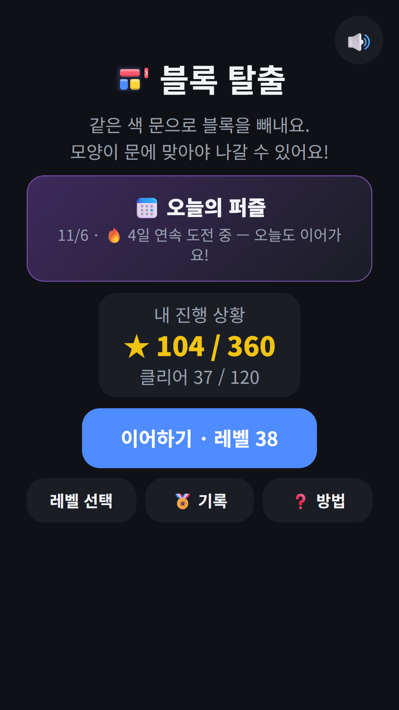
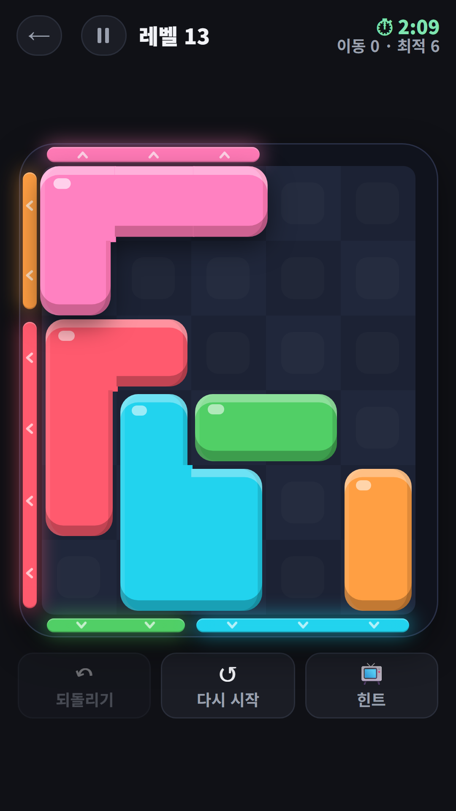
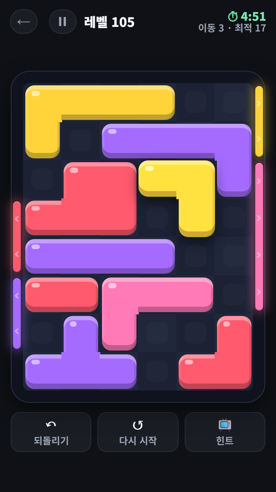
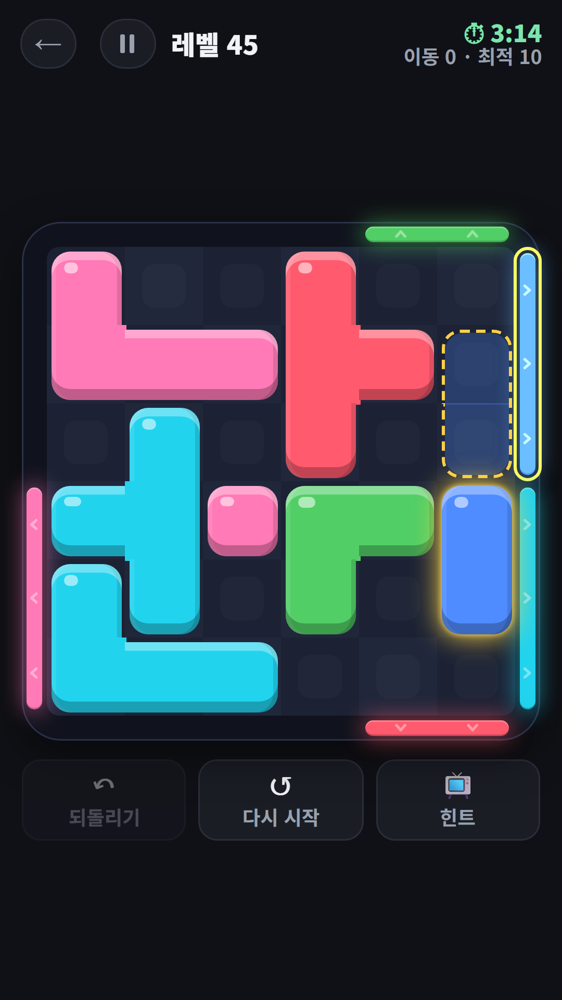
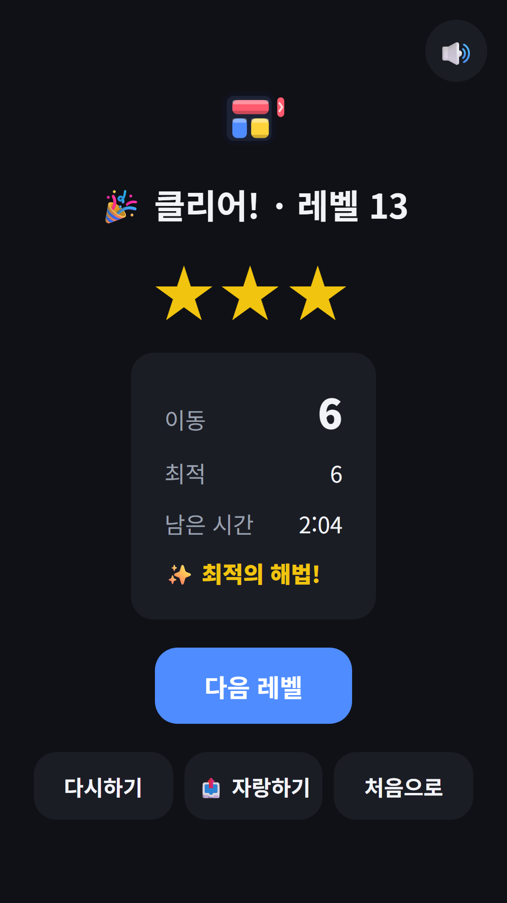

## Info
> **블록 탈출 - 같은 색 문으로 빼내기** — 같은 색 문으로 블록을 끌어 빼내는 퍼즐. 120레벨, 최소 수로 별 3개에 도전하세요. Google Play에서 무료, 광고 포함. 9개 언어.
{: .prompt-info }

## 이런 게임입니다
색색의 블록을 끌어 판 가장자리의 같은 색 문으로 빼내는 퍼즐이에요. 블록은 상하좌우로 자유롭게 움직이지만 돌릴 수는 없고, 문보다 넓은 블록은 나갈 수 없어요. 판 위의 블록을 모두 빼내면 클리어예요.

## 어떻게 하나요
- 블록을 손가락으로 잡아 원하는 곳까지 끌어요. 벽과 다른 블록은 통과할 수 없어요
- 같은 색 문 쪽으로 길이 비어 있고 블록 폭이 문 안에 들어가면 그대로 빠져나가요
- 한 번 잡아서 놓으면 1수예요. 멀리 끌고 가도 1수로 쳐요
- 최소 수로 풀면 별 3개, 1.5배 이내면 별 2개예요
- 레벨마다 제한시간(1~5분)이 있어요

## 특징
- 6구간 120레벨: 블록 2개 몸풀기부터 꽉 찬 7×8 판까지, 모두 자체 풀이기로 풀리는지 검증했어요
- 되돌리기·다시 시작은 무제한 무료, 판이 완전히 막히는 일은 없어요
- 막히면 짧은 광고를 보고 힌트를 받을 수 있어요. 다음에 움직일 블록과 놓을 자리를 보여 줘요
- 오늘의 퍼즐: 매일 모두 같은 판, 연속 기록을 이어 가요
- 기록 화면에서 별 합계·클리어 수, 일·주·월별로 모은 별 확인
- 한 수마다 자동 저장, 인터넷 없이도 플레이, 9개 언어 지원

무료로 즐길 수 있고 광고가 포함되어 있습니다.

{: w="360" }
{: w="360" }
{: w="360" }
{: w="360" }
{: w="360" }

## 플레이 영상


## Download
- Google Play: <https://play.google.com/store/apps/details?id=com.fadongkwon.block_escape>

{: w="200" .normal }

소식은 이 블로그와 [인스타그램(@fadongkwon.soft)](https://www.instagram.com/fadongkwon.soft/)에서 전해드립니다.
