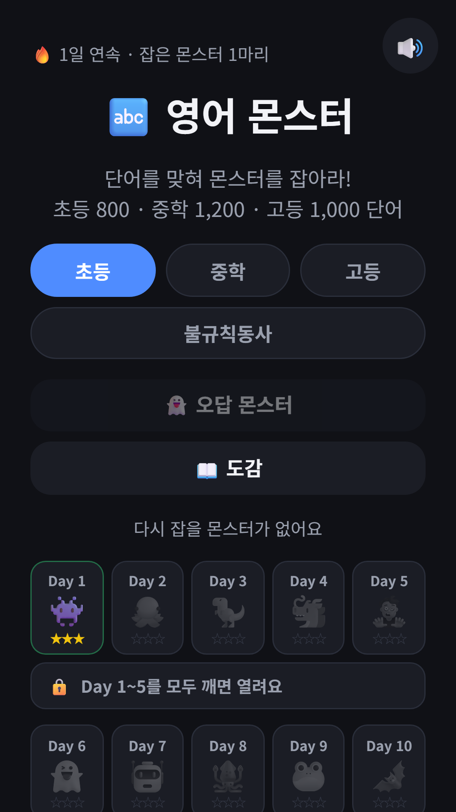
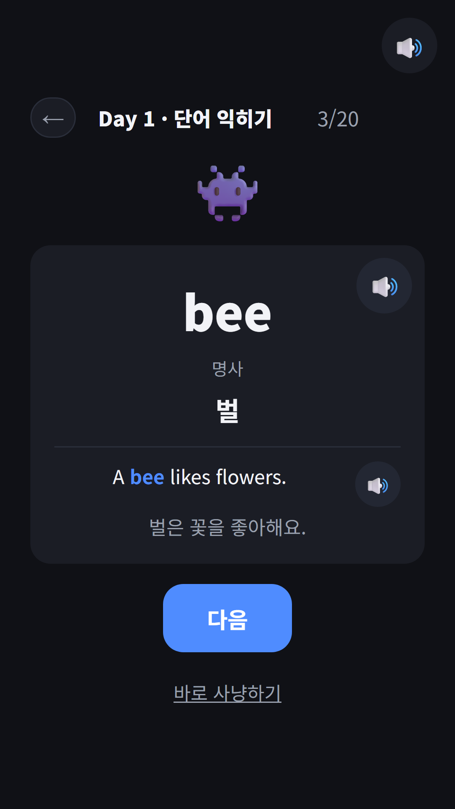
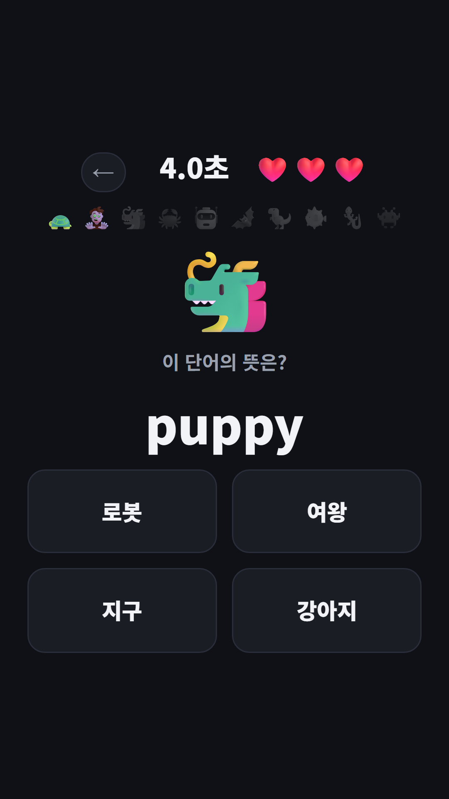
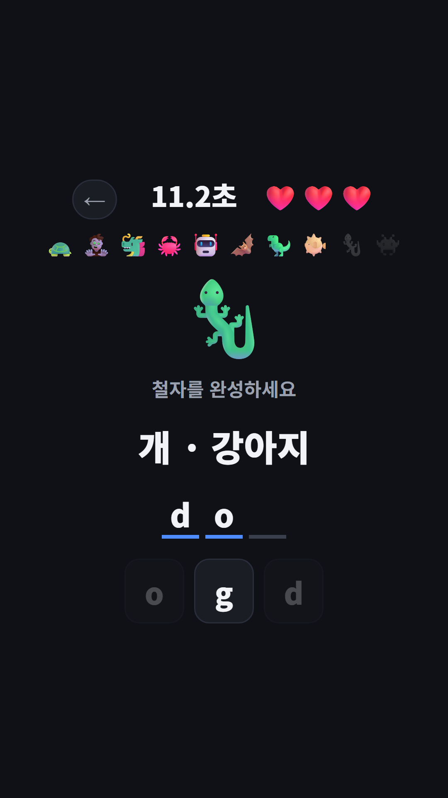
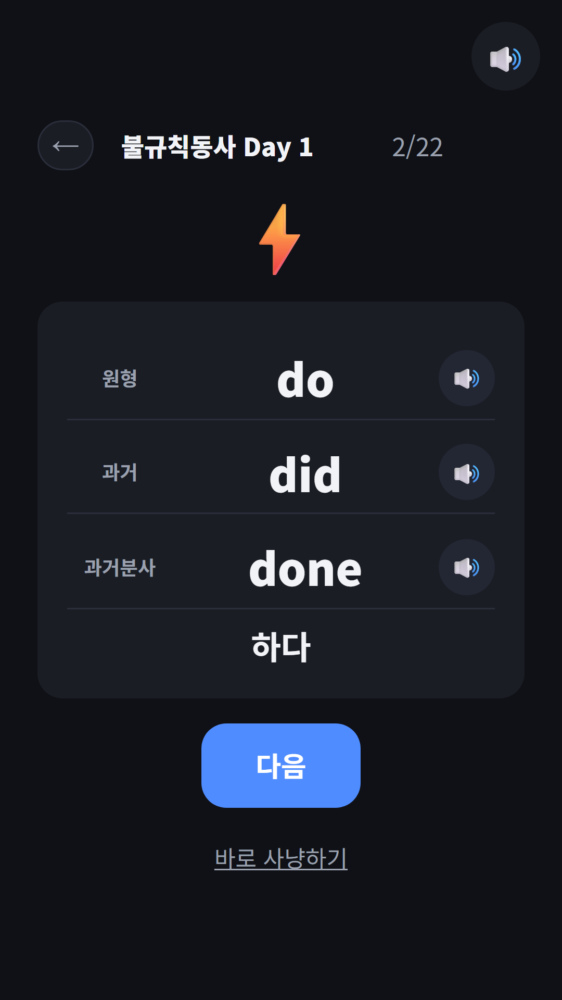
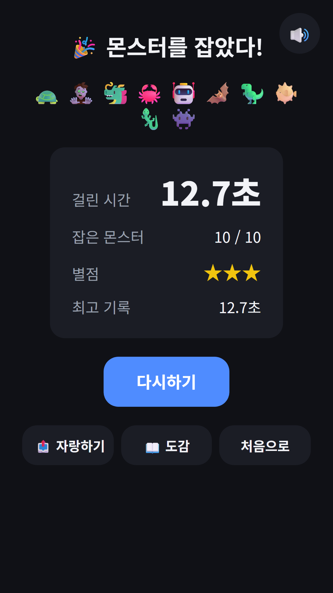

## Info
> **영어 몬스터 · 초중고 영단어** — 교육부 교육과정 기본 어휘 3,000단어와 불규칙동사 127개를 몬스터를 잡으며 익히는 영단어 앱. 광고·결제·회원가입 없음. 한국어·영어 화면.
{: .prompt-info }

> Google Play는 출시 심사 중이에요. 심사가 끝나기 전에는 아래 [브라우저판](/play/english-monsters/)으로 바로 해 볼 수 있어요.
{: .prompt-tip }

## 이런 앱입니다
한글 몬스터, 수학 몬스터에 이은 세 번째 몬스터 앱이에요. 이번에는 영어 단어입니다. 단어를 맞힐 때마다 몬스터를 한 마리씩 잡아요.

단어는 교육부가 고시한 2022 개정 영어과 교육과정의 **기본 어휘 3,000개**를 그대로 썼어요. 초등 800단어(Day 1~40), 중학 1,200단어(Day 41~100), 고등 1,000단어(Day 101~150)를 하루 20단어씩, 모두 150일로 나눴어요. 뜻과 예문은 직접 쓰고 여러 번 교차 검수했어요.

## 어떻게 배우나요
- **익히기**: Day를 고르면 단어 카드 20장이 나와요. 카드마다 뜻·품사·예문이 있고, 카드가 뜨면 단어를 읽어 주고 🔊 버튼으로 예문도 들을 수 있어요
- **사냥**: 10문제를 풀어 몬스터 10마리를 잡아요. 뜻 고르기, 단어 고르기, 듣고 고르기, 글자 타일로 철자 맞추기가 섞여 나오고 하트는 3개예요
- **오답 몬스터**: 틀린 단어는 다음 날, 3일 뒤, 7일 뒤에 다시 나와요. 끝까지 맞히면 졸업해요
- **보스전**: Day 5개를 모두 깨면 20문제 보스전이 열려요
- **별점**: 판이 끝날 때 남은 하트 수가 별이 돼요

## 특징
- 교육과정 기본 어휘 3,000단어 전체를 초등·중학·고등 탭으로 나눴어요
- 불규칙동사 과정: 127개 동사를 6일 동안 원형·과거형·과거분사형 세 모양으로 익히고, 마지막에 동사왕 보스에 도전해요
- 몬스터 도감 187칸: Day 몬스터 150, 보스 30, 불규칙동사 7
- 모든 단어와 예문을 자연스러운 영어 음성으로 들려줘요
- 아이를 위해 만들었어요. 광고도, 결제도, 회원가입도 없어요
- 단어 뜻과 예문 번역은 한국어예요. 화면은 한국어·영어를 지원해요

{: w="360" }
{: w="360" }
{: w="360" }
{: w="360" }
{: w="360" }
{: w="360" }

## 플레이 영상


## Download
- Google Play: <https://play.google.com/store/apps/details?id=com.fadongkwon.english_monsters> (출시 심사 중)
- 브라우저에서 바로 하기: [fadongkwon.com/play/english-monsters/](/play/english-monsters/) — 설치 없이 스마트폰·태블릿·PC에서 돼요. 기록은 이 브라우저 안에만 저장돼요.

함께 만든 [한글 몬스터](/ko/posts/hangul-monsters/)와 [수학 몬스터](/ko/posts/math-monsters/)도 있어요. 아이 학습 앱은 [아이들을 위한 학습 앱](/kids/) 페이지에 모아 두었어요.

소식은 이 블로그와 [인스타그램(@fadongkwon.soft)](https://www.instagram.com/fadongkwon.soft/)에서 전해드립니다.
