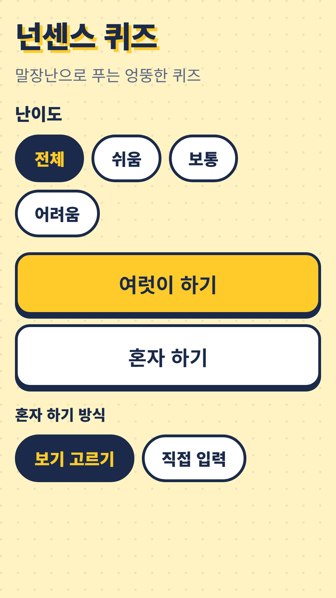
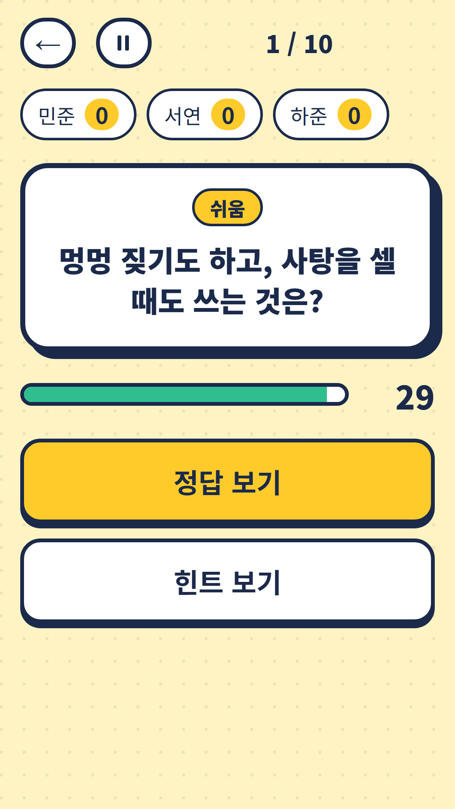
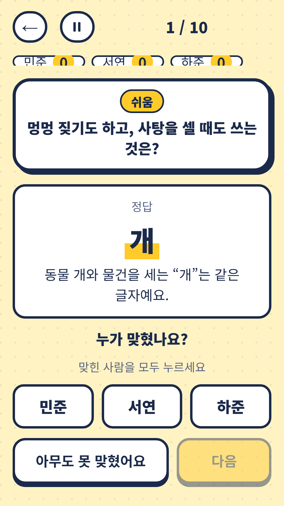
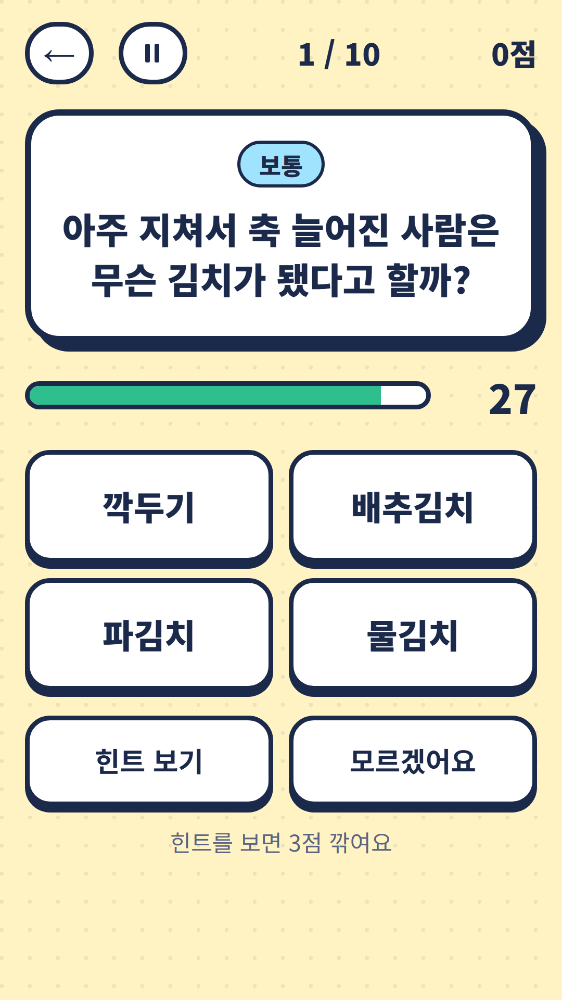

## Info
> **Nonsense Quiz: Korean Puns** — 300 original Korean pun riddles. Laugh together in a group or play solo. The riddles are in Korean. Free to play on Google Play, with ads.
{: .prompt-info }

## 이런 게임입니다
듣고 나면 '아~' 하고 웃게 되는 넌센스 퀴즈 게임이에요. 말장난에 바탕을 둔 문제 300개를 직접 만들었고, 정답마다 풀이가 있어요. 모임에서 다 같이 웃거나 혼자서 풀 수 있어요.

## 어떻게 하나요
- 난이도를 쉬움·보통·어려움 중에서 골라요(전체도 가능해요)
- **여럿이 하기** — 문제 수(5·10·15)와 생각할 시간(15·30·60초)을 고르고, 필요하면 힌트를 봐요. 정답과 풀이를 확인한 뒤 맞힌 사람을 모두 눌러 점수를 줘요. 순위, 공동 순위, 공동 우승이 표시돼요
- **혼자 하기** — 10문제, 문제당 30초. 보기 4개 중에서 고르거나 정답을 직접 입력해요. 힌트를 보면 점수가 줄어요
- 언제든 일시정지할 수 있어요

## 특징
- 직접 만든 말장난 문제 300개, 정답마다 풀이 제공
- 난이도 3단계: 쉬움·보통·어려움
- 여럿이 하기와 혼자 하기, 혼자 하기는 보기 고르기와 직접 입력 중 선택
- 최근에 나온 문제는 다시 나오지 않아요

문제는 한국어로 나와요. 무료로 즐길 수 있고 광고가 포함되어 있습니다.

{: w="360" }
{: w="360" }
{: w="360" }
{: w="360" }

## 플레이 영상


## Download
- Google Play: <https://play.google.com/store/apps/details?id=com.fadongkwon.nonsense_quiz>

{: w="200" .normal }

## 함께 출시된 앱
같은 시기 Google Play에 함께 나온 앱들입니다.

<!-- TODO: hub-quiz·quiz-battle·twenty-q·cert-hub 글 게시 뒤 링크 복원 -->

- 파동권 퀴즈한마당 — 넌센스 퀴즈를 포함한 모임 퀴즈 4종
- 상식 대결 — 역사·경제·과학·지리 4지선다 퀴즈 대결
- [초성 퀴즈](/ko/posts/chosung-quiz/) — 초성만 보고 단어 맞히기
- 스무고개 — 예/아니요 질문 스무 개로 단어 맞히기
- 파동권 자격증 — 자격증 시험 7종 문제은행을 한 앱에

소식은 이 블로그와 [인스타그램(@fadongkwon.soft)](https://www.instagram.com/fadongkwon.soft/)에서 전해드립니다.
