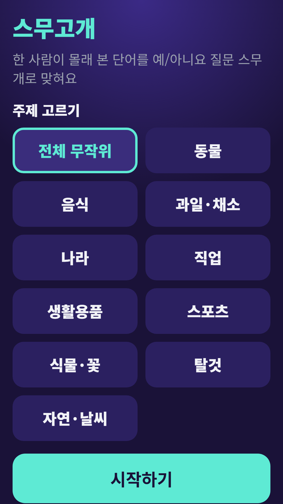
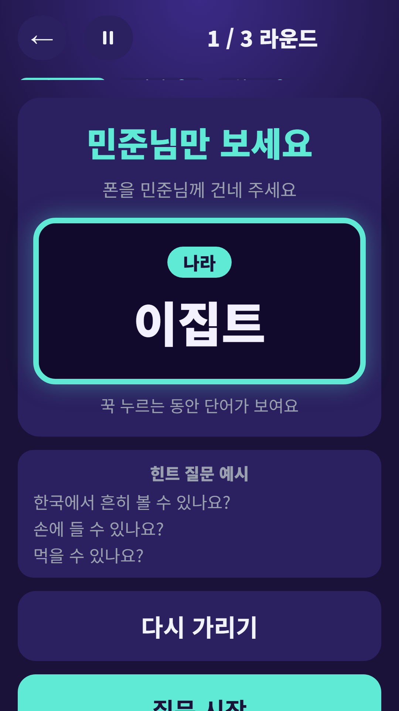
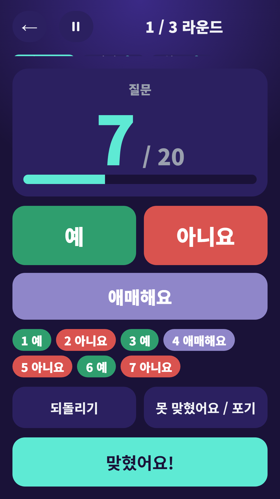
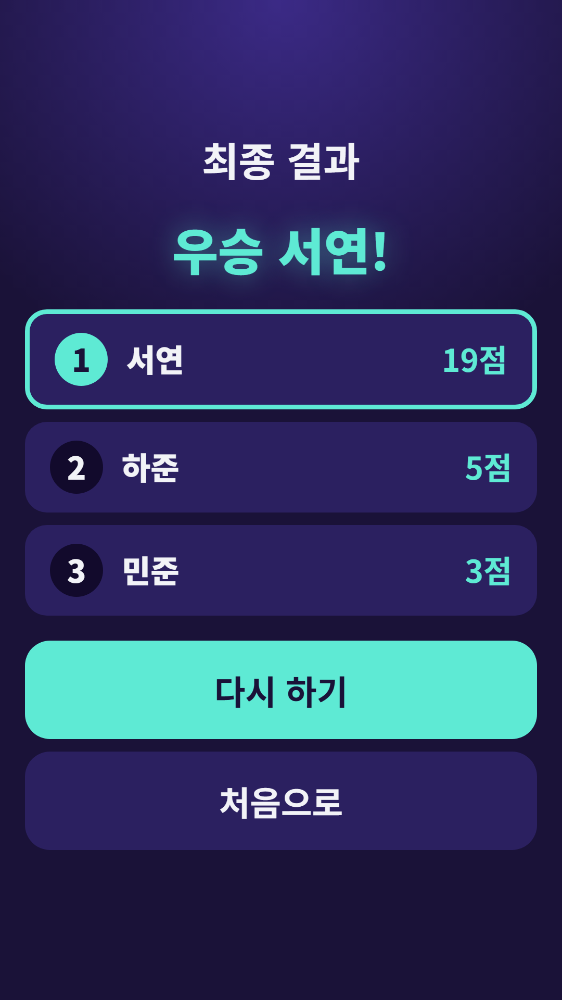

## Info
> **Twenty Questions: Party Game** — One player sees a secret Korean word and everyone else has 20 yes-or-no questions to find it. The words are in Korean. Free to play on Google Play, with ads.
{: .prompt-info }

## 이런 게임입니다
모두가 아는 스무고개를 폰 하나로 즐기는 모임 게임이에요. 한 사람이 단어를 몰래 보고, 나머지는 예/아니요로 대답할 수 있는 질문을 스무 개까지 해서 단어를 맞혀요.

## 어떻게 하나요
- 주제를 고르고 참가자 이름을 입력해요
- 출제자만 단어를 몰래 봐요. 폰을 건네받은 출제자는 단어를 확인한 뒤 다시 가려요
- 나머지 사람들이 말로 예/아니요 질문을 하면 출제자가 **예**, **아니요**, **애매해요** 중 하나를 눌러요. 누를 때마다 질문 수가 올라가고, 되돌리기도 돼요
- 맞히면 **맞혔어요!** 를 누르고 누가 맞혔는지 골라요
- 출제자는 라운드마다 참가자 순서대로 돌아가요
- 빨리 맞힐수록 높은 점수를 받고, 출제자도 점수를 받아요. 마지막 화면에서 순위, 공동 순위, 공동 우승이 표시돼요

## 특징
- 10가지 주제 또는 전체 무작위: 동물, 음식, 과일·채소, 나라, 직업, 생활용품, 스포츠, 식물·꽃, 탈것, 자연·날씨
- 라운드마다 제한 시간 없음, 3분, 5분 중 선택
- 규칙 보기와 질문 예시 제공

단어는 한국어로 나와요. 무료로 즐길 수 있고 광고가 포함되어 있습니다.

{: w="360" }
{: w="360" }
{: w="360" }
{: w="360" }

## 플레이 영상


## Download
- Google Play: <https://play.google.com/store/apps/details?id=com.fadongkwon.twenty_q>

{: w="200" .normal }

## 함께 출시된 앱
같은 시기 Google Play에 함께 나온 앱들입니다.

<!-- TODO: hub-quiz·quiz-battle·cert-hub 글 게시 뒤 링크 복원 -->

- [파동권 퀴즈한마당](/ko/posts/hub-quiz/) — 스무고개를 포함한 모임 퀴즈 4종
- 상식 대결 — 역사·경제·과학·지리 4지선다 퀴즈 대결
- [초성 퀴즈](/ko/posts/chosung-quiz/) — 초성만 보고 단어 맞히기
- [넌센스 퀴즈](/ko/posts/nonsense-quiz/) — 직접 만든 말장난 300문제
- 파동권 자격증 — 자격증 시험 7종 문제은행을 한 앱에

소식은 이 블로그와 [인스타그램(@fadongkwon.soft)](https://www.instagram.com/fadongkwon.soft/)에서 전해드립니다.
