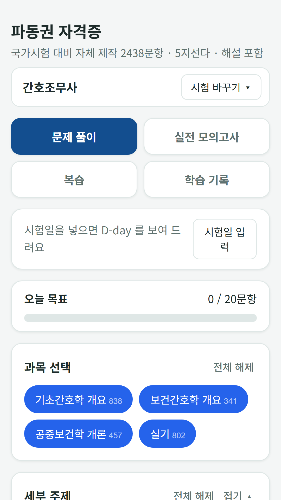
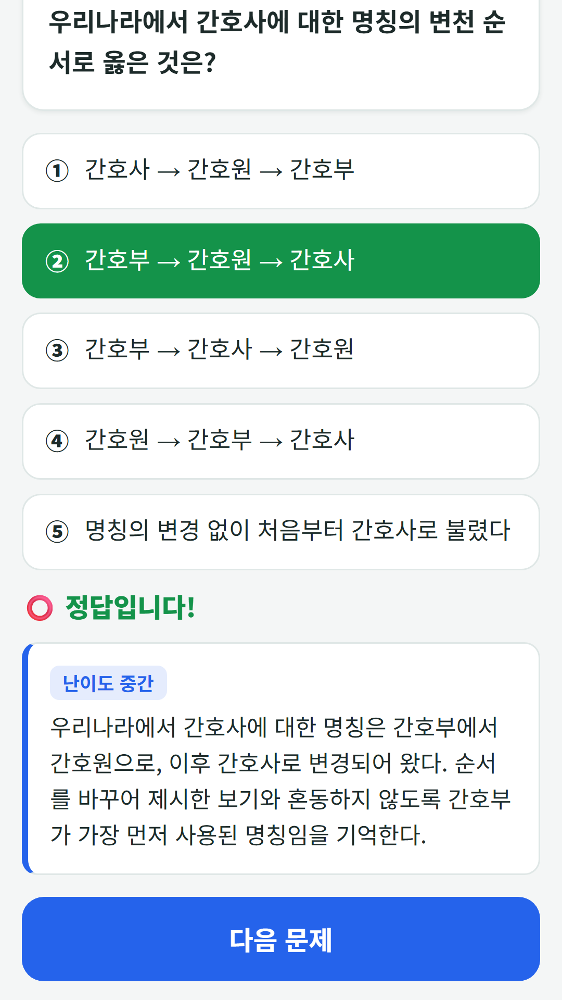
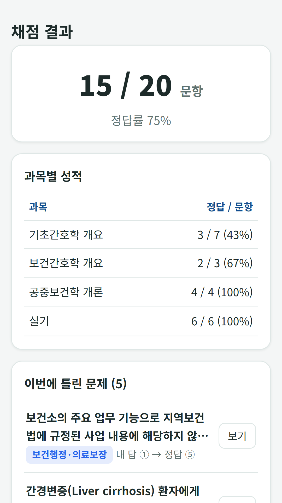
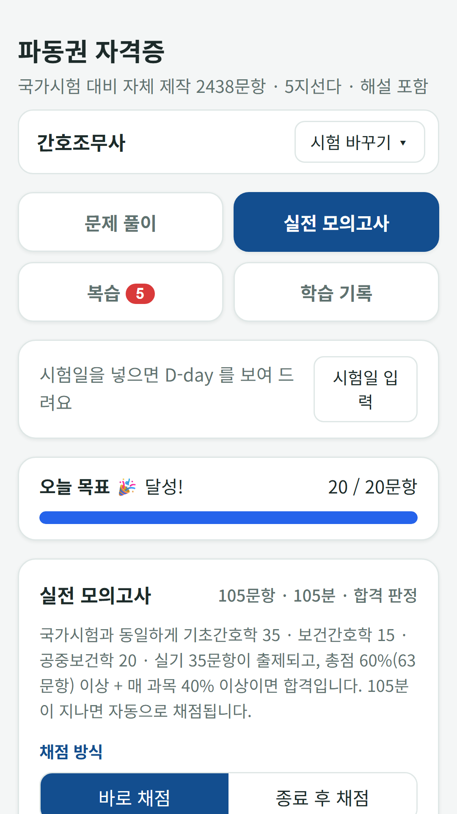
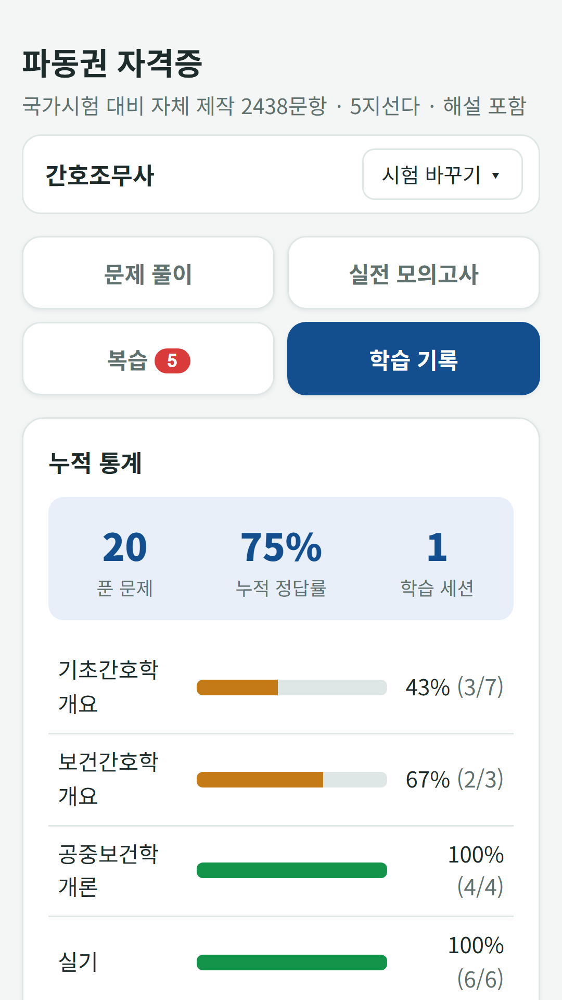

## Info
> **FDK Certification Exam Prep** — Question banks for seven Korean license exams in one app: nursing assistant, care worker, beautician, cook, baking, forklift and excavator, and driver's license. 10,603 questions in total, with a mock exam for each. Free with ads on Google Play. Korean language only.
{: .prompt-info }

## 이런 앱입니다
자격증 시험 7종 문제은행을 한 앱에 모았어요. 준비하는 시험을 고르면 그 시험의 문제 풀이, 실전 모의고사, 오답노트, 학습 기록이 따로 쌓여요. 여러 시험을 같이 준비해도 **시험 바꾸기** 한 번으로 오갈 수 있어요.

- **10,603문항** — 간호조무사 2,438 · 요양보호사 1,500 · 미용사(일반·피부·네일·메이크업) 1,800 · 조리기능사(한식·양식·중식·일식) 1,500 · 제과제빵기능사 1,200 · 지게차·굴착기 운전기능사 1,200 · 운전면허 학과시험 965
- **실전 모의고사** — 시험마다 실제와 같은 문항 수·제한 시간·합격 판정으로 풀어요

## 어떻게 하나요
- **시험 고르기** — 준비하는 시험을 고르고, 시험일 D-day와 하루 목표 문항 수를 정해 둬요
- **문제 풀이** — 과목·세부 주제를 골라 연습하고, 바로 정답과 해설을 확인해요
- **실전 모의고사** — 문항 수·제한 시간·합격 판정이 실제 시험과 같아요. 바로 채점과 종료 후 채점 중에서 고를 수 있어요
- **복습** — 오답노트와 별표를 시험별로, 또는 전체 시험을 한꺼번에 모아 복습해요
- **학습 기록** — 누적 정답률, 과목별 정답률, 회차별 기록을 봐요

## 특징
- 시험 7종을 한 앱에서, 시험별로 따로 쌓이는 기록
- 시험일 D-day와 하루 목표 막대
- 글자 크기 조절(보통·크게·아주 크게)

무료로 이용할 수 있고 광고가 포함되어 있습니다(25문제마다 광고 1회, 배너 광고).

운전면허 문항은 한국도로교통공단 공개 문제은행(2026.3.9. 시행)을 그대로 쓰고, 나머지 시험 문항은 공개된 출제기준과 법령·교재를 바탕으로 자체 제작했으며 실제 시험 문제가 아닙니다. 해설에 오류가 있을 수 있으니 참고용으로 활용하세요. 시험 주관 기관과 관계없는 학습용 앱입니다.

{: w="360" }
{: w="360" }
{: w="360" }
{: w="360" }
{: w="360" }

## 수록된 시험 7종
각 시험은 따로 소개 글이 있어요.

- [간호조무사 모의고사](/ko/posts/nursing-quiz/) · [요양보호사 모의 문제은행](/ko/posts/care-quiz/) · [미용사 필기 문제은행](/ko/posts/beauty-quiz/)
- [조리기능사 필기 문제은행](/ko/posts/cook-quiz/) · [제과제빵기능사 필기 문제은행](/ko/posts/bake-quiz/) · [지게차 굴착기 필기 문제은행](/ko/posts/heavy-quiz/)
- [운전면허 학과시험 문제은행](/ko/posts/drive-quiz/)

## Download
- Google Play: <https://play.google.com/store/apps/details?id=com.fadongkwon.hub_cert>

{: w="200" .normal }

## 함께 출시된 앱
같은 시기 Google Play에 함께 나온 앱들입니다.

- [파동권 퀴즈한마당](/ko/posts/hub-quiz/) — 상식 대결, 초성 퀴즈, 스무고개, 넌센스 퀴즈 모임 퀴즈 4종
- [상식 대결](/ko/posts/quiz-battle/) — 역사·경제·과학·지리 4지선다 퀴즈 대결
- [스무고개](/ko/posts/twenty-q/) — 예/아니요 질문 스무 개로 단어 맞히기
- [넌센스 퀴즈](/ko/posts/nonsense-quiz/) — 직접 만든 말장난 300문제

소식은 이 블로그와 [인스타그램(@fadongkwon.soft)](https://www.instagram.com/fadongkwon.soft/)에서 전해드립니다.
