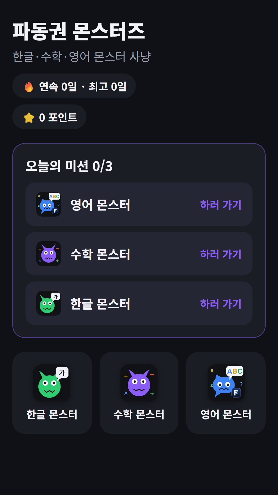
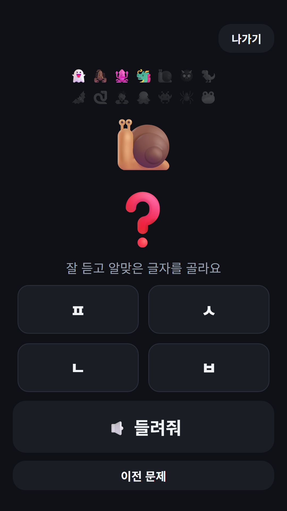
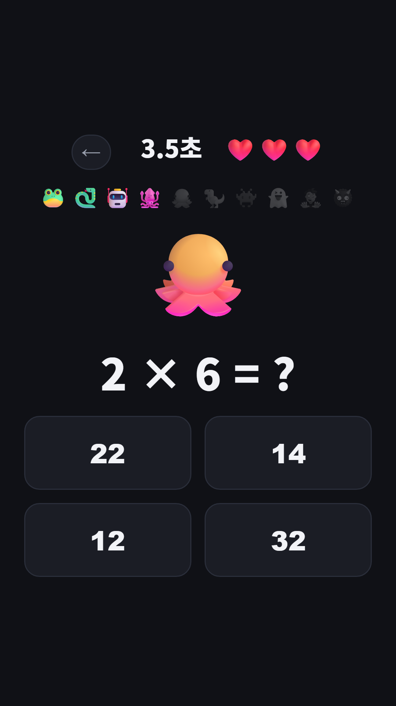
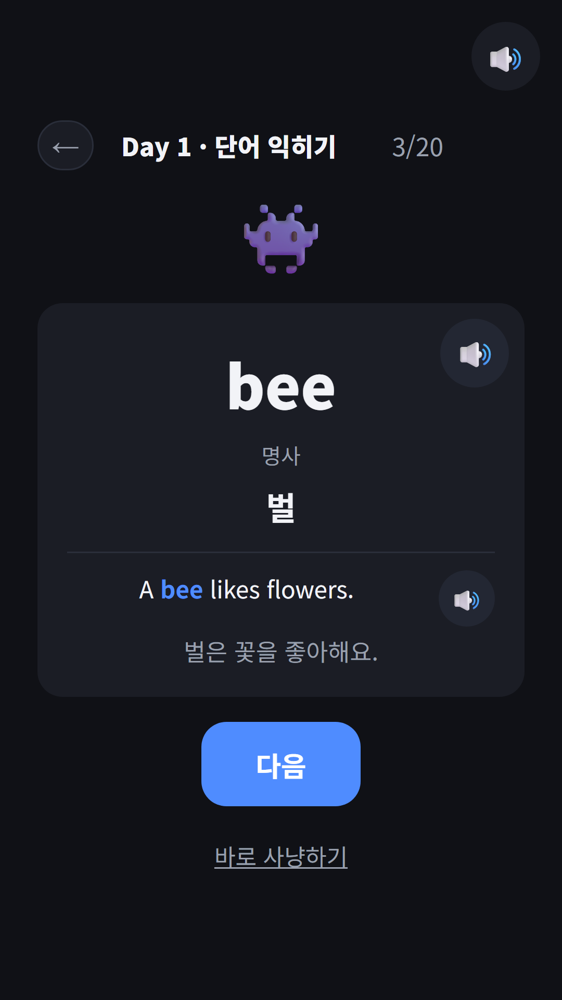

## Info
> **파동권 몬스터즈 · FDK Monsters** — 한글 몬스터, 수학 몬스터, 영어 몬스터 세 가지 학습 게임을 한 앱에 모은 아이용 앱. 광고·결제·별점 요청 없음. 한국어·영어 화면.
{: .prompt-info }

> Google Play와 토스에서 지금 바로 쓸 수 있어요. 설치 없이 해 보고 싶다면 아래 [브라우저판](#download)도 있어요.
{: .prompt-tip }

## 이런 앱입니다
지금까지 몬스터 시리즈는 과목마다 앱이 따로였어요. [한글 몬스터](/ko/posts/hangul-monsters/)는 한글을, [수학 몬스터](/ko/posts/math-monsters/)는 사칙연산을, 어제 소개한 [영어 몬스터](/ko/posts/english-monsters/)는 영단어를 다뤄요. 아이가 셋 다 하려면 앱을 세 번 찾아 들어가야 했죠.

파동권 몬스터즈는 그 세 게임을 한 앱에 모은 **허브 앱**이에요. 홈에서 오늘의 미션 세 개와 게임 세 개가 보이고, 게임을 하다가 뒤로가기를 누르면 다시 홈으로 돌아와요. 게임 자체는 각 앱과 같아요.

## 어떻게 하나요
- 홈에 **오늘의 미션 3개**가 나와요. 한글·수학·영어 몬스터를 한 판씩 하면 하나씩 완료돼요
- 미션 하나를 끝낼 때마다 포인트 10점, 세 개를 모두 끝낸 날이 이어지면 **연속 학습일**이 쌓여요
- 게임이 끝나면 결과 화면에 '다음 미션' 버튼이 떠서 다음 과목으로 바로 넘어가요
- 홈의 '🔔 매일 저녁 6시 알림 받기'를 누르고 동의한 경우에만, 매일 저녁 6시에 오늘의 학습 알림을 보내요

## 수록된 게임 3종
각 게임은 따로 소개 글이 있어요.

- [한글 몬스터](/ko/posts/hangul-monsters/) — 자음·모음과 낱말을 듣고 고르거나 소리 내어 읽으며 한글을 익혀요. 소리 내어 읽기는 마이크 권한을 허용했을 때만 쓰고, 녹음은 저장하지 않아요
- [수학 몬스터](/ko/posts/math-monsters/) — 덧셈·뺄셈·곱셈·나눗셈 문제를 풀어 몬스터를 잡아요. 난이도는 3단계예요
- [영어 몬스터](/ko/posts/english-monsters/) — 교육과정 기본 어휘 3,000단어를 하루 20단어씩 카드로 듣고 익힌 뒤, 퀴즈로 몬스터를 잡아요. 틀린 단어는 오답 몬스터로 다시 나와요

{: w="360" }
{: w="360" }
{: w="360" }
{: w="360" }

## 아이용 허브라서 바꾼 것
지금까지 만든 허브 11개는 모두 어른용이라, 홈 아래 배너 광고, 토스 1원 프로모션 안내, 다른 앱 소개 목록이 들어 있었어요. 아이 앱에 그대로 쓸 수는 없어서 허브 설정에 **아동 모드**를 하나 추가했어요.

- 설정 파일에 `kids` 표시 하나를 켜면 광고 지면이 비워지고, 래퍼 설정에 광고 값이 잘못 들어가 있어도 실행 중에 다시 비워요
- 1원 프로모션 안내와 지급 경로를 막아요
- 홈 아래 '이런 앱도 있어요'에는 아이용 앱과 허브만 나와요
- 별점 요청 창을 띄우지 않아요
- 출시 전 검사 스크립트가 아동 허브일 때만 광고 코드, 외부 링크, 별점 요청 호출이 0인지 따로 확인해요

이 표시가 없는 기존 허브는 예전과 똑같이 동작해요. 시험용 허브를 다시 빌드해, 허브 설정 파일이 바뀌기 전과 바이트 단위로 같은지 확인했어요.

## 이름 끝에 '즈'가 붙은 이유
원래 이름은 **파동권 몬스터**였어요. 시작은 영어 몬스터였어요. 영어 몬스터를 토스에 올리려는데 '영어 몬스터'라는 이름이 "토스 서비스명과 동일한 이름은 쓸 수 없어요"라는 오류로 막혔어요. 콘솔에는 이름만 확인하는 기능이 없어서, 원인을 찾으려고 여러 후보 이름으로 새 앱 만들기 요청을 보내 봤어요. 요청은 전부 워크스페이스 앱 개수 한도 때문에 실패했는데, **실패한 요청에 실렸던 이름들이 예약된 것처럼 막혀 버렸어요.** 그중 하나가 허브에 쓰려던 '파동권 몬스터'였어요.

그 뒤 기존 앱의 앱 정보를 바꾸면서 '파동권 몬스터'를 넣자 같은 오류가 났어요. 콘솔 채팅으로 예약 해제를 문의했지만, 답을 기다리는 동안 출시가 멈추는 것보다 이름을 바꾸는 쪽을 골랐어요. 그래서 **파동권 몬스터즈**가 됐어요. 몬스터가 셋이니 복수형이 오히려 잘 맞는다고 생각해요.

이름을 바꾸면서 허브 홈 제목, 레지스트리, 토스 앱 정보, 스토어 문안을 전부 '몬스터즈'로 맞췄어요. 영어 이름은 그대로 **FDK Monsters**(토스 영문 이름은 Monster Academy)예요. 교훈은 하나예요. 원인을 알아보려고 무언가를 만드는 요청은 보내지 않아요. 실패해도 흔적이 남을 수 있고, 되돌릴 방법이 없어요.

## 토스에는 '병 돌리기' 자리로
토스 워크스페이스는 앱이 [50개까지만](/ko/posts/toss-workspace-50-limit/) 들어가고 이미 꽉 차 있어요. 그래서 [다른 허브들처럼](/ko/posts/toss-hub-conversion/) 새 앱을 등록하지 않고, 이용자가 가장 적던 기존 앱 **병 돌리기**의 앱 정보와 번들을 파동권 몬스터즈로 바꿨어요. 병 돌리기 기능은 [파동권 복불복](/ko/posts/hub-party/) 안에 그대로 있어요.

번들이 커진 것도 확인할 거리였어요. 영어 단어와 예문 발음 클립 6,146개, 한글 발음 클립 1,076개가 들어가 번들이 약 38MB예요. 지금까지 올린 허브 중 가장 큰 행운연구소의 두 배가 넘는데, 업로드와 검수 모두 문제없이 통과했어요.

토스에서는 앱 정보와 번들 검수를 모두 통과해 11월 7일 밤에 출시됐어요. Google Play에는 같은 날 파동권 몬스터즈와 영어 몬스터를 함께 심사에 넣었고, 파동권 몬스터즈는 11월 13일에 출시됐어요. Play 앱 안 이름과 스토어 한국어 제목도 '파동권 몬스터즈'로 맞췄어요.

## 플레이 영상
허브 홈에서 세 게임을 차례로 둘러보는 영상과, 세 게임 각각의 플레이 영상이에요.









## Download
- Google Play: <https://play.google.com/store/apps/details?id=com.fadongkwon.hub_monsters>
- 앱인토스(토스 미니앱): <https://fadongkwon.com/toss/hub-monsters/> — 휴대폰에서 열면 토스 앱으로 바로 연결됩니다.
- 브라우저에서 바로 하기: [한글 몬스터](/play/hangul-monsters/) · [수학 몬스터](/play/math-monsters/) · [영어 몬스터](/play/english-monsters/)

{: w="200" .normal }

다른 아이용 앱은 [키즈 페이지](/kids/)에 모아 두었어요. 소식은 이 블로그와 [인스타그램(@fadongkwon.soft)](https://www.instagram.com/fadongkwon.soft/)에서 전해드립니다.
