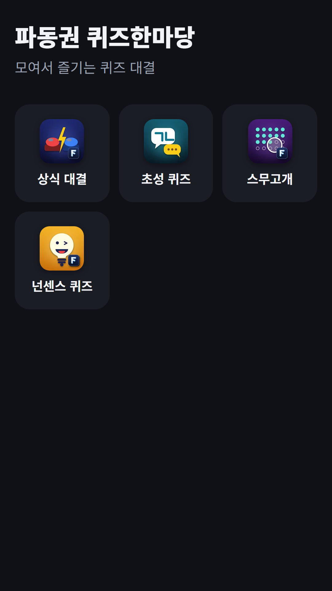
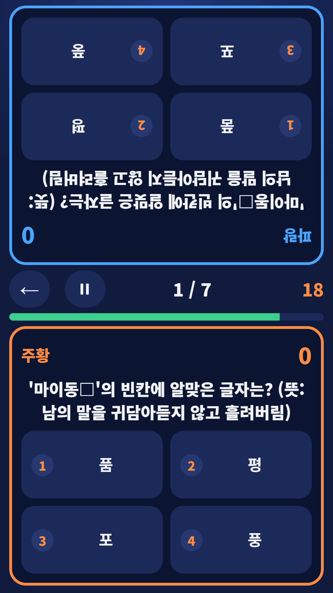
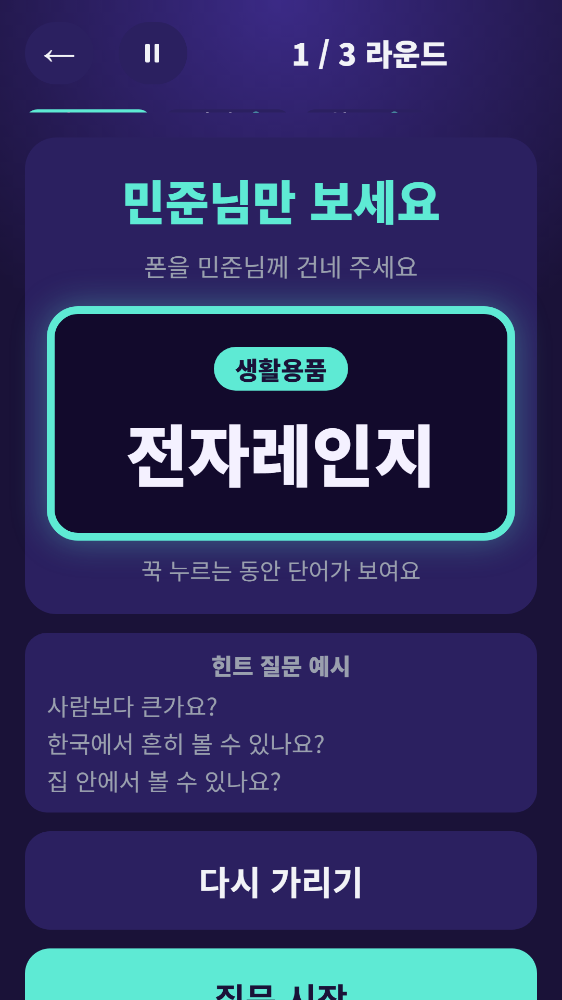
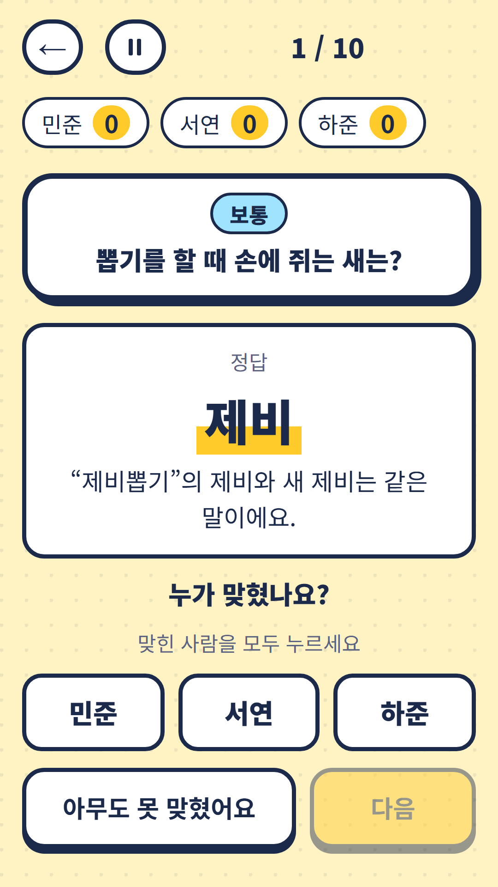

## Info
> **FDK Quiz Fest: Party Quizzes** — Four party quiz games in one app: trivia, initials quiz, Twenty Questions and pun riddles. The questions are in Korean. Free to play on Toss, with ads. Google Play is coming soon.
{: .prompt-info }

## 이런 게임입니다
파동권 퀴즈한마당은 모임에서 다 같이 즐기는 퀴즈 4가지를 모은 앱이에요. 상식 대결, 초성 퀴즈, 스무고개, 넌센스 퀴즈 중에서 그날 분위기에 맞는 퀴즈를 골라 보세요.

## 어떻게 하나요
- 홈에서 하고 싶은 퀴즈를 눌러요
- 참가자 이름을 한 번 적어 두면 모든 퀴즈에서 같이 써요
- 점수와 순위는 자동으로 정리돼요
- 혼자 하기 모드가 있는 퀴즈는 혼자서도 즐길 수 있어요

## 특징
- 상식 대결: 역사·경제·과학·지리 4지선다 퀴즈, 마주 보고 겨루는 둘이 대결까지
- 초성 퀴즈: 초성만 보고 단어 맞히기
- 스무고개: 예/아니요 질문 스무 개로 정답 찾기
- 넌센스 퀴즈: 모임에서 주고받는 유명한 말장난 문제 320개
- 참가자 이름 한 번 입력으로 모든 퀴즈에서 같이 사용

문제는 한국어로 나와요. 한글을 읽을 수 있어야 즐길 수 있어요. 무료로 즐길 수 있고 광고가 포함되어 있습니다.

{: w="360" }
{: w="360" }
{: w="360" }
{: w="360" }

## 플레이 영상


## Download
- 앱인토스(토스 미니앱): <https://fadongkwon.com/toss/hub-quiz/> — 휴대폰에서 열면 토스 앱으로 바로 연결됩니다.
- Google Play: 준비 중이에요. 열리면 이 글에 링크를 넣을게요.

{: w="200" .normal }

## 함께 볼 앱
퀴즈한마당에 들어 있는 퀴즈는 따로도 나왔어요.

- [초성 퀴즈](/ko/posts/chosung-quiz/) — 초성만 보고 단어 맞히기
- [스무고개](/ko/posts/twenty-q/) — 예/아니요 질문 스무 개로 단어 맞히기
- [넌센스 퀴즈](/ko/posts/nonsense-quiz/) — 말장난 320문제

소식은 이 블로그와 [인스타그램(@fadongkwon.soft)](https://www.instagram.com/fadongkwon.soft/)에서 전해드립니다.
