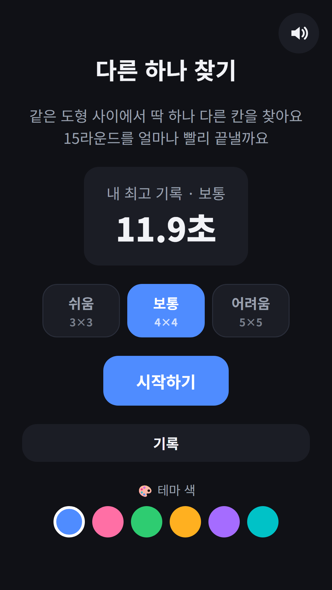
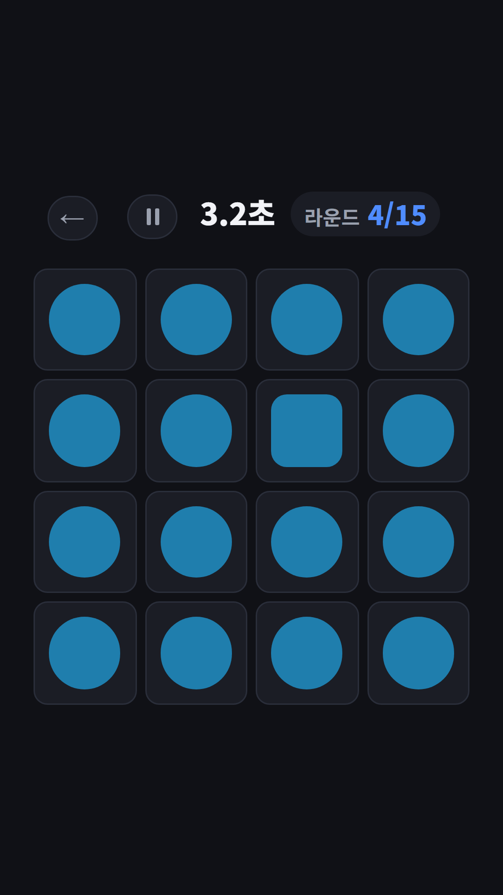
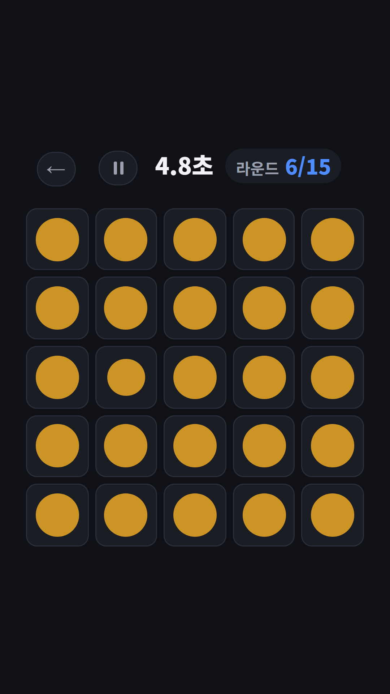
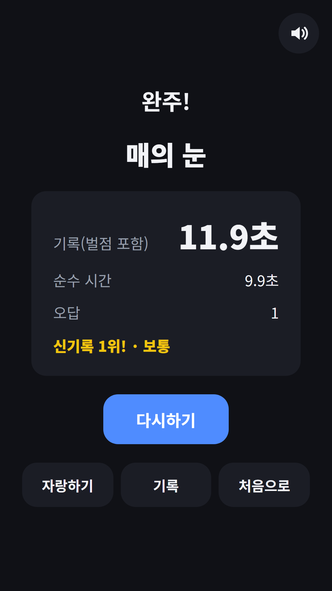

## Info
> **Odd One Out: Spot the Tile** — Find the one tile that looks different in 15 rounds and beat your best time. Free to play on Google Play, with ads.
{: .prompt-info }

## 이런 게임입니다
같은 도형이 가득한 격자에서 딱 하나만 달라요. 다른 칸을 찾아 최대한 빨리 누르면 되고, 15라운드를 끝낸 총 시간이 내 기록이에요. 빠를수록 좋아요. 파동권 뇌나이에 들어 있는 두뇌 게임 중 집중력 영역을 맡은 게임을 Google Play에 따로 내놓았어요.

## 어떻게 하나요
- 홈에서 난이도를 고르고 **시작하기**를 눌러요. 쉬움은 3×3, 보통은 4×4, 어려움은 5×5 격자예요
- 준비 화면을 터치하면 시계가 시작해요. 시작 전에는 격자가 가려져 있어요
- 다른 칸은 밝기, 모양, 크기 중 하나가 달라요. 어떤 차이가 나올지는 몰라요
- 잘못 누르면 2초가 더해져요. 15라운드를 끝내면 기록과 등급이 나와요
- 언제든 일시정지할 수 있고, 멈춘 동안에는 격자가 가려져요

## 특징
- 라운드가 갈수록 차이가 조금씩 줄어들어요
- 색 차이는 밝기로만 내서 색약이 있어도 같은 조건으로 즐길 수 있어요
- 난이도별 TOP 10과 오늘·이번 주·이번 달·명예의 전당 기록
- 매일 하트 3개 무료. 한 판에 하나씩 쓰고, 짧은 광고를 보면 하트를 더 받을 수 있어요
- 인터넷 없이도 플레이하고, 9개 언어를 지원해요

무료로 즐길 수 있고 광고가 포함되어 있습니다.

{: w="360" }
{: w="360" }
{: w="360" }

## 플레이 영상


## Download
- Google Play: <https://play.google.com/store/apps/details?id=com.fadongkwon.odd_one_out>

{: w="200" .normal }

## 함께 보면 좋은 앱
- [파동권 뇌나이](/ko/posts/hub-brain/) — 두뇌 게임을 한 앱에 모은 허브

소식은 이 블로그와 [인스타그램(@fadongkwon.soft)](https://www.instagram.com/fadongkwon.soft/)에서 전해드립니다.
