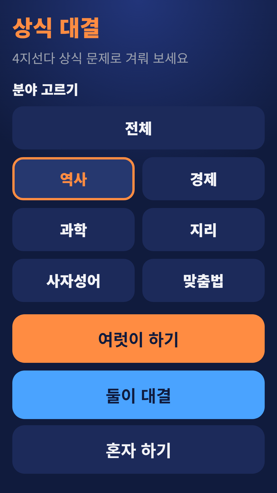
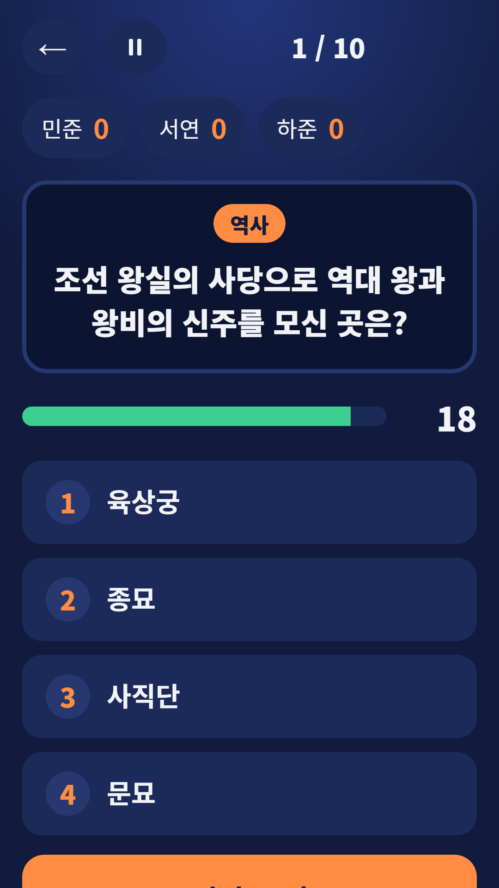
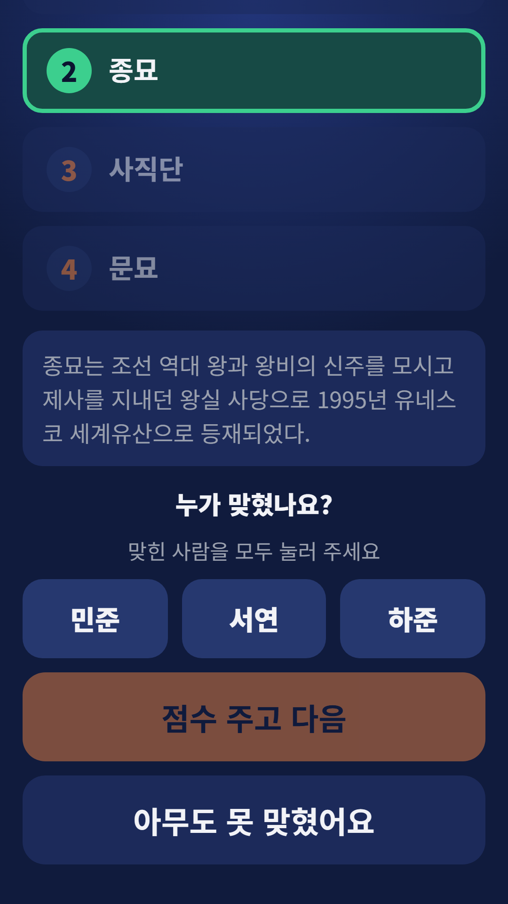
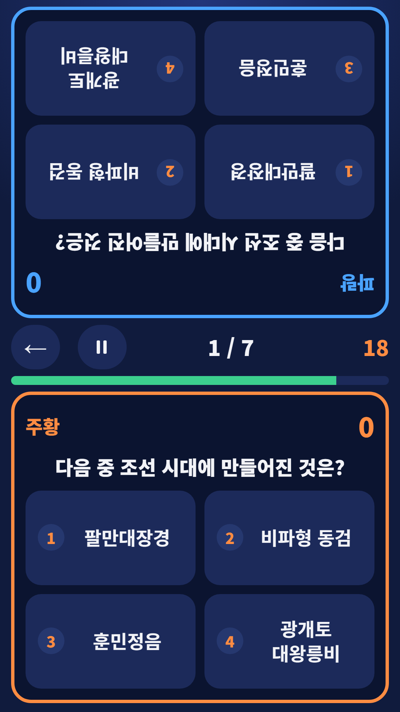

## Info
> **Trivia Battle: Party Quiz** — Four-choice Korean trivia for groups, head-to-head duels on one phone and solo play. The questions are in Korean. Free to play on Google Play, with ads.
{: .prompt-info }

## 이런 게임입니다
폰 하나로 친구들과 상식 퀴즈 대결을 하는 게임이에요. 한국사·경제·과학·세계지리·사자성어·맞춤법 6가지 분야, 2,600문항 이상의 4지선다 문제를 여럿이서, 둘이서, 혼자서 풀 수 있어요.

## 어떻게 하나요
- **여럿이 하기** — 문제 수(5·10·15)와 제한 시간(10·20·30초)을 고르고 참가자 이름을 입력해요. 정답과 해설을 본 뒤 맞힌 사람을 모두 눌러 점수를 줘요. 순위, 공동 순위, 공동 우승이 표시돼요
- **둘이 대결** — 폰을 사이에 두고 마주 앉아 같은 문제를 풀어요. 먼저 맞히면 1점, 틀리면 그 문제는 잠기고, 동점이면 서든데스로 가려요
- **혼자 하기** — 10문제, 문제당 15초. 빨리 맞히면 보너스 점수가 붙고 분야별 최고 점수가 저장돼요
- 언제든 일시정지할 수 있어요

## 특징
- 6가지 분야: 한국사·경제·과학·세계지리·사자성어·맞춤법, 2,600문항 이상
- 여럿이 하기, 둘이 대결, 혼자 하기 3가지 방식
- 최근에 나온 문제는 다시 나오지 않아요

문제는 한국어로 나와요. 무료로 즐길 수 있고 광고가 포함되어 있습니다.

{: w="360" }
{: w="360" }
{: w="360" }
{: w="360" }

## 플레이 영상


## Download
- Google Play: <https://play.google.com/store/apps/details?id=com.fadongkwon.quiz_battle>

{: w="200" .normal }

## 함께 출시된 앱
같은 시기 Google Play에 함께 나온 앱들입니다.

- [파동권 퀴즈한마당](/ko/posts/hub-quiz/) — 상식 대결을 포함한 모임 퀴즈 4종
- [초성 퀴즈](/ko/posts/chosung-quiz/) — 초성만 보고 단어 맞히기
- [스무고개](/ko/posts/twenty-q/) — 예/아니요 질문 스무 개로 단어 맞히기
- [넌센스 퀴즈](/ko/posts/nonsense-quiz/) — 직접 만든 말장난 300문제
- [파동권 자격증](/ko/posts/cert-hub/) — 자격증 시험 7종 문제은행을 한 앱에

소식은 이 블로그와 [인스타그램(@fadongkwon.soft)](https://www.instagram.com/fadongkwon.soft/)에서 전해드립니다.
