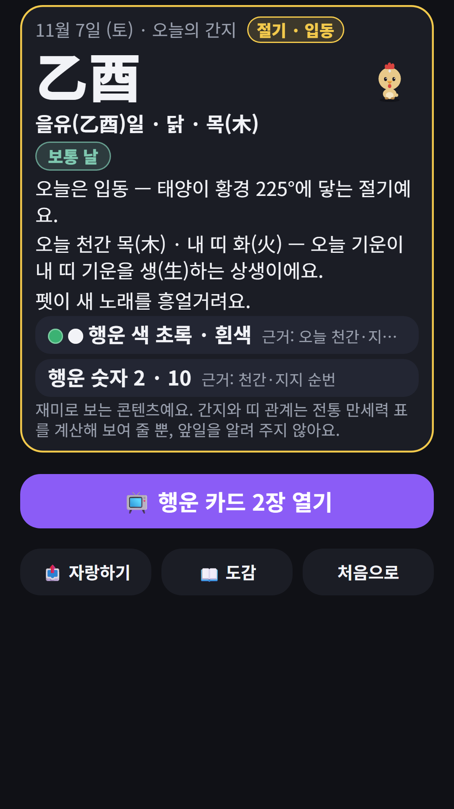
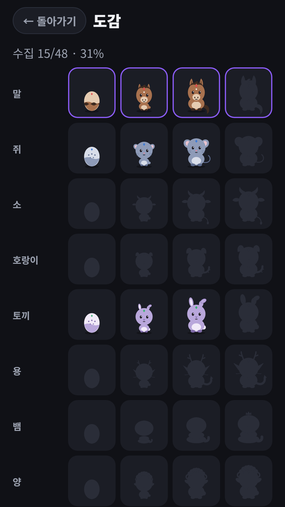
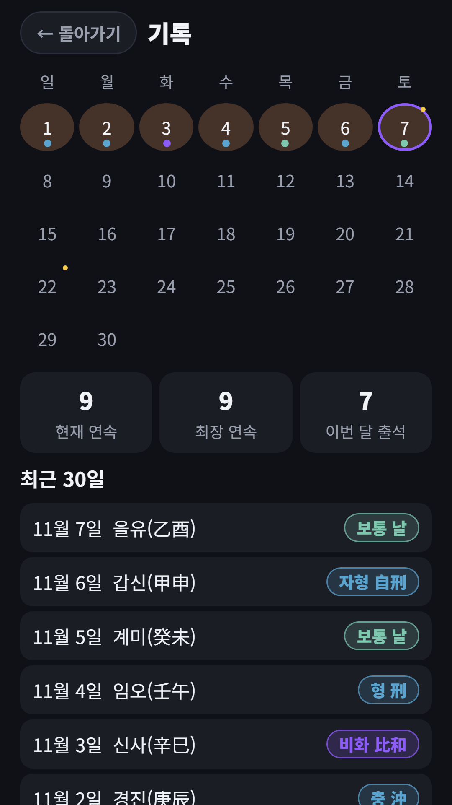
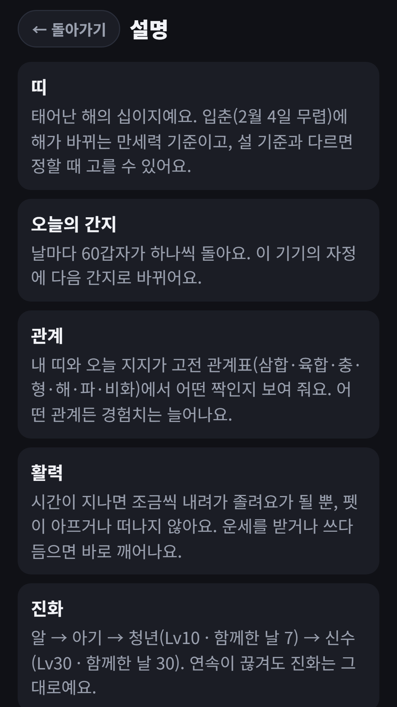

## Info
> **Zodiac Pet: Daily Fortune Card** — Your birth year's zodiac animal becomes your pet, and it shows a daily fortune card with the data behind it. For fun only. Free to use on Google Play, with ads.
{: .prompt-info }

## 이런 앱입니다
띠 운세 펫은 태어난 해의 십이지 동물을 펫으로 키우는 앱이에요. 매일 운세 카드를 열면 오늘의 간지와 내 띠가 고전 관계표에서 어떤 사이인지 근거와 함께 보여 줘요. 카드에는 예언 대신 계산된 데이터만 담겨요.

재미와 참고용 콘텐츠예요. 점술이나 의료·금융·법률 조언이 아니에요.

## 어떻게 하나요
- 처음에 태어난 해(양력·음력, 월·일은 선택)를 고르면 내 띠가 정해지고 펫의 알이 생겨요
- 홈에서 **오늘의 운세 받기**를 누르면 카드가 뒤집히며 오늘의 운세 카드가 열려요
- 카드에는 오늘의 간지, 내 띠와의 고전 관계(삼합·육합·충·형·해·파·비화), 오행의 상생·상극, 행운 색과 숫자가 나와요
- 원하면 **행운 카드 2장 열기**로 행운 방위와 시간대를 더 볼 수 있어요(광고를 한 번 보고 열려요)
- 펫을 쓰다듬고, 도감과 기록 달력을 둘러봐요

## 특징
- 오늘의 운세 카드: 오늘의 간지, 내 띠와의 고전 관계, 오행의 상생·상극을 데이터로 보여 줘요
- 행운 색·숫자·방위·시간대는 정해진 규칙으로 계산해요. 지어낸 해석은 없어요
- 펫 키우기: 알에서 아기, 청년, 신수까지 함께한 날이 쌓일수록 자라요
- 부드러운 연속 기록: 하루 걸러도 펫이 아프거나 떠나지 않아요. 졸려할 뿐 돌아오면 바로 깨어나요
- 나머지 11띠 친구를 초대해 도감을 채우고, 기록 달력에서 최근 30일의 관계를 모아 봐요
- 인터넷 없이도 되고 로그인이 없어요. 생년월일은 내 기기에만 저장돼요
- 한국어·영어·일본어·중국어·스페인어·포르투갈어·독일어·프랑스어·이탈리아어 지원

무료로 즐길 수 있고 광고가 포함되어 있습니다. 선택해서 보는 보상형 광고 2종(행운 카드 2장 더 열기, 펫 간식 주기)과 배너 광고가 있어요.

{: w="360" }
{: w="360" }
{: w="360" }
{: w="360" }
{: w="360" }

## 플레이 영상


## Download
- Google Play: <https://play.google.com/store/apps/details?id=com.fadongkwon.zodiac_pet>
- 앱인토스(토스 미니앱): [파동권 행운연구소](/ko/posts/hub-fortune/) 안에 들어 있어요 — <https://fadongkwon.com/toss/hub-fortune/> 휴대폰에서 열면 토스 앱으로 바로 연결됩니다.

{: w="200" .normal }

## 함께 보면 좋은 앱
- [파동권 행운연구소](/ko/posts/hub-fortune/) — 사주·타로·로또 운세를 한 앱에
- [사주로또](/ko/posts/saju-lotto/) — 생년월일시에서 뽑는 이번 주 번호
- [운세 타로핑](/ko/posts/tarot-ping/) — 귀여운 카드로 보는 오늘의 운세
- [타로 운세](/ko/posts/tarot-fortune/) — 카드 한 장으로 보는 오늘의 흐름

소식은 이 블로그와 [인스타그램(@fadongkwon.soft)](https://www.instagram.com/fadongkwon.soft/)에서 전해드립니다.
