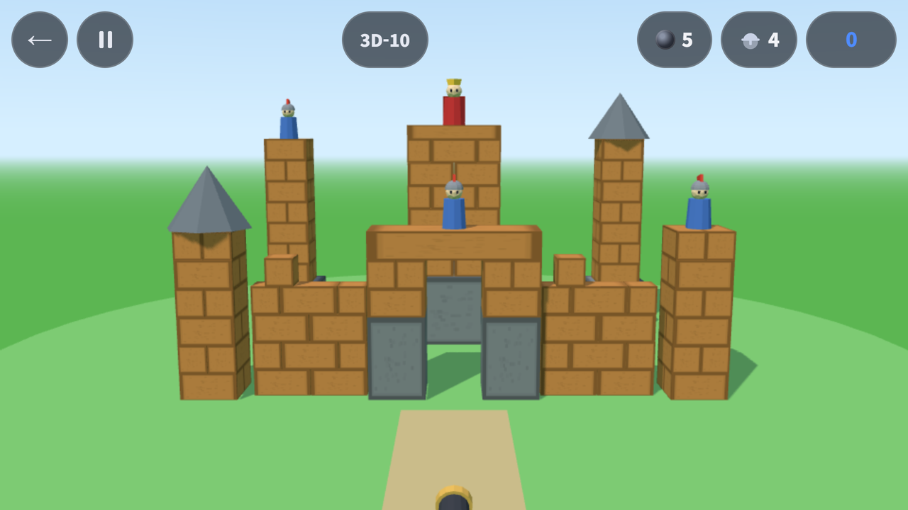
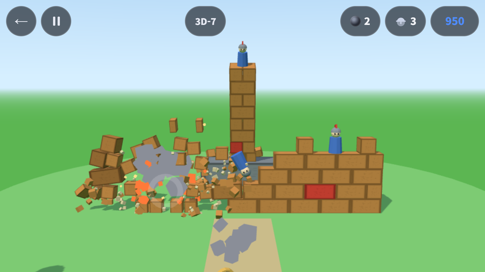
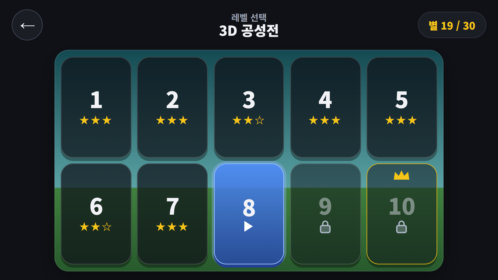

## Info
> **파괴왕 공성전 1.2.0** — 대포로 성을 무너뜨리는 물리 퍼즐에 새 모드 **3D 공성전**이 생겼어요. Google Play와 앱인토스(토스 미니앱)에서 무료로 즐길 수 있고 광고가 포함되어 있습니다.
{: .prompt-info }

## 이런 모드입니다
[파괴왕 공성전](/ko/posts/castle-topple/)은 대포를 당겨 쏴서 성을 무너뜨리는 2D 물리 퍼즐입니다. 1.2.0 업데이트에서 홈 화면에 세 번째 모드 카드 **3D 공성전**이 생겼어요.

정면 약간 위에서 내려다본 입체 성채가 화면을 채우고, **성을 탭하면 대포가 그 지점으로 쏩니다.** 당겨서 힘과 각도를 맞추던 2D와 달리 "어디를 칠지"만 고르면 됩니다. 성채는 벽돌을 한 장씩 쌓은 복셀 성이라, 맞은 자리에서 벽돌이 조각나 튀고 그 위가 통째로 내려앉아요.

{: w="640" }

## 어떻게 하나요
- **탭 = 발사.** 성채의 한 점을 짧게 누르면 대포가 그 점을 향해 쏩니다
- **드래그 = 시점 회전.** 좌우로 끌면 대포와 카메라가 함께 성채 둘레를 최대 ±45° 돌아요. 정면에서 안 보이던 옆면을 노릴 수 있어요
- 앞 공이 아직 날고 있어도 0.75초가 지나 공이 성에 닿았으면 다음 공을 쏠 수 있어요
- 공이 날거나 성이 흔들리는 동안 누르고 있으면 빨리 감기(⏩)
- 지금 버전의 클리어 조건은 2D와 같아요. 성을 지키는 기사와 왕을 모두 쓰러뜨리면 클리어, 정해진 발 수(par) 안에 깨면 별 3개
- 대포알이 떨어지면 광고를 보고 +2개를 받아 그 자리에서 이어서

블록은 재료마다 다르게 부서져요. 나무는 조각 2~4개로 쪼개져 날아가고, 얼음은 산산이 흩어지고, TNT는 반경 2.4m를 날려 버립니다. 돌은 대포알로는 깨지지 않아요.

{: w="640" }

## 3D 레벨 10개
홈의 3D 공성전 카드를 누르면 3D 전용 레벨 선택 화면이 나와요. 3D-10이 보스 성입니다. 탄은 par보다 한 발 많이 줍니다.

| 레벨 | 성채 구성 | 기사(왕 포함) | par(별 3개) | 탄 |
|---|---|---|---|---|
| 3D-1 | 돌 기단 위 나무 성벽 한 장, 뒤에 기사 | 1 | 1 | 2 |
| 3D-2 | 각탑 둘(위에 기사) + 사이 성벽 | 2 | 2 | 3 |
| 3D-3 | 성문(돌기둥 + 나무 상인방) 위 기사 + 양옆 성벽 + 각탑 | 2 | 2 | 3 |
| 3D-4 | 앞 낮은 성벽 + 기단 위 나무 천수각 | 2 | 2 | 3 |
| 3D-5 | 얼음 성벽 + 얼음 각탑 둘 | 3 | 3 | 4 |
| 3D-6 | 돌 하단 2줄 사각 성 + 각탑 넷 | 2 | 2 | 3 |
| 3D-7 | TNT 벽돌이 박힌 성벽 + 각탑 | 3 | 3 | 4 |
| 3D-8 | 안 깨지는 돌 외벽 + 안쪽 나무 천수각 + 각탑 둘 | 2 | 2 | 3 |
| 3D-9 | 앞 성벽 + 각탑 넷 + 황금 천수각 | 3 | 3 | 4 |
| 3D-10 | 보스: 성문 + 앞 성벽 + 각탑 넷 + 천수각 위 왕 | 4 | 4 | 5 |

par는 해답 찾는 프로그램(솔버)이 실제 화면을 탭하는 방식으로 쏴서 정한 값이고, 한 발에 깨지는 판은 튜토리얼인 3D-1뿐이에요.

{: w="640" }

## 원래는 별도 앱이었다
이 모드는 처음부터 모드로 계획한 게 아닙니다.

10월에 2D판을 만들면서 원래 원했던 그림은 **세로로 높은 성이 화면을 채우고 와르르 무너지는** 쪽이었는데, 결과물은 멀리 있는 성에 포물선으로 던지는 구도가 됐습니다. 그래서 [planck 글](/ko/posts/castle-topple-planck/) 끝에 적었듯 2D 앱은 그대로 다듬고, 세로 성채판은 **별도 앱**으로 만들기로 했습니다. 작업 목록에 붙인 이름은 `tower-royal`이었습니다.

11월 5일 그 작업을 시작하면서 방향을 바꿨습니다. 별도 앱 대신 **파괴왕 공성전 안의 새 모드**로 넣기로 한 것입니다. [농구 슛](/ko/posts/hoop-shot/)의 3D 슛아웃을 같은 앱의 모드로 넣었던 선례가 있었고, 앱 수 한도·스토어 노출·유지보수 모두 모드 쪽이 낫다고 봤습니다.

그러면서 규칙도 2D의 것을 그대로 옮겼습니다. **기사를 모두 쓰러뜨리면 클리어.** 만들어 놓고 보니 이게 문제였습니다. 11월 8일 받은 평가는 세 가지였습니다.

1. 3D는 원래 별도 앱으로 하기로 했던 것이다
2. 성을 무너뜨리는 게임이 아니라 기사 인형을 떨어뜨리는 게임이 됐다
3. 그래서 너무 평이하다

이유는 단순했습니다. 기사가 꼭대기에 서 있으니 맨 위 한두 단만 쳐도 떨어지고, 성 몸통이 멀쩡히 남아도 클리어됩니다. 기록해 둔 결정(별도 앱, 성 자체를 무너뜨리는 목표)을 제 판단으로 덮어쓴 결과였습니다.

정리는 이렇게 했습니다.

- **이미 만든 3D 공성전 모드는 파괴왕 공성전 안에 그대로 둡니다.** 지금 스토어에 나가 있는 1.2.0이 이 판이고, 클리어 조건은 위에 적은 기사 규칙입니다.
- **목표를 성 파괴 쪽으로 고치는 작업을 하고 있습니다.** 계획은 성채를 땅보다 높은 받침 위에 세우고, **받침 위 블록을 전부 떨어뜨리면 클리어**로 바꾸는 것입니다. 기사는 없애고, 남은 블록 수와 받침 비우기 진행률을 화면 위에 보여 주고, 별은 남긴 탄 수로 줍니다. 레벨도 새 규칙에 맞게 전부 다시 짭니다. 규칙이 바뀌므로 3D 별 기록은 새로 시작하게 할 계획입니다(2D 기록은 그대로). 검증이 끝나면 다음 업데이트로 냅니다.
- 세로 성채를 무너뜨리는 **별도 앱 `tower-royal`은 따로 새로 기획합니다.**

## 만든 방법: three.js + cannon-es
2D판은 planck(Box2D 포팅) 물리 엔진으로 돌아갑니다. 3D 모드는 렌더링에 **three.js 0.187.0**, 물리에 **cannon-es 0.20.0**을 썼고, 둘 다 버전을 정확히 고정했습니다. 2D 판(캠페인·오늘의 공성전·무한 공성)의 코드는 한 줄도 바꾸지 않는다는 조건을 먼저 걸었습니다. 저장값도 3D 기록을 따로 두어 기존 2D 기록과 섞이지 않습니다.

들이기 전에 planck 때처럼 노드에서 먼저 쟀습니다. 1/60초 한 스텝을 **1/120초 두 번으로 나눠** 계산하면 0.5m 정육면체 20단 탑이 10초 뒤 2cm 이내로 서서 잠들었습니다. 한 번에 계산하면 14단부터 무너졌습니다. 그래서 두 번 나누기는 고정값입니다.

### 탭한 지점으로 쏘기
대포알의 속도는 초속 26m로 고정이고, 탭한 지점까지 닿는 **낮은 포물선**의 각도를 계산해서 쏩니다. 닿는 해가 없으면 45°로 쏩니다. 손가락이 움직이지 않고 400ms 안에 떨어지면 탭(발사), 그 밖은 드래그(시점 회전)로 나눴습니다.

"탭한 곳이 어디인가"를 정하는 코드는 한 곳에 두고, 화면과 솔버가 같이 씁니다. 처음에는 솔버가 화면을 거치지 않고 3D 좌표를 바로 겨눠 par를 정했더니, 실제로 화면을 탭해 쏘면 10판 중 7판만 깨졌습니다. 허공을 탭하면 성채 한가운데 평면으로 떨어지고, 첫 발에 무너진 벽이 둘째 탭 자리를 가리는 판도 있었습니다. 그래서 허공 탭은 가장 가까운 기사 쪽 평면으로, 지붕 탭은 지붕을 받치는 블록 윗면으로 보내도록 규칙을 정하고, 솔버도 실제 게임 화면 크기(622×350)에 탭하는 방식으로 다시 돌렸습니다. 그 뒤 실제 탭만으로 10판 모두 par 발 수에 별 3개로 깨졌습니다.

### 연속 발사
첫 판은 한 발 쏘고 성이 완전히 멈출 때까지 기다려야 다음 발을 쏠 수 있었는데, 그 기다림이 3~10초였습니다. 연타하는 손맛이 없었습니다. 그래서 '멈춤'과 '쏠 수 있음'을 떼었습니다. 마지막 발 뒤 45스텝(0.75초)이 지났고 그 공이 성에 한 번 닿았으면 성이 흔들리는 중에도 쏠 수 있습니다. 바꾼 뒤 잰 발사 간격은 레벨마다 0.72~0.89초였습니다.

### 시점 회전 ±35° → ±45°
처음 설계는 드래그로 카메라만 ±35° 돌리는 것이었는데, 돌리면 대포가 화면 밖으로 나갔습니다. 그래서 **대포와 카메라를 한 몸으로 묶어** 성채 중심을 같이 돌게 하고 범위를 ±45°로 넓혔습니다. 어느 각도에서든 대포는 화면 아래 가운데에 있고, 공도 돌아간 대포에서 나갑니다.

## 3D 코드는 따로 떼어 낸다
가장 신경 쓴 건 **2D 첫 로딩을 지키는 것**이었습니다. 토스는 첫 로딩이 느리면 검수에서 반려합니다. three.js와 cannon-es를 메인 번들에 넣으면 3D를 안 하는 사람까지 그 무게를 받게 됩니다.

그래서 3D 코드는 처음 화면에서 불러오지 않고 **필요할 때 따로 불러오는 묶음(청크)**으로 뗐습니다. 1.2.0 빌드 기준 크기는 이렇습니다.

| 파일 | 크기 | gzip |
|---|---|---|
| 메인(2D 게임 전체, 첫 화면에서 받음) | 507.7KB | 160.8KB |
| 3D 묶음(three.js + cannon-es + 3D 게임 코드) | 670.5KB | 179.0KB |

3D 묶음은 첫 화면이 다 뜨고 자리를 잡은 뒤(약 5초 뒤) 뒤에서 미리 받아 둡니다. 개발폰(갤럭시 S23 Ultra, 120Hz)에서 잰 값은 앱 콜드 스타트 933ms, 3D 묶음 받기 26ms(앱 안에 든 파일), 3D 레벨 타일을 누르고 3D 화면이 뜨기까지 348ms였습니다. 3D 판을 하는 동안 평균 프레임 간격은 8.94ms로 120Hz를 거의 따라갔습니다.

1.2.0을 내기 전 자동 테스트는 288개였고, 3D 레벨 10개는 솔버와 실제 화면 탭 두 가지로 모두 par 발 수 안에 깨지는 것을 확인했습니다.

## 플레이 영상


## Download
- Google Play: <https://play.google.com/store/apps/details?id=com.fadongkwon.castle_topple>
- 앱인토스(토스 미니앱): <https://fadongkwon.com/toss/castle-topple/> — 휴대폰에서 열면 토스 앱으로 바로 연결됩니다.

{: w="200" .normal }
{: w="200" .normal }

소식은 이 블로그와 [인스타그램(@fadongkwon.soft)](https://www.instagram.com/fadongkwon.soft/)에서 전해드립니다.
