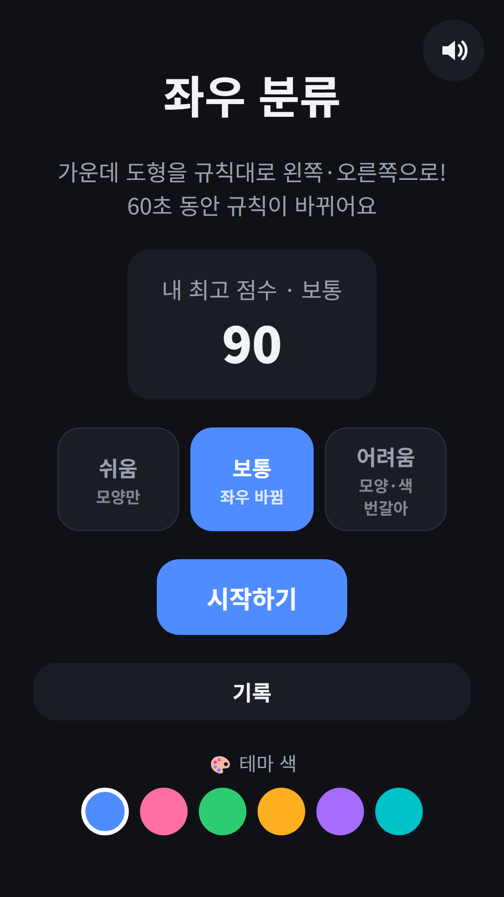
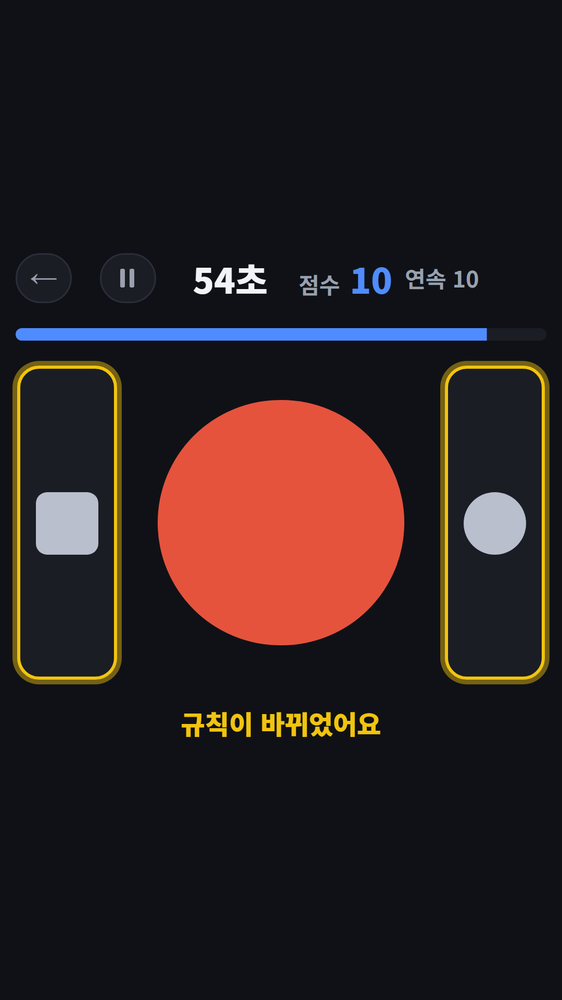
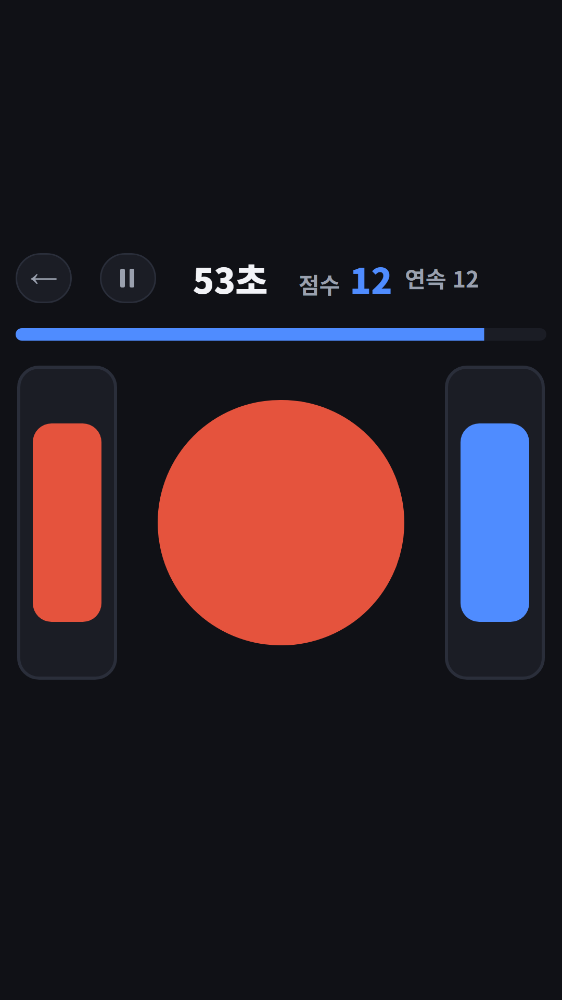
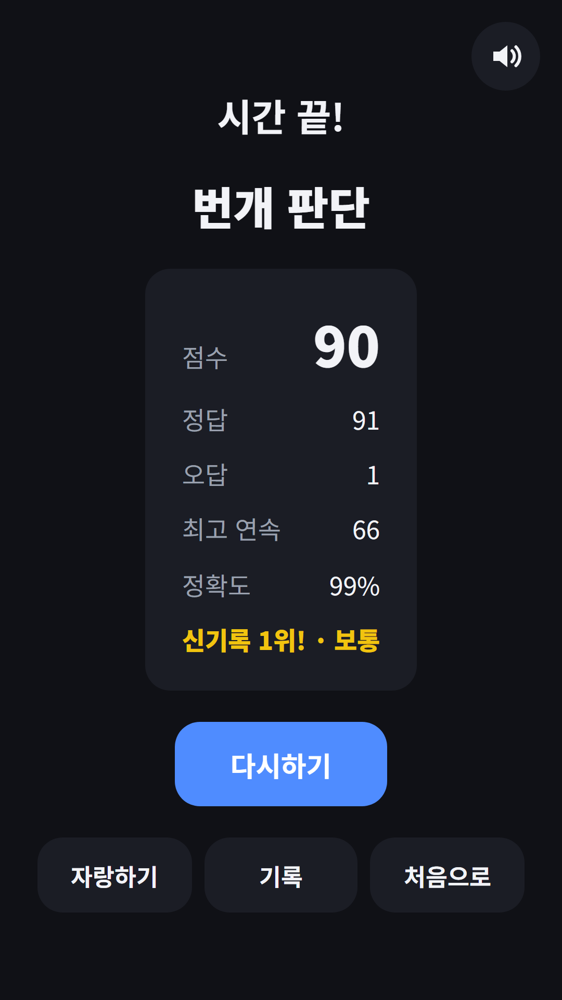

## Info
> **Left or Right: Quick Sort** — Send each card left or right by the rule. The rule changes while you play. Free to play on Google Play, with ads.
{: .prompt-info }

## 이런 게임입니다
가운데에 카드가 나와요. 화면 양쪽에 그려진 지금 규칙에 따라 왼쪽이나 오른쪽으로 보내면 돼요. 제한 시간은 60초이고, 하는 도중에 규칙이 바뀌어요. 점수는 정답 수에서 오답 수를 뺀 값이에요. 파동권 뇌나이에 들어 있는 두뇌 게임 중 하나를 Google Play에 따로 내놓았어요.

## 어떻게 하나요
- 홈에서 난이도를 고르고 **시작하기**를 눌러요
- 양쪽 칸에 그려진 그림이 지금 규칙이에요. 가운데 카드와 같은 쪽을 고르면 돼요
- 화면 왼쪽 반이나 오른쪽 반을 눌러 카드를 보내요
- '규칙이 바뀌었어요'가 뜨면 양쪽 그림을 다시 확인해요
- 틀리면 0.5초 동안 잠기고 같은 카드가 남아요

## 특징
- 난이도 3단계: 쉬움은 모양만, 보통은 몇 장마다 좌우가 바뀌고, 어려움은 모양과 색 규칙이 번갈아 나와요
- 규칙은 그림으로 보여 줘서 글을 읽지 않아도 할 수 있어요
- 결과에서 정답·오답·최고 연속·정확도와 등급을 보여 줘요
- 난이도별 TOP 10과 오늘·이번 주·이번 달·명예의 전당 기록
- 매일 하트 3개 무료. 한 판에 하나씩 쓰고, 짧은 광고를 보면 하트를 더 받을 수 있어요
- 인터넷 없이도 플레이하고, 9개 언어를 지원해요

무료로 즐길 수 있고 광고가 포함되어 있습니다.

{: w="360" }
{: w="360" }
{: w="360" }

## 플레이 영상


## Download
- Google Play: <https://play.google.com/store/apps/details?id=com.fadongkwon.left_right>

{: w="200" .normal }

## 함께 보면 좋은 앱
- [파동권 뇌나이](/ko/posts/hub-brain/) — 두뇌 게임을 한 앱에 모은 허브
- [다른 하나 찾기](/ko/posts/odd-one-out/) — 딱 하나 다른 칸을 빨리 찾는 눈썰미 게임
- [야바위](/ko/posts/shell-game/) — 공이 든 컵을 끝까지 따라가는 집중력 게임

소식은 이 블로그와 [인스타그램(@fadongkwon.soft)](https://www.instagram.com/fadongkwon.soft/)에서 전해드립니다.
