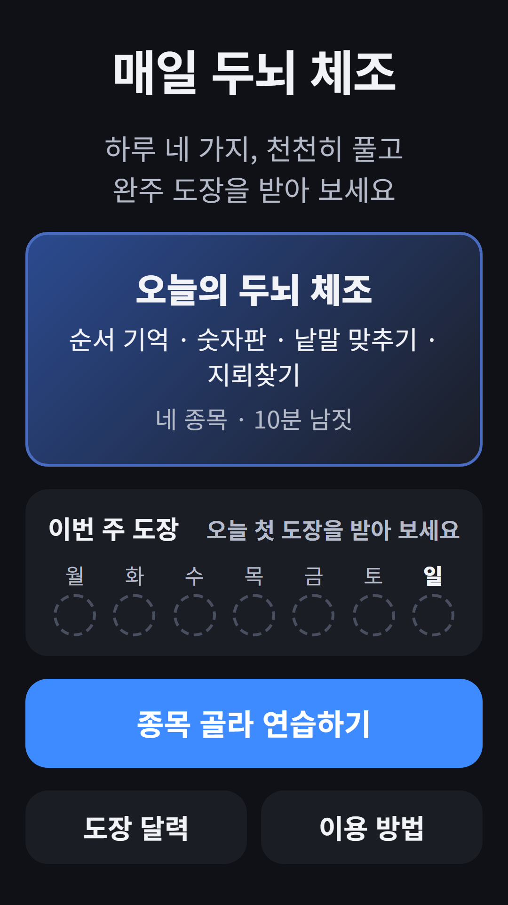
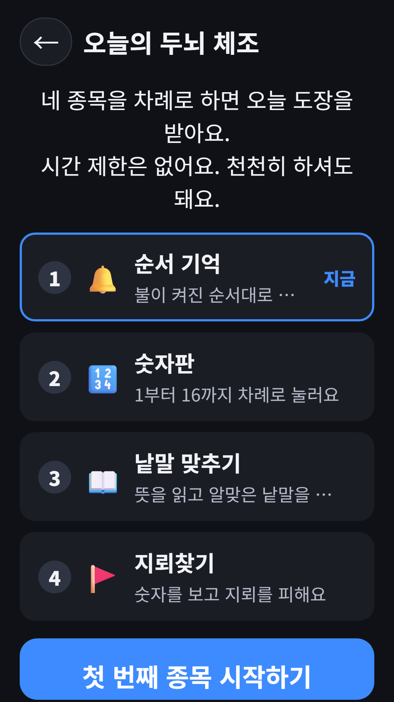
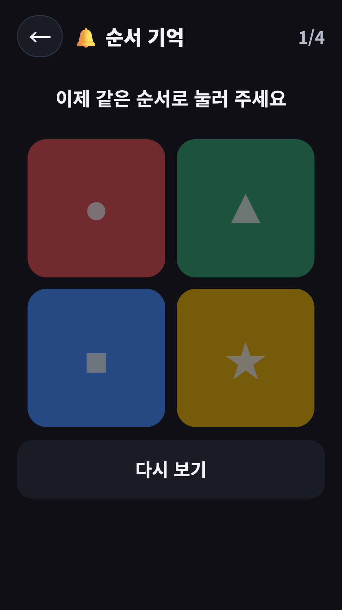
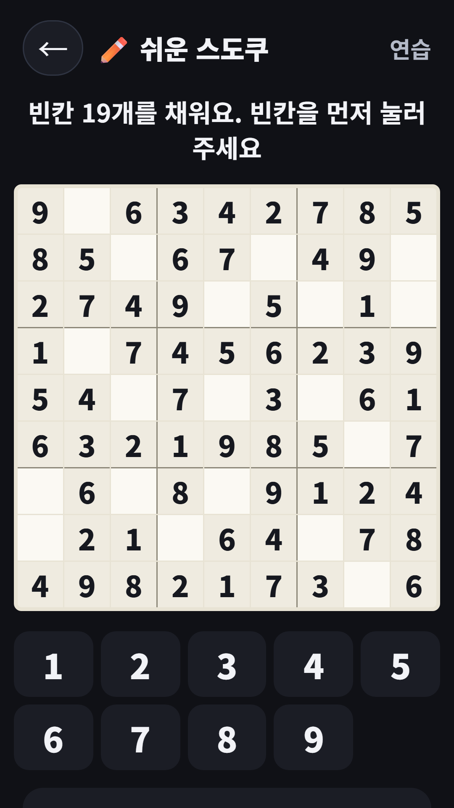
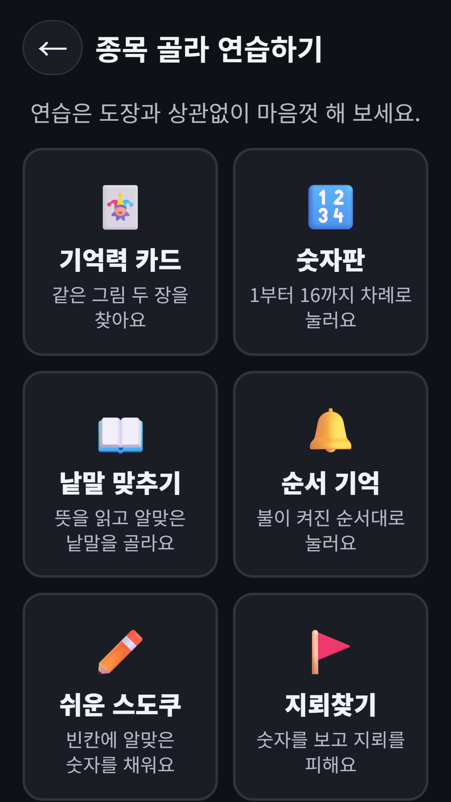
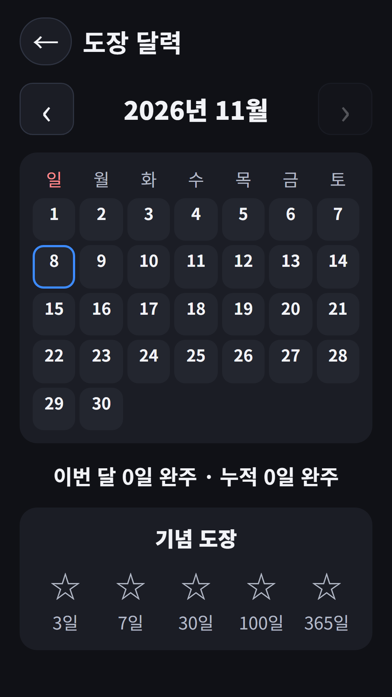

## Info
> **매일 두뇌 체조** — 하루 네 종목을 천천히 풀고 완주 도장을 모아요. 점수·순위·제한 시간이 없어요. Google Play에서 무료, 광고 포함.
{: .prompt-info }

## 이런 앱입니다
하루 네 종목을 천천히 풀고 '참 잘했어요' 완주 도장을 모으는 퍼즐 앱이에요. 매일 코스가 정해져 있어서, 기억력 카드·숫자판·낱말 맞추기·순서 기억 중 세 종목과 마무리 퍼즐(스도쿠 또는 지뢰찾기) 하나를 풀면 오늘의 도장이 찍혀요. 같은 날에는 누구나 같은 코스와 같은 판이 나와요. 파동권 뇌나이에 '시니어 하루 코스'로 들어 있는 앱을 Google Play에 따로 내놓았어요.

## 어떻게 하나요
- 홈에서 **오늘의 두뇌 체조**를 누르면 오늘 코스 네 종목이 차례로 나와요
- 한 종목을 마치면 코스 화면으로 돌아와 다음 종목을 시작해요
- 네 종목을 다 마치면 '참 잘했어요' 도장이 찍히고 이번 주 도장 칸이 채워져요
- 중간에 나가도 마친 종목은 저장돼서 이어서 할 수 있어요
- 도장과 상관없이 **종목 골라 연습하기**에서 마음에 드는 종목만 풀 수도 있어요

## 특징
- 점수·순위·제한 시간이 없어서 천천히 즐길 수 있어요
- 판 크기와 속도, 틀렸을 때의 관대함을 편하게 맞춘 6가지 종목
- 도장 달력과 연속 완주 일수, 3·7·30·100·365일 기념 도장
- 한국어 낱말을 쓰는 퍼즐이 들어 있어 한국어로만 제공돼요
- 회원가입 없이 쓸 수 있어요

광고가 포함되어 있습니다(배너·전면·보상형). 스도쿠 힌트는 몇 번은 무료이고, 그다음에는 광고를 보고 받을 수 있어요.

{: w="360" }
{: w="360" }
{: w="360" }
{: w="360" }
{: w="360" }

## 플레이 영상


## Download
- Google Play: <https://play.google.com/store/apps/details?id=com.fadongkwon.senior_brain>

{: w="200" .normal }

## 함께 보면 좋은 앱
- [파동권 뇌나이](/ko/posts/hub-brain/) — 두뇌 게임을 한 앱에 모은 허브
- [다른 하나 찾기](/ko/posts/odd-one-out/) — 딱 하나 다른 칸을 빨리 찾는 눈썰미 게임
- [야바위](/ko/posts/shell-game/) — 공이 든 컵을 끝까지 따라가는 집중력 게임

소식은 이 블로그와 [인스타그램(@fadongkwon.soft)](https://www.instagram.com/fadongkwon.soft/)에서 전해드립니다.
