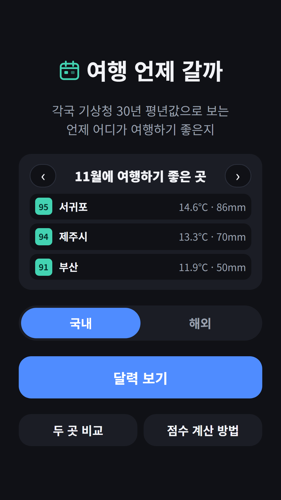
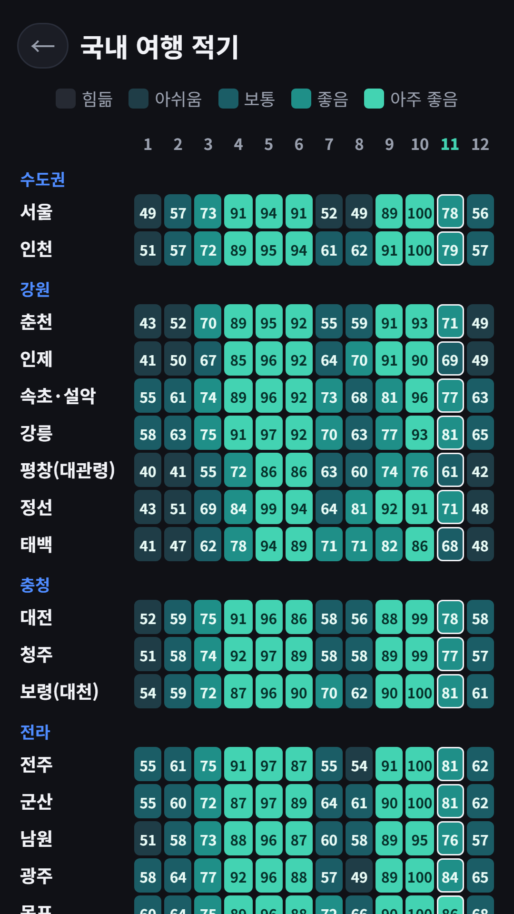
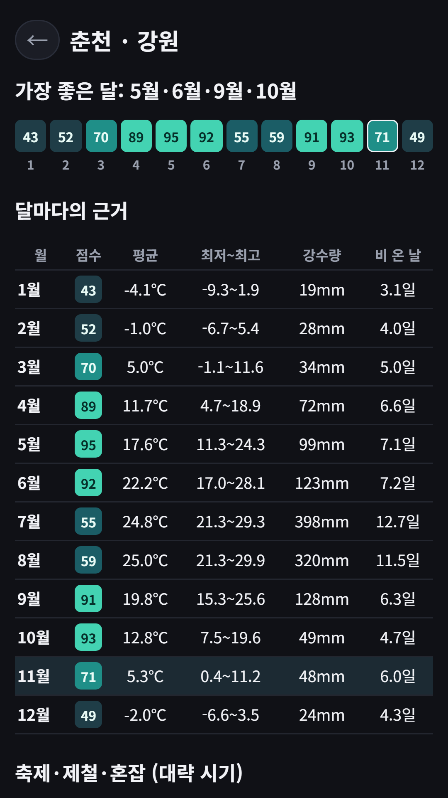
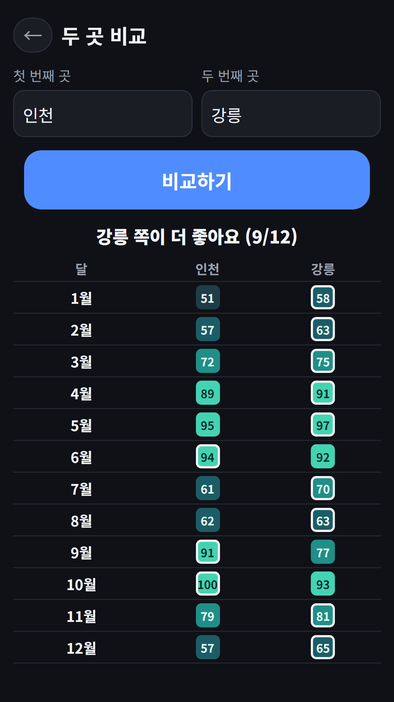
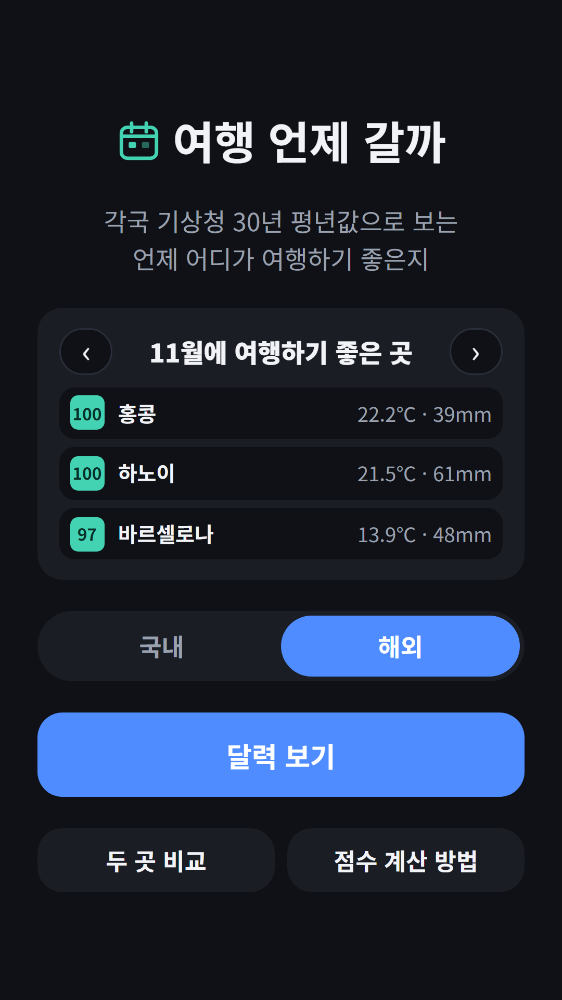
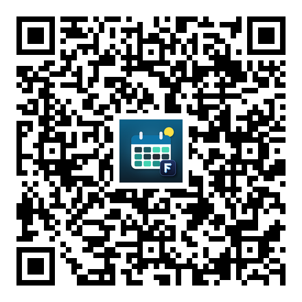

## Info
> **여행 언제 갈까** — 국내 32곳·해외 28곳, 어느 달에 가면 좋은지 평년 기온·강수량으로 한눈에 봐요. Google Play에서 무료, 광고 포함.
{: .prompt-info }

## 이런 앱입니다
여행 날짜를 정할 때 가장 많이 찾는 말이 "○○ 몇 월에 가면 좋아요?"예요. 그런데 답은 대개 "봄·가을이 좋아요" 정도라 막상 날짜를 고르려면 다시 날씨 사이트를 뒤져야 하죠. 그래서 **기상청과 각국 기상청이 낸 30년 평년값(1991~2020)** 으로 국내 32곳·해외 28곳의 1월~12월을 한 장의 달력으로 만들었어요. 색이 진할수록 그 달에 여행하기 좋은 곳이에요.

## 어떻게 쓰나요
- 홈에서 **이번 달에 여행하기 좋은 곳 TOP 3**를 바로 보고, 화살표로 달을 넘겨요
- **국내/해외**를 바꾸고 **달력 보기**를 누르면 권역별 1~12월 점수표가 나와요
- 지역을 누르면 달마다 평균·최저·최고 기온, 강수량, 비 온 날수와 근거 자료의 출처가 나와요
- **두 곳 비교**에서 두 지역의 월별 점수를 나란히 볼 수 있어요
- **점수 계산 방법**에서 산식을 그대로 확인할 수 있어요

## 점수는 이렇게 계산해요
점수는 평년값 **두 가지만** 써요. 누구나 같은 숫자로 다시 계산할 수 있게요.

- **기온 점수**: 월 평균기온이 15~24℃면 1점. 그보다 추우면 1℃마다 1/20씩, 더우면 1℃마다 1/10씩 깎아요
- **비 점수**: 월 강수량이 60mm 이하면 1점, 360mm 이상이면 0점, 그 사이는 비례해서 줄어요
- **여행 점수 = 100 × (기온 × 0.6 + 비 × 0.4)**, 85점 이상은 '아주 좋음'

습도·태풍·미세먼지·물가·혼잡은 점수에 넣지 않았어요(지점마다 같은 기준의 공개 평년값이 없어서). 대신 지역 화면에 **축제·제철·현지 연휴(혼잡)** 를 대략적인 달과 근거 링크로 따로 적었어요. 스키처럼 추워야 좋은 여행은 점수가 낮게 나온다는 점도 감안해 주세요.

## 달마다 점수가 높은 곳 — 국내

| 달 | 점수 높은 곳 (점수) |
|---|---|
| 1월 | 서귀포 77 · 제주시 72 · 성산 69 |
| 2월 | 서귀포 77 · 제주시 75 · 부산 71 |
| 3월 | 대구 80 · 포항 80 · 제주시 80 |
| 4월 | 대구 97 · 포항 94 · 제주시 94 |
| 5월 | 경주 100 · 정선 99 · 대구 98 |
| 6월 | 경주 95 · 인천 94 · 정선 94 |
| 7월 | 울릉도 85 · 경주 74 · 포항 73 |
| 8월 | 울릉도 84 · 정선 81 · 경주 71 |
| 9월 | 정선 92 · 안동 92 · 인제 91 |
| 10월 | 대구 100 · 인천 100 · 서울 100 |
| 11월 | 서귀포 95 · 제주시 94 · 부산 91 |
| 12월 | 서귀포 83 · 제주시 80 · 성산 75 |

- **장마철(7~8월)에는 육지 대부분이 50점 안팎**으로 떨어져요. 서울 7월 평년 강수량이 414mm, 8월이 348mm예요. 이때는 상대적으로 비가 적은 울릉도·경주·정선이 위로 올라와요
- **겨울에는 제주(특히 서귀포)** 가 국내에서 가장 따뜻해요. 서귀포 1월 평균기온은 7℃ 안팎이에요
- **10월은 서울·인천·대구가 모두 100점**이에요. 기온과 강수량 둘 다 '여행하기 좋은 범위' 안에 들어오는 달이에요

## 달마다 점수가 높은 곳 — 해외

| 달 | 점수 높은 곳 (점수) |
|---|---|
| 1월 | 치앙마이 100 · 하노이 100 · 홍콩 100 |
| 2월 | 하노이 100 · 다낭 100 · 홍콩 100 |
| 3월 | 하노이 100 · 하와이(호놀룰루) 100 · 다낭 99 |
| 4월 | 바르셀로나 100 · 상하이 98 · 하와이 95 |
| 5월 | 바르셀로나 100 · 로마 100 · 칭다오 99 |
| 6월 | 바르셀로나 100 · 로마 100 · 런던 100 |
| 7월 | 런던 100 · 파리 100 · 삿포로 96 |
| 8월 | 런던 100 · 파리 100 · 시드니 97 |
| 9월 | 파리 100 · 런던 100 · 시드니 100 |
| 10월 | 칭다오 100 · 시드니 99 · 상하이 98 |
| 11월 | 홍콩 100 · 하노이 100 · 바르셀로나 97 |
| 12월 | 치앙마이 100 · 하노이 100 · 홍콩 100 |

동남아는 우기와 건기가 뚜렷해서 같은 나라 안에서도 달라요. 예를 들어 다낭은 10월 평년 강수량이 600mm를 넘는 반면 2~4월은 20~35mm 수준이에요. 일본은 골든위크(4월 말~5월 초)와 오봉(8월 중순), 중국은 춘절과 국경절(10월 1~7일), 베트남은 뗏(설) 연휴를 지역 화면에 '혼잡'으로 따로 표시했어요.

## 데이터 출처
- **국내 32곳**: 기상청이 세계기상기구(WMO)에 낸 1991~2020 기후평년값(미국 해양대기청 NOAA NCEI 공개 표)
- **해외 22곳**: 각국 기상청(JMA·HKO·TMD·PAGASA 등)이 같은 WMO 평년값으로 낸 표
- **교토·타이베이·베트남 4곳(다낭·하노이·호찌민·푸꾸옥)**: WMO 공개 표에 없어 각 기관 값을 옮긴 위키백과 기후표를 썼고, 앱의 지역 화면에 그렇게 적어 두었어요
- 축제 시기는 2026년 11월 공개 자료로 확인한 '대략적인 달'이에요. 날짜는 해마다 바뀌니 떠나기 전에 공식 안내를 꼭 확인하세요

평년값은 30년 평균이라 올해 날씨와는 다를 수 있어요. 날짜를 정하는 첫 단추로 써 주세요.

회원가입 없이 쓸 수 있어요. 광고가 포함되어 있으며, 두 곳 비교 화면에서는 광고를 본 뒤 결과가 나오고(한 번 실행에 1회), 화면 하단에 배너 광고가 표시돼요. 지역별 근거 화면은 광고 없이 볼 수 있어요.

{: w="360" }
{: w="360" }
{: w="360" }
{: w="360" }

## 사용 영상


## Download
- Google Play: <https://play.google.com/store/apps/details?id=com.fadongkwon.travel_season>

{: w="200" .normal }

소식은 이 블로그와 [인스타그램(@fadongkwon.soft)](https://www.instagram.com/fadongkwon.soft/)에서 전해드립니다.
