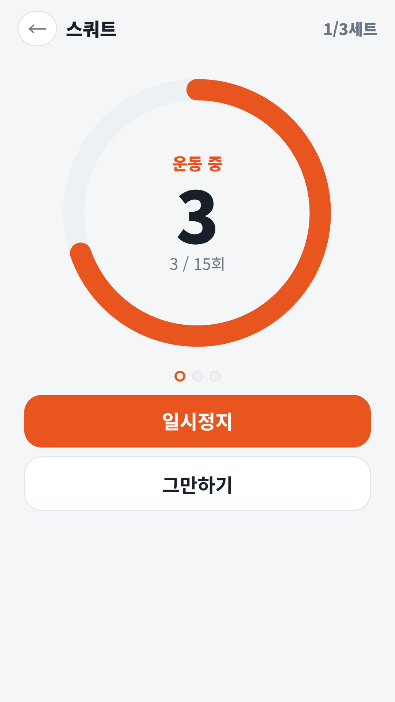
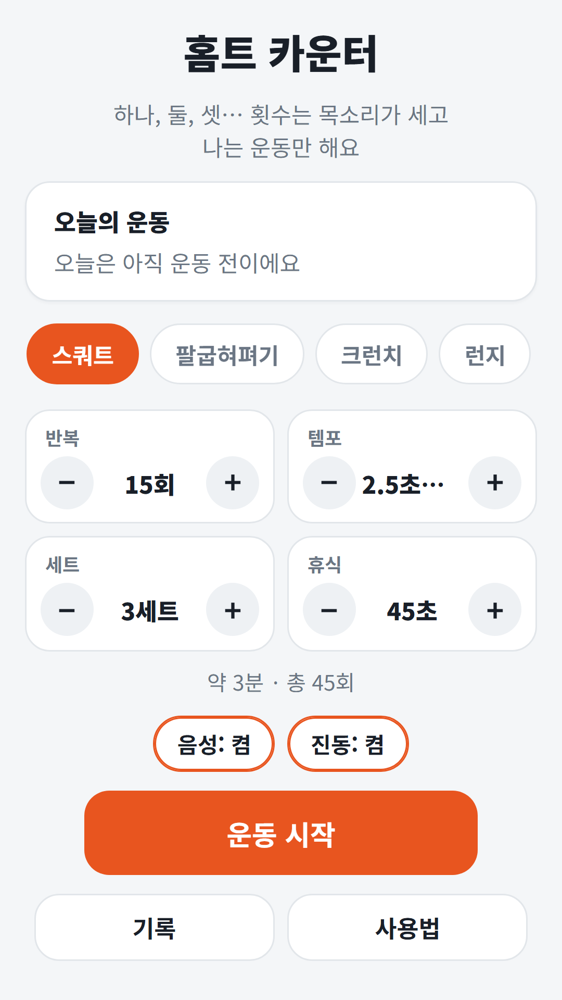
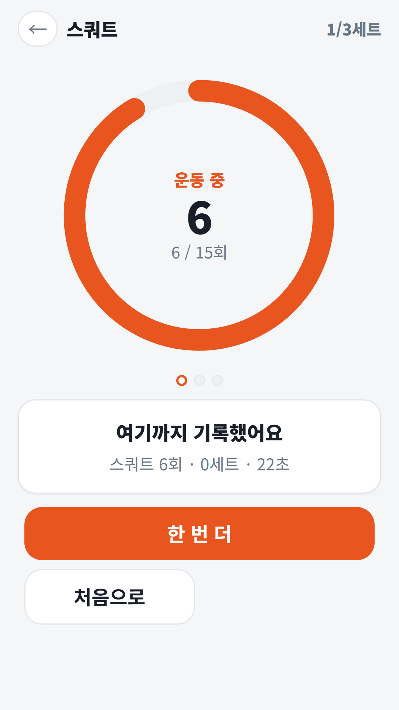
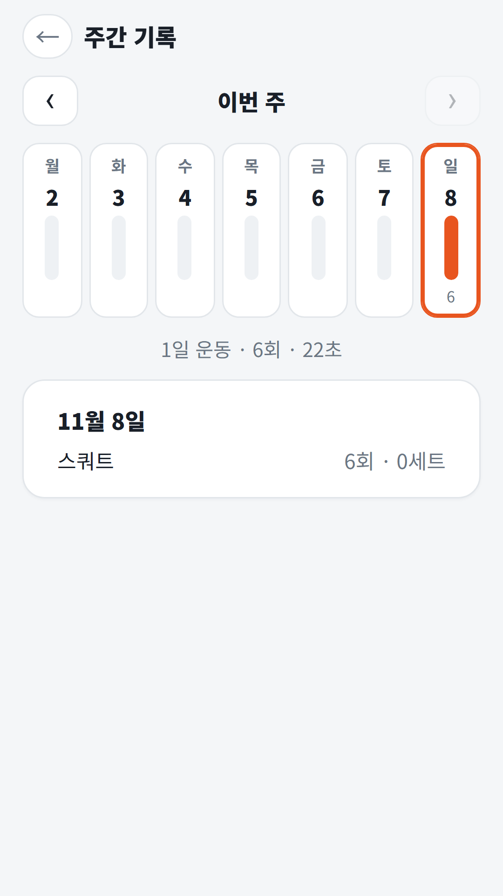
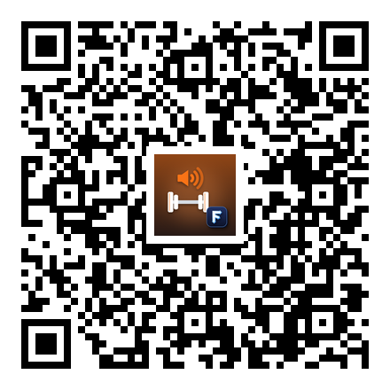

## Info
> **홈트 카운터** — 운동 횟수·세트·휴식을 목소리로 세어 줘요. 화면을 안 봐도 돼요. Google Play에서 무료, 광고 포함. 토스에서는 별도 앱 없이 '파동권 주말생활' 안에서 쓸 수 있어요.
{: .prompt-info }

## 이런 앱입니다
집에서 스쿼트를 하다 보면 지금 몇 개째인지 헷갈리고, 휴대폰 화면을 들여다보느라 자세가 흐트러지기 쉬워요. 홈트 카운터는 횟수와 세트, 쉬는 시간을 **목소리로 세어 주는 카운터**예요. 운동을 고르고 반복 횟수·템포·세트·휴식을 정한 뒤 '운동 시작'을 누르면, "준비하세요, 3·2·1, 시작!" 다음에 하나, 둘, 셋… 하고 박자에 맞춰 세어 줘요. 나는 목소리에 맞춰 움직이기만 하면 돼요.

카메라나 센서로 동작을 알아보는 앱은 아니에요. 정한 템포대로 세어 주는 방식이에요.

## 어떻게 쓰나요
- 운동 9가지 중 하나를 골라요: 스쿼트·팔굽혀펴기·크런치·런지·팔벌려뛰기·버피·플랭크·벽 앉기·자유 운동
- **반복**·**템포**·**세트**·**휴식**을 정해요. 템포는 1회에 걸리는 시간이에요. 아래에 예상 시간과 총 횟수가 나와요(예: 약 3분 · 총 45회)
- 세트가 끝나면 휴식 시간을 재고, 다음 세트가 다가오면 3·2·1로 미리 알려 줘요
- 플랭크·벽 앉기처럼 버티는 운동은 버티기 시간을 정하면 남은 시간을 알려 줘요
- 운동 중에는 **일시정지**·**휴식 건너뛰기**·**그만하기**를 쓸 수 있어요. 다른 앱으로 가면 자동으로 멈춰요
- 중간에 그만둬도 센 만큼은 오늘 기록에 남아요

## 특징
- 음성 9개 언어: 한국어·영어·일본어·중국어·스페인어·포르투갈어·독일어·프랑스어·이탈리아어
- 음성·진동을 따로 켜고 끌 수 있어요
- 운동하는 동안 화면이 꺼지지 않아요
- 운동별 설정을 저장하고, 홈에 오늘의 운동과 연속 운동일이 나와요
- **주간 기록**: 요일별 막대와 날짜별 운동 내역. 기록은 이 기기 안에만 저장돼요
- 회원가입 없이 바로 쓸 수 있어요

광고가 포함되어 있습니다(화면 하단 배너).

{: w="360" }
{: w="360" }
{: w="360" }
{: w="360" }

## 사용 영상


## Download
- Google Play: <https://play.google.com/store/apps/details?id=com.fadongkwon.exercise_count>
- 토스: 별도 앱은 없고, 파동권 주말생활 안의 '홈트 카운터'로 쓸 수 있어요 — <https://fadongkwon.com/toss/hub-weekend/> (휴대폰에서 열면 토스 앱으로 바로 연결됩니다)

{: w="200" .normal }

## 함께 보면 좋은 앱
- [여행 언제 갈까](/ko/posts/travel-season/) — 국내외 60곳의 달마다 여행하기 좋은 정도를 30년 평년값으로 보여 주는 여행 달력. 파동권 주말생활에 함께 들어 있어요
- [매일 두뇌 체조](/ko/posts/senior-brain/) — 점수·순위·제한 시간 없이 하루 네 종목을 천천히 푸는 퍼즐 앱

소식은 이 블로그와 [인스타그램(@fadongkwon.soft)](https://www.instagram.com/fadongkwon.soft/)에서 전해드립니다.
