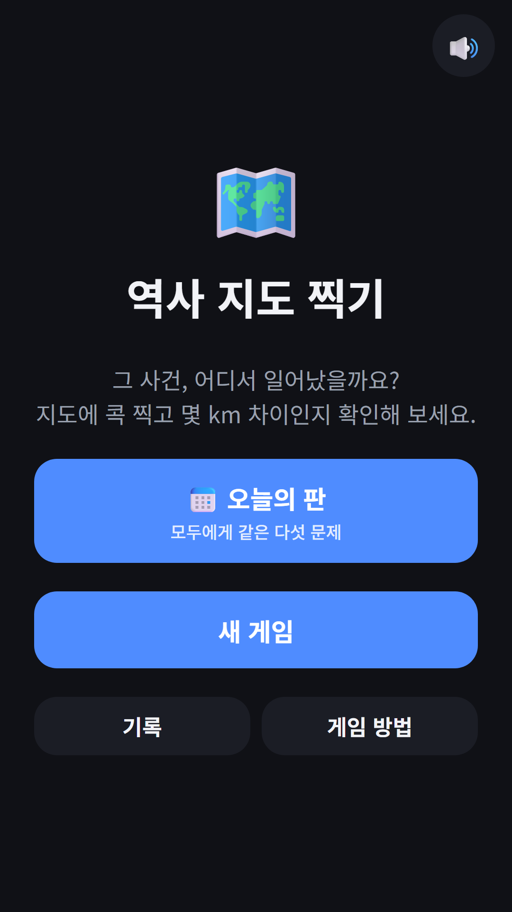
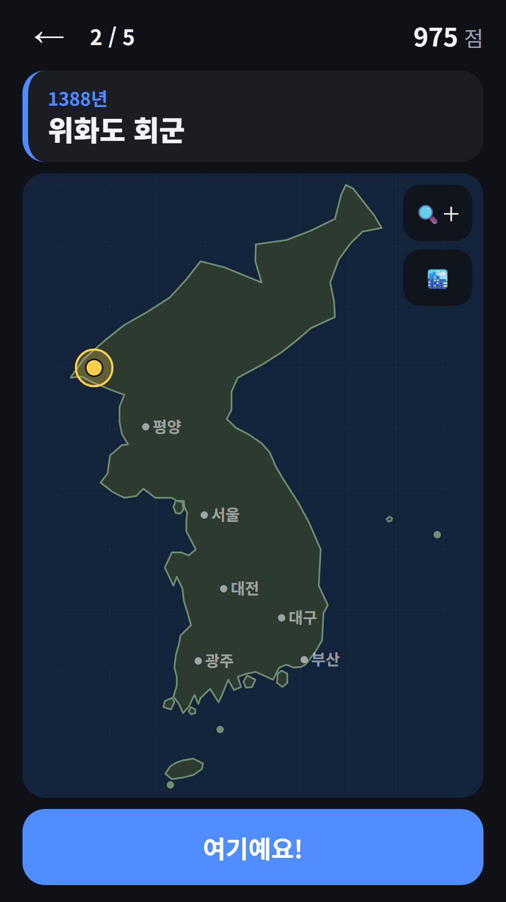
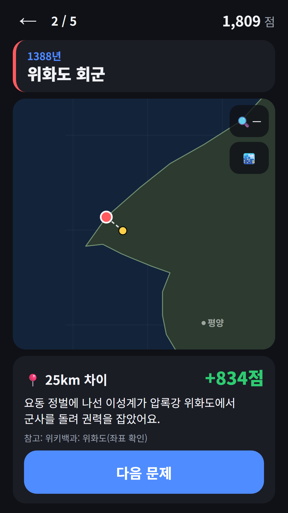
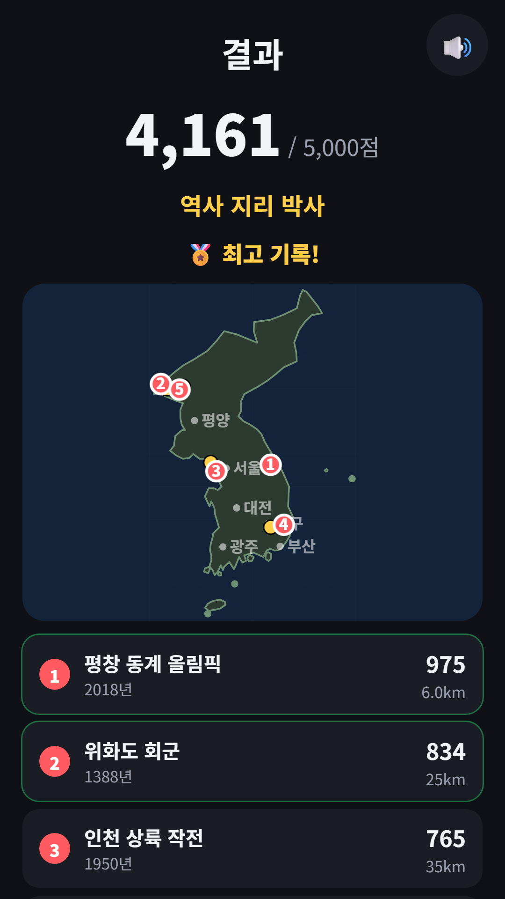

## Info
> **역사 지도 찍기** — 한국사 사건이 일어난 곳을 한반도 지도에 콕 찍고, 실제 위치와의 거리로 점수를 받는 지도 퀴즈예요. Google Play에서 무료, 광고 포함. 토스에서는 [파동권 하루상식](/ko/posts/hub-edu/) 안에서 즐길 수 있어요.
{: .prompt-info }

## 이런 게임입니다
'1388년 위화도 회군'처럼 연도와 사건 이름이 적힌 카드가 나오면, 한반도 지도에서 그 일이 일어난 자리를 눌러 핀을 꽂아요. '여기예요!'를 누르면 실제 위치가 나타나고, 두 점 사이 거리(km)만큼 점수가 정해져요. 연표 외우기와는 다르게 '어디서'를 떠올리게 하는 한국사 퀴즈예요.

## 어떻게 하나요
- 한 판은 5문제, 5,000점 만점이에요. 3km 안으로 찍으면 그 문제는 만점 1,000점이고, 멀어질수록 점수가 줄어요
- 핀은 '여기예요!'를 누르기 전까지 몇 번이든 다시 찍을 수 있어요
- 지도는 돋보기 버튼으로 확대하고, 확대한 채로 끌어서 옮길 수 있어요. 평양·서울·대전 같은 길잡이 도시 표시는 켜고 끌 수 있어요(점수와는 상관없어요)
- 정답이 공개되면 실제 위치와 거리, 한 줄 사실, 참고 문서가 함께 나와요
- 다섯 문제가 끝나면 결과 지도에 다섯 문제의 핀과 정답이 한꺼번에 그려지고, 점수에 따라 칭호를 받아요

## 특징
- 문제는 모두 96개: 한국사 78개, 지리 18개. 위치가 학설마다 갈리는 곳과 국외 유적은 넣지 않았어요
- 오늘의 판: 같은 날에는 누구나 같은 5문제를 풀어요. 연속 기록이 쌓이고, 오늘 점수는 첫 판으로 남아요
- 기록 TOP 10, 하던 판 이어하기
- 원할 때만 보는 보상형 광고로, 한 판에 한 번 정답이 들어 있는 반경 약 60km 원을 볼 수 있어요. 힌트를 쓴 문제는 최대 700점이에요
- 회원가입 없이 바로 할 수 있어요

광고가 포함되어 있습니다(배너·보상형).

{: w="360" }
{: w="360" }
{: w="360" }
{: w="360" }

## 플레이 영상


## Download
- Google Play: <https://play.google.com/store/apps/details?id=com.fadongkwon.geo_history>
- 토스: [파동권 하루상식](/ko/posts/hub-edu/) 안의 '역사 지도 찍기'

{: w="200" .normal }

## 함께 보면 좋은 앱
- [파동권 하루상식](/ko/posts/hub-edu/) — 한국사·경제·맞춤법·사자성어·과학·세계지리 하루 한 문제와 역사 지도 찍기·한글 연금술을 한 앱에 모은 허브
- [매일 한국사](/ko/posts/daily-history/) — 하루 한 문제로 다시 만나는 한국사
- [매일 세계지리](/ko/posts/daily-geo/) — 하루 한 문제로 넓히는 세계지리 상식

소식은 이 블로그와 [인스타그램(@fadongkwon.soft)](https://www.instagram.com/fadongkwon.soft/)에서 전해드립니다.
