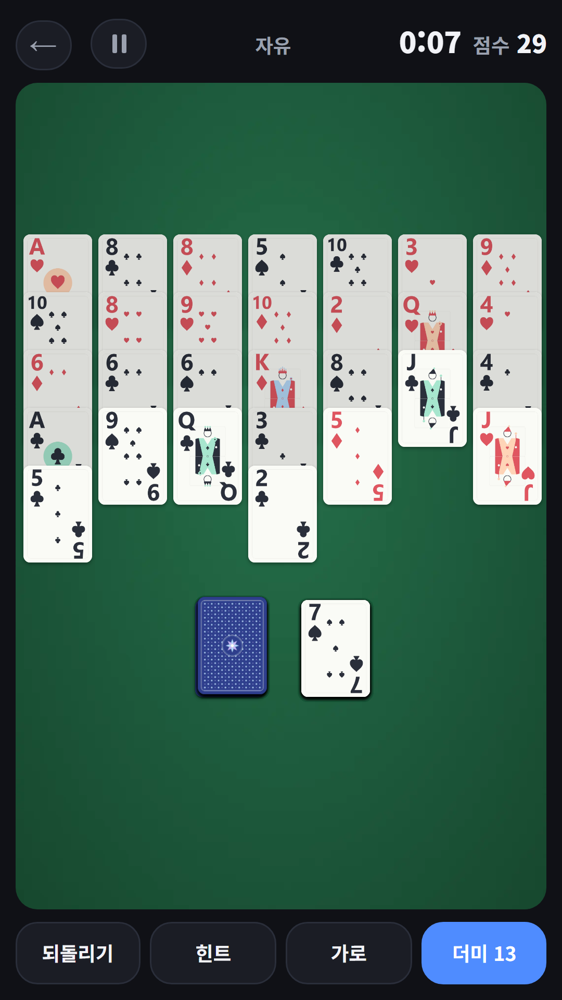
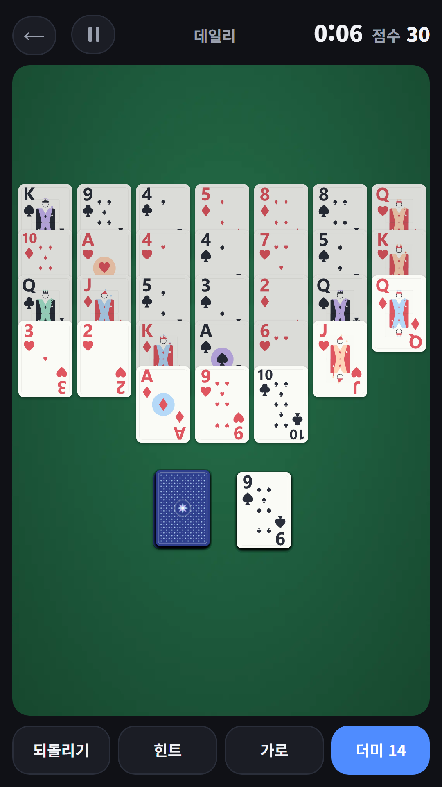
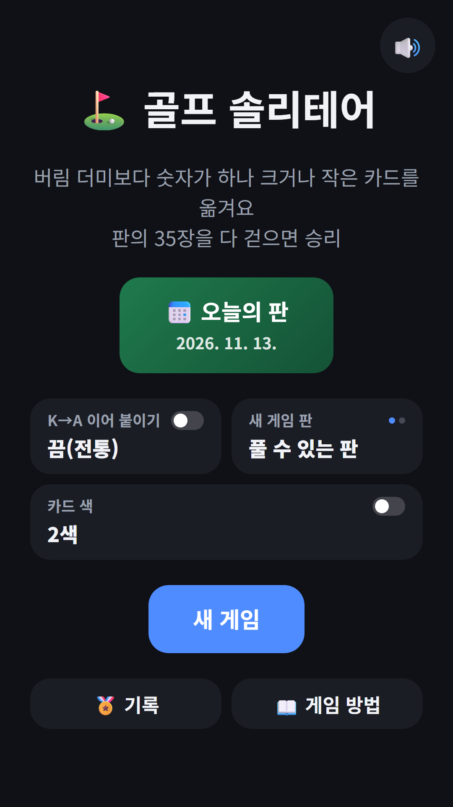
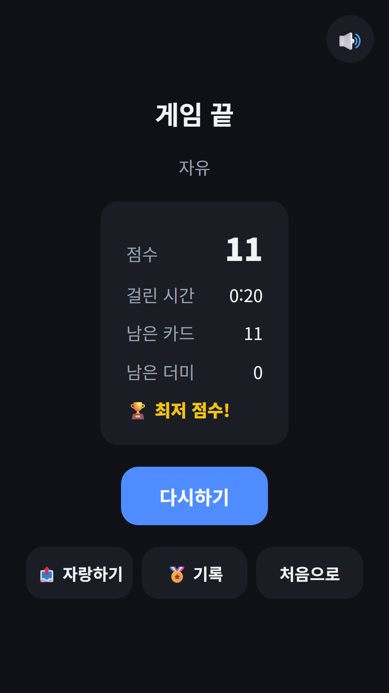
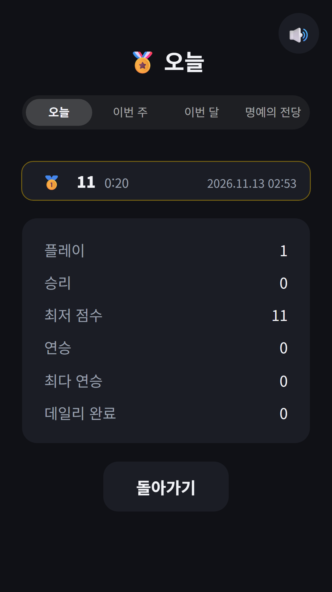

## Info
> **골프 솔리테어** — 버림 더미보다 한 끗 높거나 낮은 카드를 눌러 판의 35장을 모두 걷어 내는 클래식 카드 게임이에요. Google Play에서 무료, 광고 포함. 카드 게임 모음 앱 [파동권 카드놀이](/ko/posts/hub-card/)(Google Play)에도 들어 있어요.
{: .prompt-info }

## 이런 게임입니다
판에는 카드가 7열 × 5장, 35장이 모두 앞면으로 펼쳐져 있어요. 버림 더미 맨 위 카드보다 숫자가 하나 크거나 작은 카드를 누르면 버림 더미로 옮겨 가요. 무늬는 상관없어서 7 위에는 6이나 8을 놓을 수 있어요. 7-6-5-6-7처럼 오르내리며 길게 이어 갈수록 판이 빨리 비워져요. 점수는 골프처럼 낮을수록 좋아요.

## 어떻게 하나요
- 열마다 맨 앞(맨 아래) 카드만 옮길 수 있어요. 탭 한 번이면 버림 더미로 가요
- 옮길 카드가 없으면 더미를 눌러 한 장을 넘겨요. 더미는 다시 돌리지 않아요
- K 위에는 아무것도 놓을 수 없어요. 홈의 'K→A 이어 붙이기'를 켜면 K 다음에 A·Q, A 다음에 K·2를 놓을 수 있어요(오늘의 판은 늘 전통 규칙)
- 끝났을 때 판에 남은 카드 수가 점수예요. 35장을 다 걷으면 0점에서 남은 더미 장수만큼 빼요(더미 3장이 남으면 −3점)
- 더 둘 곳이 없으면 되돌리기·점수 확인·새 판 중에 골라요

## 특징
- 풀 수 있는 판만: 오늘의 판과 새 게임은 풀이기로 끝까지 풀리는지 확인한 판만 나와요. 원하면 무작위 판으로 바꿀 수 있어요
- 오늘의 판: 같은 날에는 누구나 같은 판으로 겨루고, 연속 일수가 쌓여요
- 힌트를 누르면 지금 옮길 수 있는 카드가 깜빡여요. 되돌리기도 있어요
- 기록: 오늘·이번 주·이번 달·명예의 전당 점수 순위와 플레이·승리·최저 점수·연승 통계
- 또렷한 카드 그림, 4색 덱 선택, 세로·가로 화면, 하던 판 이어하기
- 회원가입 없이 바로 할 수 있어요

광고가 포함되어 있습니다(배너).

{: w="360" }
{: w="360" }
{: w="360" }
{: w="360" }
{: w="360" }

## 플레이 영상


## Download
- Google Play: <https://play.google.com/store/apps/details?id=com.fadongkwon.golf_solitaire>
- 카드 게임 모음: [파동권 카드놀이](/ko/posts/hub-card/)(Google Play) 안의 '골프 솔리테어'

{: w="200" .normal }

## 함께 보면 좋은 앱
- [파동권 카드놀이](/ko/posts/hub-card/) — 솔리테어·프리셀·스파이더·피라미드·골프 솔리테어·트라이픽스를 한 앱에 모은 카드 게임 허브
- [피라미드](/ko/posts/pyramid/) — 합이 13인 두 장을 짝지어 비우는 카드 게임
- [솔리테어](/ko/posts/solitaire/) — 윈도우에서 하던 그 클론다이크

소식은 이 블로그와 [인스타그램(@fadongkwon.soft)](https://www.instagram.com/fadongkwon.soft/)에서 전해드립니다.
