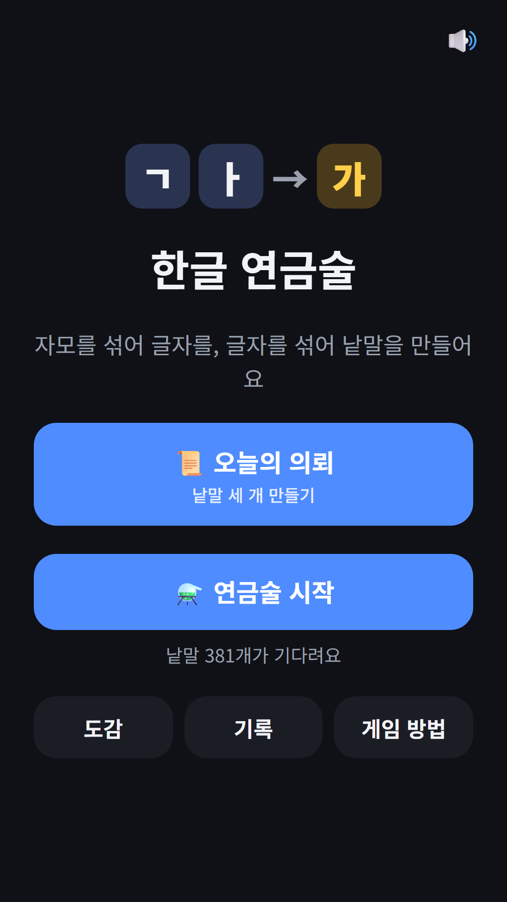
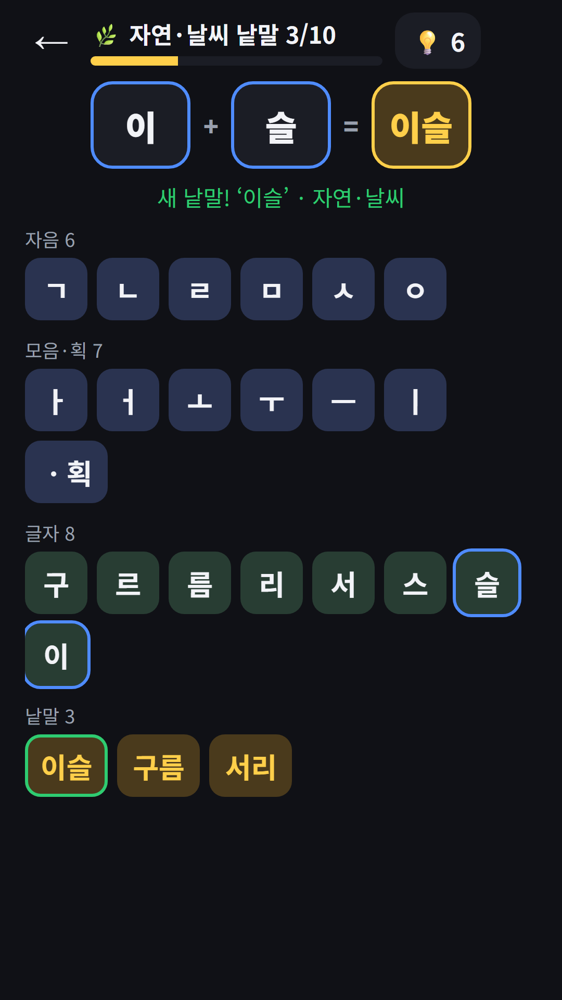
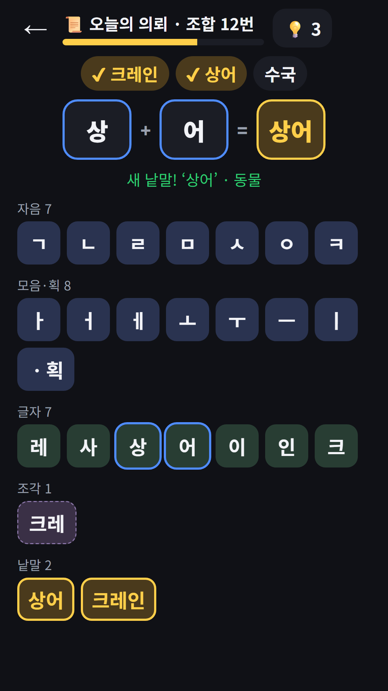
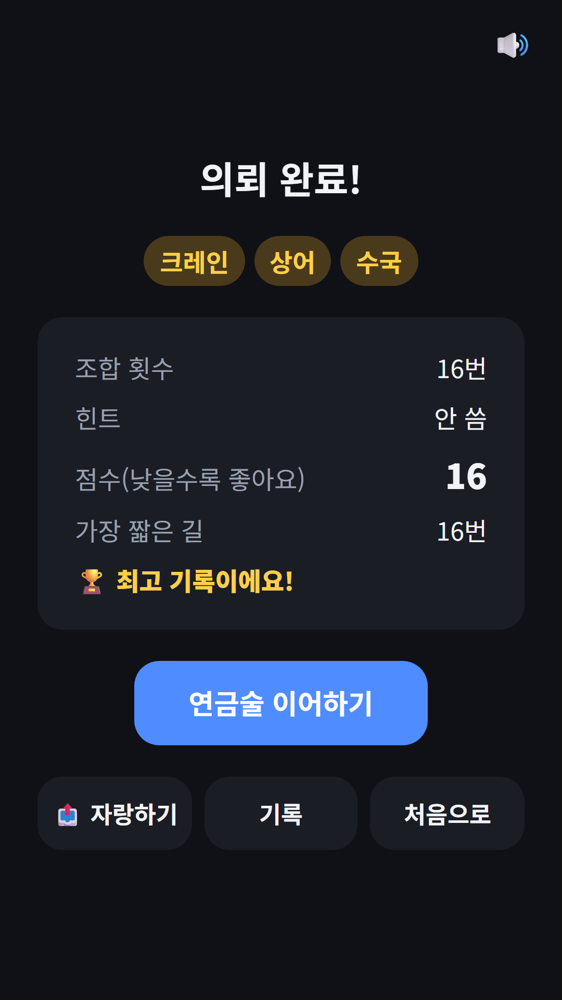

## Info
> **한글 연금술** — 자모를 섞어 글자를, 글자를 섞어 실제 낱말을 만들어 도감을 채우는 한글 발견 게임이에요. Google Play에서 무료, 광고 포함. 토스에서는 [파동권 하루상식](/ko/posts/hub-edu/) 안에서 즐길 수 있어요.
{: .prompt-info }

## 이런 게임입니다
원소를 섞어 새 원소를 찾아내는 연금술 게임을 한글로 옮겼어요. 처음에는 자음 6개(ㄱ ㄴ ㄹ ㅁ ㅅ ㅇ), 모음 6개(ㅏ ㅓ ㅗ ㅜ ㅡ ㅣ), 그리고 획 하나뿐이에요. ㄱ에 획을 더하면 ㅋ, ㄱ과 ㅏ를 섞으면 '가'가 되고, '이'와 '슬'을 섞으면 '이슬'이라는 낱말이 나와요. 도감에 있는 낱말은 모두 실제로 쓰는 일상 낱말이에요.

## 어떻게 하나요
- 재료 두 개를 차례로 누르면 작업대에서 섞여요. 재료를 끌어다 다른 재료 위에 놓아도 돼요
- 자모끼리: 획을 더해 ㄴ→ㄷ→ㅌ, ㅅ→ㅈ→ㅊ처럼 새 자음을 만들고, 같은 자음 둘은 쌍자음, 모음 둘은 겹모음, 받침 둘은 겹받침이 돼요
- 자음과 모음을 섞으면 받침 없는 글자, 거기에 자음을 더하면 받침 있는 글자가 돼요
- 글자 두 개를 섞으면 두 글자 낱말이 되고, 세 글자 낱말은 앞 두 글자 '조각'에 글자를 하나 더 섞어 만들어요
- 낱말이 안 되는 조합도 조합 1번으로 세요. 막히면 힌트를 눌러요. 다음 한 단계에 쓸 재료를 하나 알려 주고, 한 번 더 누르면 나머지 재료도 알려 줘요

## 특징
- 연금술(자유 모드): 자연·날씨, 동물, 과일·채소, 음식, 식물·꽃, 생활용품, 탈것까지 7개 주제를 차례로, 주제마다 낱말 10개가 목표예요. 자동 저장되고, 힌트는 처음 3개에 새 낱말을 찾을 때마다 1개씩 늘어요
- 오늘의 의뢰: 서로 다른 주제에서 고른 낱말 3개를 처음 재료부터 만들어요. 점수는 조합 횟수에 힌트 1개당 3을 더한 값이라 낮을수록 좋고, 결과에서 가장 짧은 길과 비교해 볼 수 있어요
- 7개 주제 일상 낱말 381개를 모으는 도감, 기록 화면과 오늘의 의뢰 연속 일수
- 힌트를 다 쓰면 원할 때만 보는 보상형 광고로 힌트를 하나 더 받을 수 있어요(연금술은 주제마다 한 번, 오늘의 의뢰는 하루 한 번)
- 회원가입 없이 바로 할 수 있어요

광고가 포함되어 있습니다(배너·보상형).

{: w="360" }
{: w="360" }
{: w="360" }
{: w="360" }

## 플레이 영상


## Download
- Google Play: <https://play.google.com/store/apps/details?id=com.fadongkwon.hangul_alchemy>
- 토스: [파동권 하루상식](/ko/posts/hub-edu/) 안의 '한글 연금술'

{: w="200" .normal }

## 함께 보면 좋은 앱
- [파동권 하루상식](/ko/posts/hub-edu/) — 하루 한 문제 상식 퀴즈 6과목과 역사 지도 찍기·한글 연금술을 한 앱에 모은 허브
- [단어 맞추기](/ko/posts/hangul-word/) — 여섯 자모로 한글 단어를 추리하는 한글 워들
- [초성 퀴즈](/ko/posts/chosung-quiz/) — 초성만 보고 단어를 맞혀요

소식은 이 블로그와 [인스타그램(@fadongkwon.soft)](https://www.instagram.com/fadongkwon.soft/)에서 전해드립니다.
