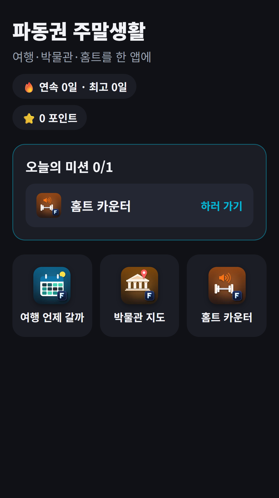
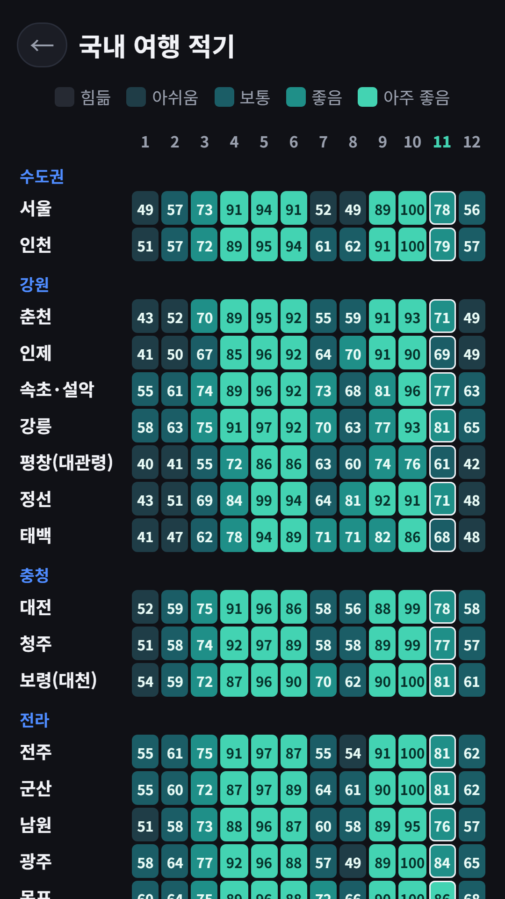
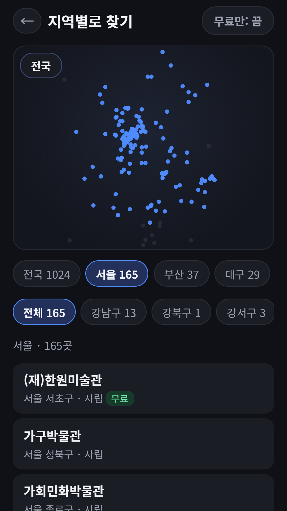
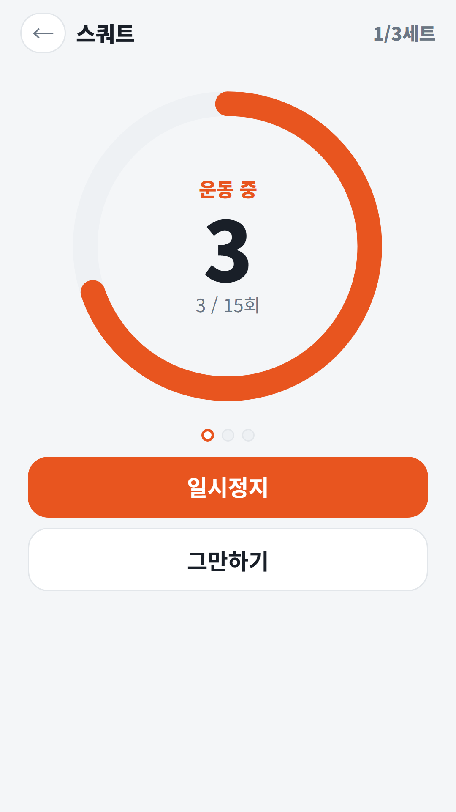

## Info
> **파동권 주말생활 · Weekend Life** — 여행 시기, 박물관 찾기, 홈트를 한 앱에 모은 생활 도구 모음. Google Play에서 무료, 광고 포함. 토스 미니앱으로도 쓸 수 있어요.
{: .prompt-info }

## 이런 앱입니다
주말에 어디 갈지, 뭘 할지 정할 때 쓰는 도구 세 가지를 한 앱에 모은 **허브 앱**이에요. 이번 달 여행하기 좋은 곳을 보고, 가까운 박물관·미술관을 찾고, 집에서는 목소리에 맞춰 운동할 수 있어요. 홈에서 세 앱을 바로 열고, 앱 안에서 뒤로가기를 누르면 다시 홈으로 돌아와요.

## 어떻게 쓰나요
- 홈에 **오늘의 미션** 하나가 나와요. 세 앱 중 하나이고, '하러 가기'로 바로 들어가요
- 매일 오늘의 할 일을 마치면 **연속 기록**이 쌓여요. 홈에서 연속·최고 기록과 포인트를 볼 수 있어요
- 홈 아래 타일 세 개로 여행 언제 갈까·박물관 지도·홈트 카운터를 언제든 열 수 있어요

## 수록된 앱 3종
- [여행 언제 갈까](/ko/posts/travel-season/) — 국내 32곳·해외 28곳의 1~12월을 기상청·각국 기상청의 1991~2020 평년 기온·강수량으로 점수 매긴 여행 달력이에요. 지역마다 근거 표와 출처를 보여 주고, 두 곳을 나란히 비교할 수 있어요
- 박물관 지도 — 공공데이터포털 「전국박물관미술관정보표준데이터」로 만든 전국 박물관·미술관 1,024곳 목록이에요. 시·도와 시·군·구로 좁혀 찾고, 무료인 곳만 볼 수 있어요. 상세 화면에서 주소·운영시간·휴관일·관람료·교통을 확인하고, 다녀온 곳에 **방문 도장**을 찍어 도장 수첩에 모아요
- 홈트 카운터 — 스쿼트·팔굽혀펴기·플랭크 등 9가지 운동의 횟수·세트·쉬는 시간을 목소리로 세어 줘요. 정한 박자대로 세어 주니 화면을 안 봐도 돼요

박물관 지도의 **내 주변 찾기**는 버튼을 누르고 위치 권한을 허용했을 때만 위치를 써요. 위치는 이 기기 안에서 거리 계산에만 쓰고 저장하거나 보내지 않아요.

여행 점수는 30년 평년값으로 계산한 참고값이라 올해 날씨와 다를 수 있어요. 박물관 정보는 공공데이터 기준이라 방문 전에 운영 여부를 한 번 더 확인해 주세요.

## 토스에는 기존 앱 자리로
토스 워크스페이스는 앱이 [50개까지만](/ko/posts/toss-workspace-50-limit/) 들어가서, 이 허브도 [다른 허브들처럼](/ko/posts/toss-hub-conversion/) 새로 등록하지 않고 기존 앱 **차번호 로또**의 앱 정보와 번들을 파동권 주말생활로 바꿨어요. 차번호 로또 기능은 [파동권 행운연구소](/ko/posts/hub-fortune/) 안에 그대로 있어요.

회원가입 없이 쓸 수 있어요. 광고가 포함되어 있습니다(화면 하단 배너와, 원할 때만 보는 보상형 광고).

{: w="360" }
{: w="360" }
{: w="360" }
{: w="360" }

## 사용 영상


## Download
- Google Play: <https://play.google.com/store/apps/details?id=com.fadongkwon.hub_weekend>
- 앱인토스(토스 미니앱): <https://fadongkwon.com/toss/hub-weekend/> — 휴대폰에서 열면 토스 앱으로 바로 연결됩니다. 기존 앱 자리를 이어받아 출시했습니다([전환 이야기](/ko/posts/toss-hub-conversion/)).

{: w="200" .normal }

## 함께 보면 좋은 앱
- [매일 두뇌 체조](/ko/posts/senior-brain/) — 점수·순위·제한 시간 없이 하루 네 종목을 천천히 푸는 퍼즐 앱
- [파동권 뇌나이](/ko/posts/hub-brain/) — 단어, 기억, 순서, 반응, 집중 5가지 게임으로 오늘의 두뇌 상태를 기록하는 허브

소식은 이 블로그와 [인스타그램(@fadongkwon.soft)](https://www.instagram.com/fadongkwon.soft/)에서 전해드립니다.
