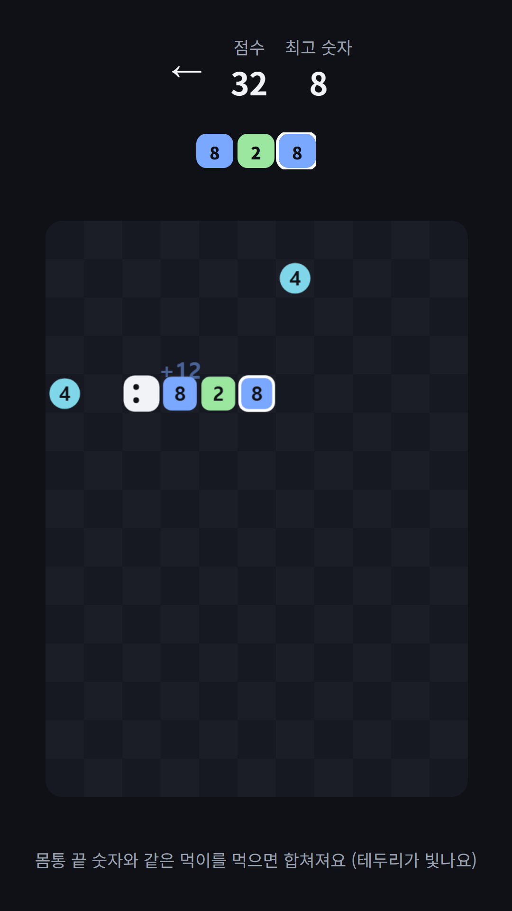
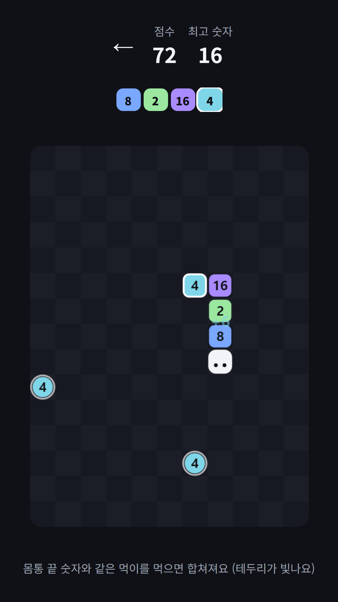
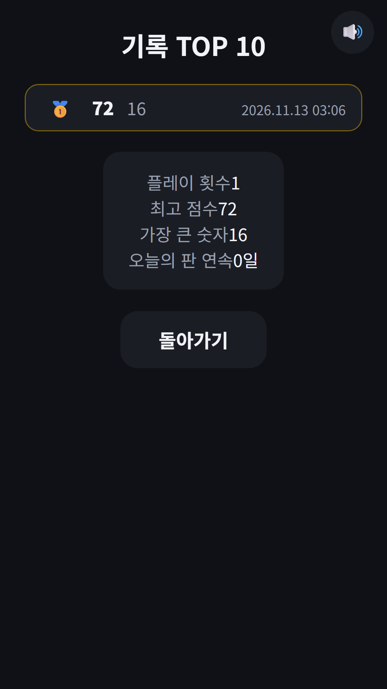

## Info
> **숫자 뱀** — 숫자를 먹고 같은 숫자끼리 합쳐 짧아지는 뱀 게임이에요. Google Play에서 무료, 광고 포함. 토스에서는 [파동권 오락실](/ko/posts/hub-arcade/) 안에서 즐길 수 있어요.
{: .prompt-info }

## 이런 게임입니다
뱀 게임과 2048을 섞었어요. 머리에는 숫자가 없고, 몸통 칸마다 숫자가 있어요. 판 위의 숫자 먹이를 먹으면 몸통 맨 끝에 그 숫자가 붙고, 끝에서부터 같은 숫자끼리 2048처럼 두 배로 합쳐져요. 합쳐질 때마다 뱀이 짧아지니, 길어지기만 하는 뱀 게임과 달리 어떤 먹이를 먼저 먹을지 고르는 재미가 있어요.

## 어떻게 하나요
- 화면을 밀어(스와이프) 방향을 바꿔요. 처음 밀면 출발해요
- 몸통 끝 숫자와 같은 먹이는 테두리가 빛나요. 그 먹이를 먹으면 바로 합쳐져요
- 합치기는 연쇄로 이어져요. 몸통이 8·4·2일 때 2를 먹으면 한 번에 16 하나가 돼요
- 벽이나 내 몸통에 부딪히면 끝이에요
- 한 판에 한 번, 원하면 광고를 보고 판 위 먹이 둘을 새로 뽑을 수 있어요

## 특징
- 11×15 판에 먹이는 늘 두 개. 2나 4가 나오고, 가장 큰 숫자가 32 이상이 되면 8도 가끔 나와요
- 점수는 먹은 숫자와 합쳐진 값의 합이에요. 가장 큰 숫자가 커질수록 뱀이 조금씩 빨라져요
- 오늘의 판: 같은 날에는 누구나 같은 먹이로 겨뤄요
- 하던 판 이어하기, 최고 점수 TOP 10과 플레이 횟수·가장 큰 숫자·오늘의 판 연속 기록
- 9개 언어, 회원가입 없이 바로 할 수 있어요

광고가 포함되어 있습니다(배너·보상형).

{: w="360" }
{: w="360" }
{: w="360" }
{: w="360" }
{: w="360" }

## 플레이 영상


## Download
- Google Play: <https://play.google.com/store/apps/details?id=com.fadongkwon.snake_2048>
- 토스: [파동권 오락실](/ko/posts/hub-arcade/) 안의 '숫자 뱀'

{: w="200" .normal }

## 함께 보면 좋은 앱
- [파동권 오락실](/ko/posts/hub-arcade/) — 벽돌깨기·뱀 게임·두더지 잡기·숫자 뱀 등 짧게 즐기는 오락실 허브
- [뱀 게임](/ko/posts/snake/) — 먹이를 먹고 길어지는 클래식
- [2048](/ko/posts/game-2048/) — 숫자를 합쳐 2048 타일을 만드는 퍼즐

소식은 이 블로그와 [인스타그램(@fadongkwon.soft)](https://www.instagram.com/fadongkwon.soft/)에서 전해드립니다.
