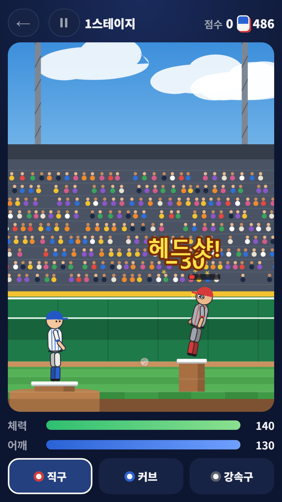
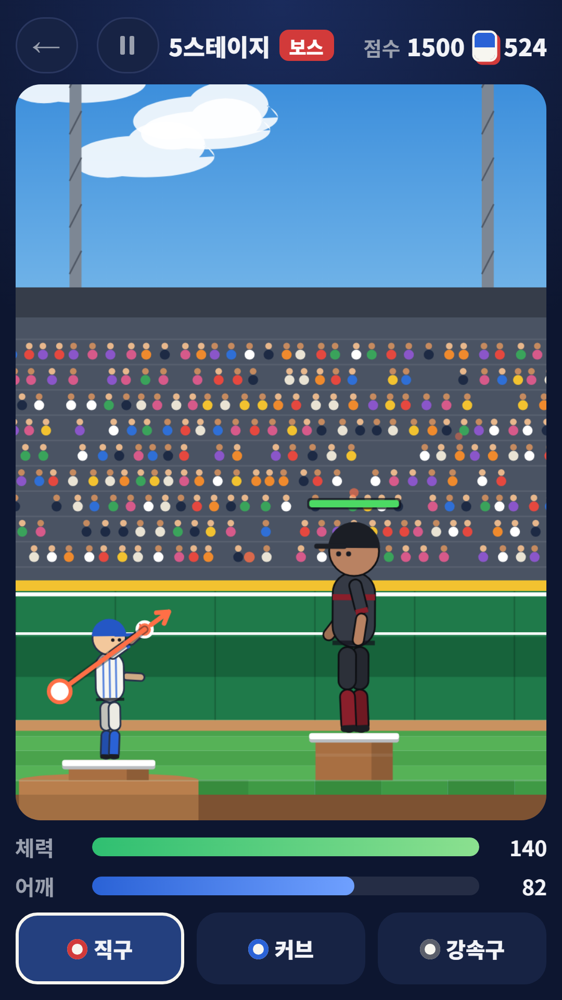
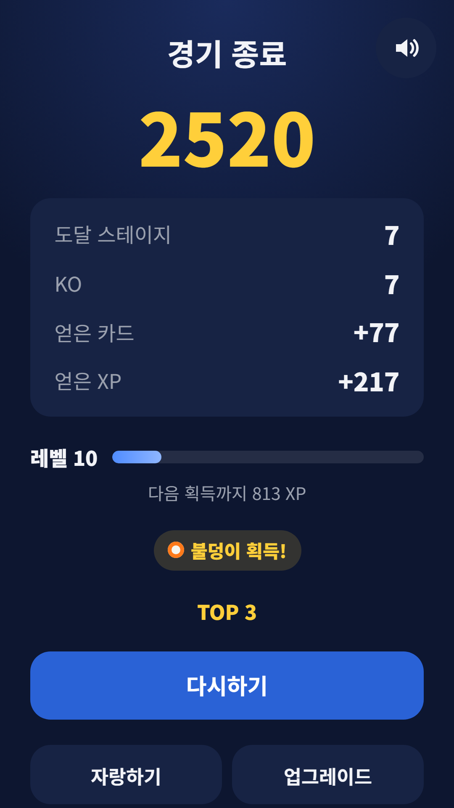
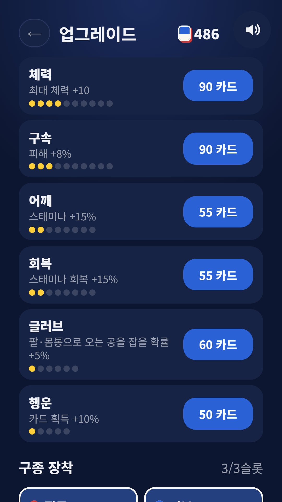
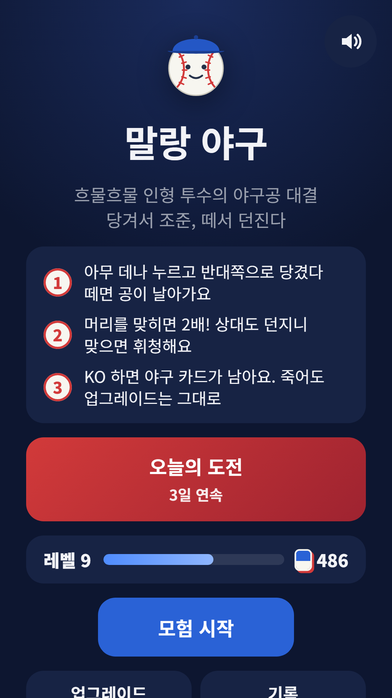

## Info
> **말랑 야구** — 흐물흐물한 인형 투수가 되어 상대 인형과 1:1 야구공 대결을 벌여요. Google Play에서 무료, 광고 포함. 토스에서는 [파동권 올림픽](/ko/posts/hub-sports/) 안에서 즐길 수 있어요.
{: .prompt-info }

## 이런 게임입니다
화면 아무 데나 누르고 반대쪽으로 당겨 조준, 손을 떼면 공이 날아가요. 상대도 공을 던지니 맞으면 휘청하고, 체력이 바닥나면 털썩 쓰러져요. 래그돌 물리라서 맞은 인형의 팔다리가 흐느적 꺾이는 게 이 게임의 재미예요. 머리를 맞히면 피해가 2배라서 헤드샷을 노리게 돼요.

## 어떻게 하나요
- 멀리 당길수록 빠른 공이 나가요. 점선으로 공이 날아갈 길을 미리 보여 줘요
- 당기고 있으면 어깨 스태미나가 줄어요. 20% 아래로 떨어지면 공이 느려지니 타이밍이 중요해요
- 상대를 KO 하면 다음 스테이지로 넘어가고, 5스테이지마다 거인 보스가 나와요
- KO 할 때마다 야구 카드와 XP 가 쌓여요. 져도 그대로 남아요
- 쓰러졌을 때 광고를 보고 한 판에 한 번 다시 일어날 수 있어요

## 특징
- 구종 7가지: 직구·커브·포크볼·강속구·너클볼·불덩이·쌍둥이공. 레벨이 오르면 얻고, 최대 3개까지 장착해요
- 영구 업그레이드 6종: 체력·구속·어깨·회복·글러브·행운
- 갈수록 새로운 상대: 장비로 머리·몸통을 지키는 포수, 공을 되받아치는 타자, 빠르고 정확한 에이스
- 오늘의 도전: 같은 날에는 누구나 같은 상대 배치로 겨뤄요
- 회원가입 없이 바로 할 수 있어요

광고가 포함되어 있습니다(배너·전면·보상형).

{: w="360" }
{: w="360" }
{: w="360" }
{: w="360" }
{: w="360" }

## 플레이 영상


## Download
- Google Play: <https://play.google.com/store/apps/details?id=com.fadongkwon.wobbly_baseball>
- 토스: [파동권 올림픽](/ko/posts/hub-sports/) 안의 '야구'

{: w="200" .normal }

## 함께 보면 좋은 앱
- [파동권 올림픽](/ko/posts/hub-sports/) — 골프·당구·탁구·볼링·양궁·농구·야구를 한 앱에 모은 스포츠 허브
- [파괴왕 공성전](/ko/posts/castle-topple/) — 대포 한 발에 성이 와르르 무너지는 물리 게임
- [농구 슛](/ko/posts/hoop-shot/) — 밀어 올려 던지는 60초 3점슛 챌린지

소식은 이 블로그와 [인스타그램(@fadongkwon.soft)](https://www.instagram.com/fadongkwon.soft/)에서 전해드립니다.
