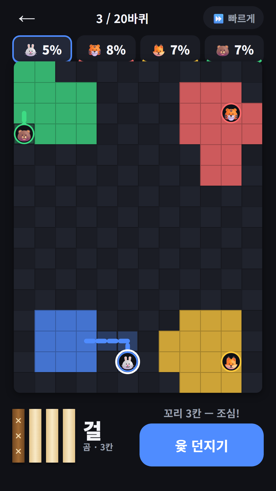
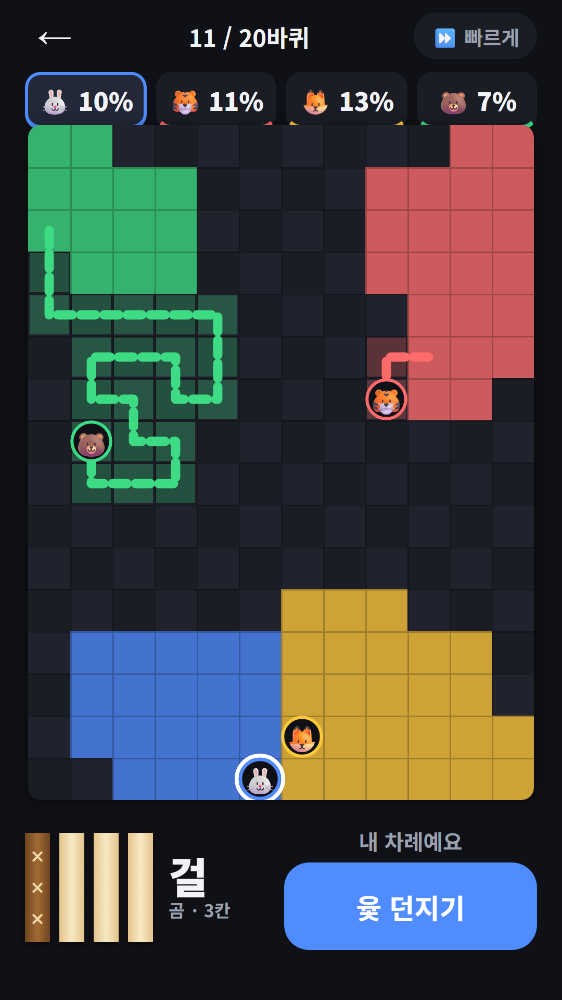
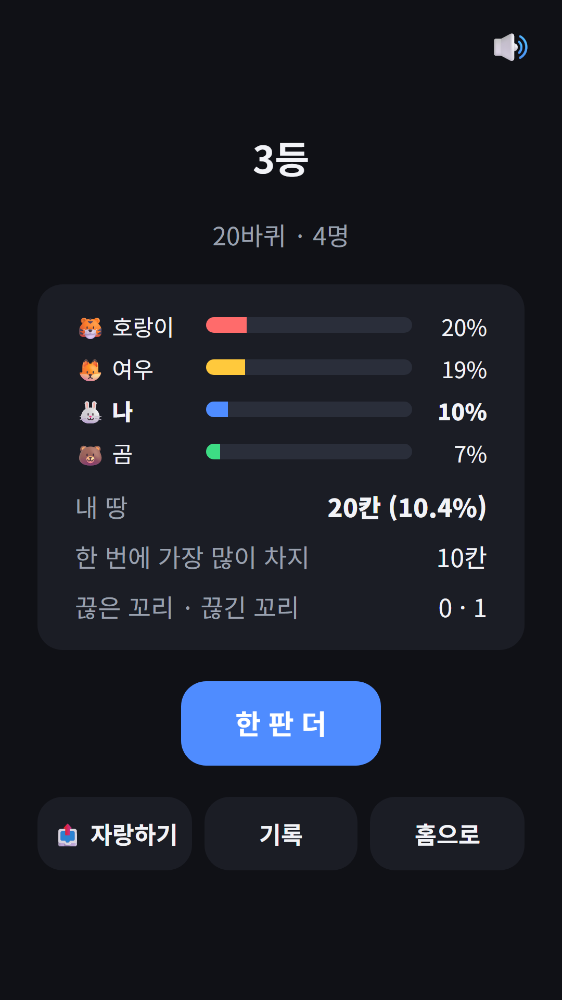
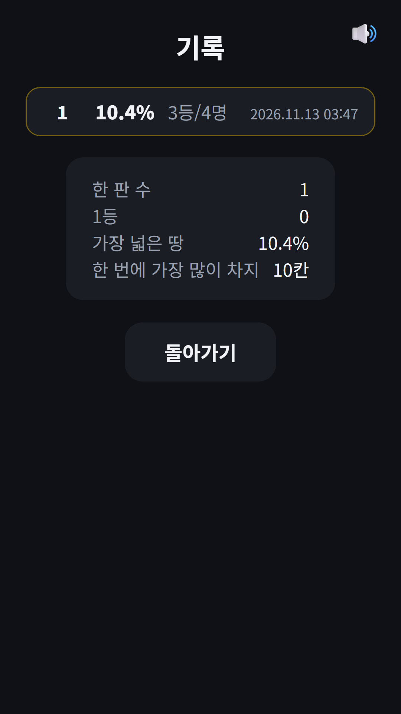
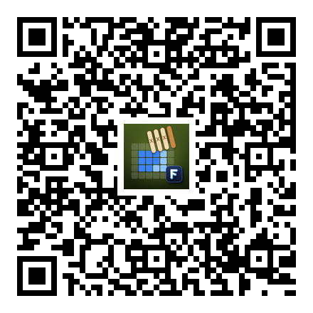

## Info
> **윷 땅따먹기** — 윷을 던진 만큼 꼬리를 끌고 나갔다가 내 땅으로 돌아오면, 둘러싼 칸이 모두 내 땅이 되는 턴제 땅따먹기 게임이에요. Google Play에서 무료, 광고 포함. 토스에서는 [파동권 한판승부](/ko/posts/hub-board/) 안에서 즐길 수 있어요.
{: .prompt-info }

## 이런 게임입니다
윷놀이와 땅따먹기를 섞었어요. 12×16 판에서 나(토끼)와 AI 상대 2~3명(호랑이·여우·곰)이 저마다 3×3 집 땅에서 시작해요. 윷을 던져 나온 칸 수만큼 한 칸씩 방향을 골라 움직이는데, 내 땅 밖으로 나가면 지나간 자리에 꼬리가 남아요. 꼬리를 끌고 내 땅으로 무사히 돌아오면 꼬리와 그 안에 둘러싼 칸이 한꺼번에 내 땅이 돼요. 크게 돌수록 많이 얻지만, 그동안 꼬리가 길게 드러나 있어 위험해요.

## 어떻게 하나요
- '윷 던지기'를 누르면 윷 네 가락이 나와요: 빽도·도·개·걸·윷·모. 윷과 모가 나오면 한 번 더 던져요
- 나온 칸 수만큼 한 칸씩 방향을 골라요. 판에서 갈 수 있는 칸을 누르거나 방향 버튼을 써요. 나온 칸 수는 다 써야 해요
- 내 꼬리는 다시 밟을 수 없어요. 빽도가 나오면 꼬리를 한 칸 거둬들여요
- 둘러싼 칸에 남의 땅이 있으면 그것도 빼앗아요. 고리를 닫는 칸에는 ✔, 남의 꼬리에는 ✂ 표시가 나와요
- 남의 꼬리를 밟으면 끊어지고, 그 말은 가장 가까운 자기 땅으로 돌아가요. 내 꼬리도 똑같이 끊길 수 있어요
- 발밑 땅을 빼앗기면 가장 가까운 내 땅으로 옮겨지고, 땅이 하나도 없으면 탈락이에요
- 20바퀴가 끝났을 때 땅이 가장 넓은 사람이 1등이에요

## 특징
- 상대 2명 또는 3명을 골라요. 상대 차례는 '빠르게'로 넘길 수 있어요
- 오늘의 판: 같은 날에는 누구나 같은 윷이 나와요(4명 대결)
- 결과 화면에 순위와 내 땅 비율, 한 번에 가장 많이 차지한 칸 수, 끊은 꼬리·끊긴 꼬리
- 기록: 내 땅 비율 TOP 10과 한 판 수·1등·가장 넓은 땅·한 번에 가장 많이 차지 통계
- 하던 판 이어하기, 9개 언어, 회원가입 없이 바로 할 수 있어요
- 한 판에 한 번, 내가 던진 직후 원하면 광고를 보고 윷을 다시 던질 수 있어요

광고가 포함되어 있습니다(배너·보상형).

{: w="360" }
{: w="360" }
{: w="360" }
{: w="360" }
{: w="360" }

## 플레이 영상


## Download
- Google Play: <https://play.google.com/store/apps/details?id=com.fadongkwon.yut_territory>
- 토스: [파동권 한판승부](/ko/posts/hub-board/) 안의 '윷 땅따먹기'

{: w="200" .normal }

## 함께 보면 좋은 앱
- [파동권 한판승부](/ko/posts/hub-board/) — 장기·바둑·오목·윷 땅따먹기 등 컴퓨터와 겨루는 보드게임을 한 앱에 모은 허브
- [윷놀이](/ko/posts/yut-nori/) — 말을 업고 지름길로 먼저 나가는 우리 전통 윷놀이
- [오목](/ko/posts/gomoku/) — 다섯 알을 먼저 잇는 사람이 이기는 게임

소식은 이 블로그와 [인스타그램(@fadongkwon.soft)](https://www.instagram.com/fadongkwon.soft/)에서 전해드립니다.
