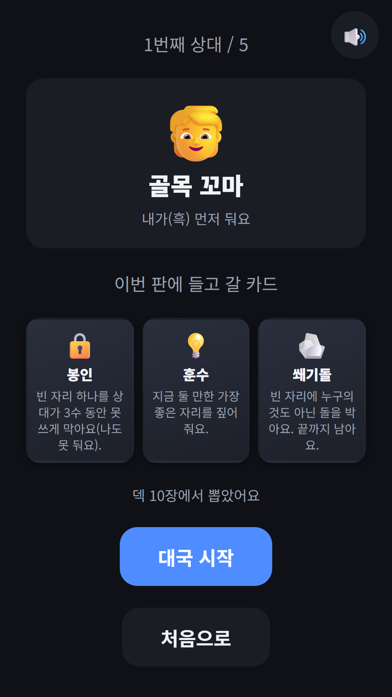
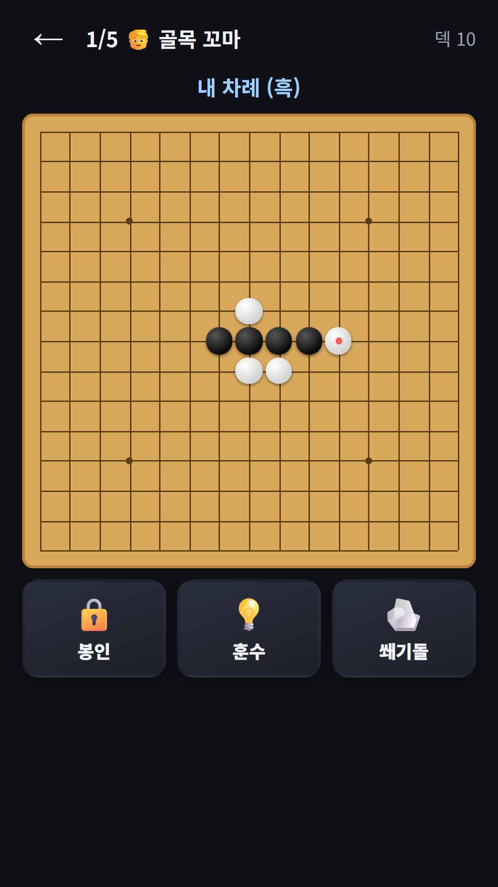
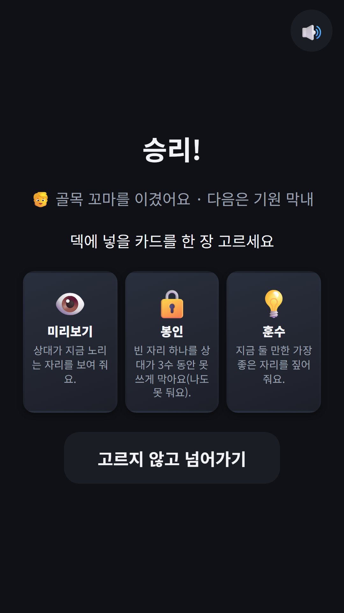
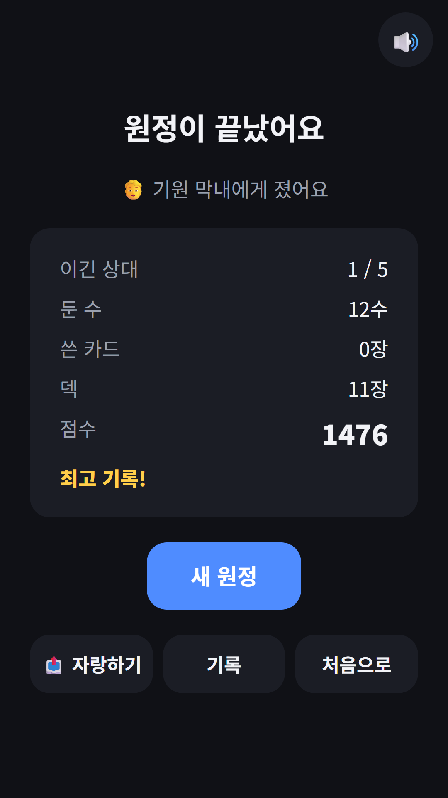
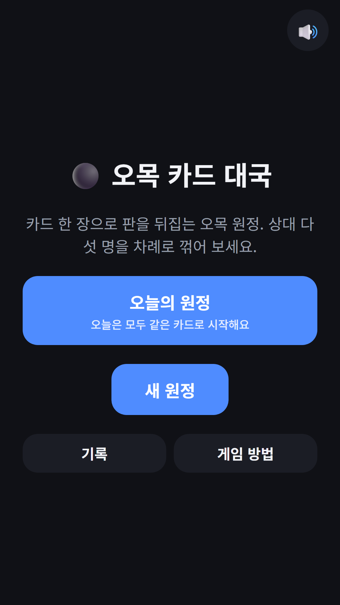

## Info
> **오목 카드 대국** — 일회용 능력 카드로 오목 고수 5명을 차례로 꺾는 로그라이크 오목이에요. Google Play에서 무료, 광고 포함. 토스에서는 [파동권 한판승부](/ko/posts/hub-board/) 안에서 즐길 수 있어요.
{: .prompt-info }

## 이런 게임입니다
오목에 로그라이크를 더했어요. 15×15 판에서 나는 흑돌, 상대는 백돌이에요. 상대 5명을 차례로 만나는 한 번의 원정이고, 판마다 내 덱에서 카드 3장을 뽑아 돌을 두기 전에 한 장씩 쓸 수 있어요. 이기면 새 카드 3장 중 1장을 덱에 추가하고, 지면 원정이 끝나요.

## 어떻게 하나요
- 정확히 5목을 만들어야 이겨요. 6목 이상은 나와 상대 모두 승리가 아니에요
- 판마다 처음 덱 10장에서 3장을 뽑아요. 판 소개 화면에서 상대와 손패를 먼저 볼 수 있어요
- 내 차례에 카드는 한 장, 돌을 두기 전에 써요. 쓸 수 있는 자리만 반짝여요
- 이기면 새 카드 3장 중 1장을 덱에 더해요(건너뛰어도 돼요). 비기면 같은 상대와 다시 겨뤄요
- 광고를 보면 판 시작 전에 손패를 다시 뽑거나, 진 직후 같은 상대와 한 판 더 할 수 있어요(각각 원정당 한 번)

## 특징
- 카드 10종: 돌 지우기, 연속 두기, 3수 봉인, 되돌리기, 바람, 미리보기, 물들이기, 폭탄, 쐐기돌, 훈수
- 상대 5명: 골목 꼬마, 기원 막내, 동네 사범(상대가 먼저 둠), 묵향 노인(카드를 2장만 들고 시작), 흑룡 명인(돌 지우기·물들이기·폭탄이 듣지 않는 단단한 돌)
- 점수는 이긴 상대 수, 둔 수에 따른 보너스, 완주 보너스로 정해져요
- 오늘의 원정: 같은 날에는 누구나 같은 원정으로 겨뤄요
- 하던 원정 이어하기, 기록 TOP 10
- 9개 언어, 회원가입 없이 바로 할 수 있어요

광고가 포함되어 있습니다(배너·보상형).

{: w="360" }
{: w="360" }
{: w="360" }
{: w="360" }
{: w="360" }

## Download
- Google Play: <https://play.google.com/store/apps/details?id=com.fadongkwon.board_cards>
- 토스: [파동권 한판승부](/ko/posts/hub-board/) 안의 '오목 카드 대국'

{: w="200" .normal }

## 함께 보면 좋은 앱
- [파동권 한판승부](/ko/posts/hub-board/) — 오목·장기·체스·오목 카드 대국 등 보드게임을 모은 허브
- [오목](/ko/posts/gomoku/) — 기본 규칙으로 두는 클래식 오목

소식은 이 블로그와 [인스타그램(@fadongkwon.soft)](https://www.instagram.com/fadongkwon.soft/)에서 전해드립니다.
