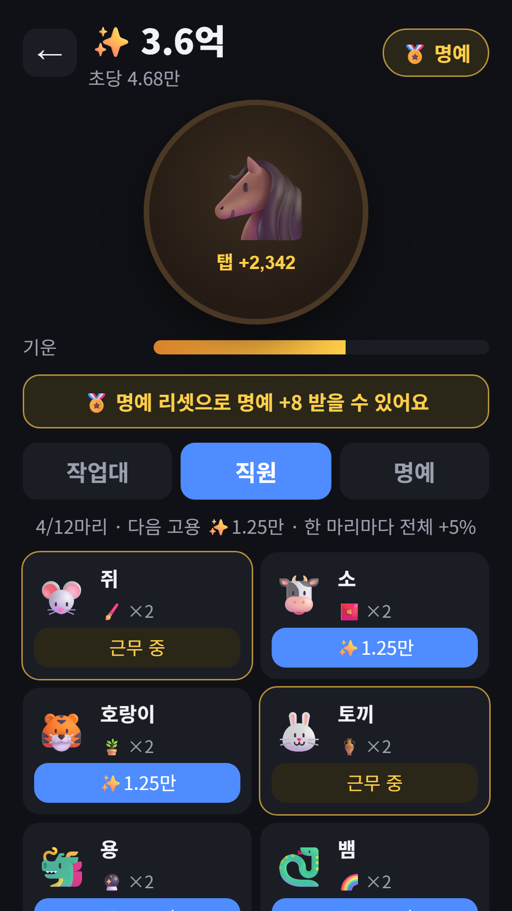
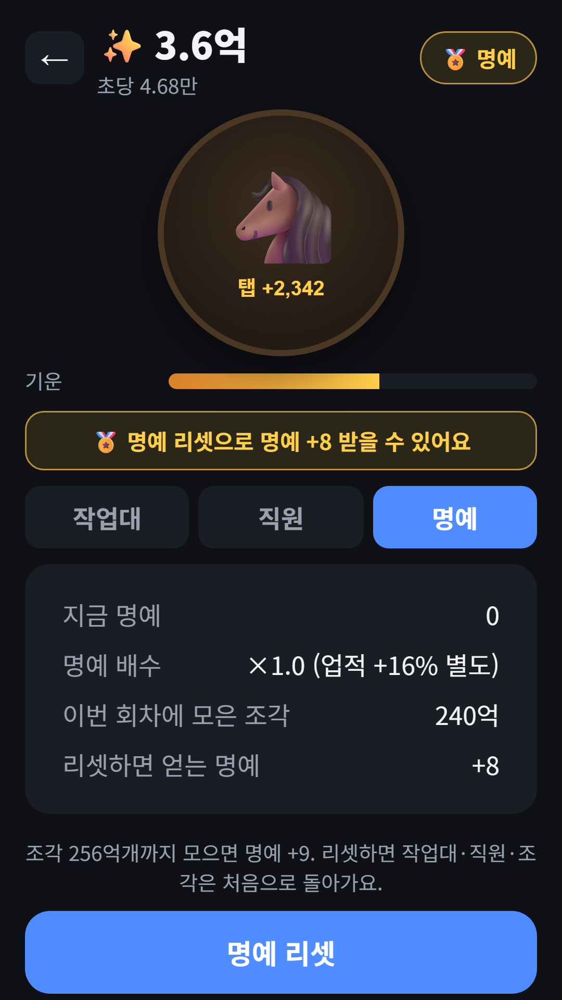
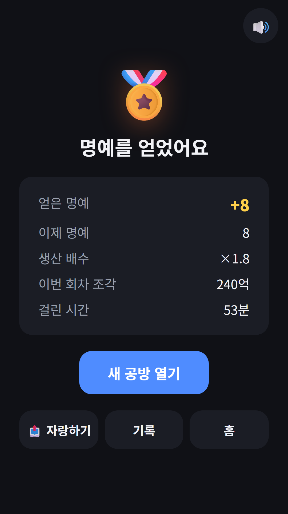
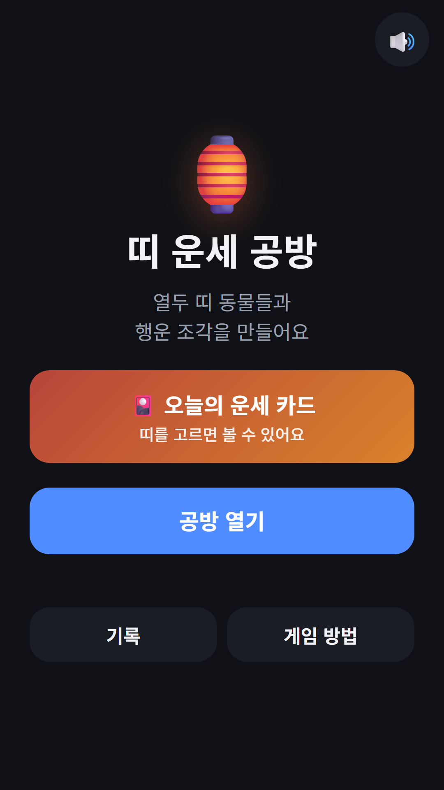

## Info
> **띠 운세 공방** — 열두 띠 동물과 공방을 키워 행운 조각을 모으는 방치형 게임이에요. Google Play에서 무료, 광고 포함. 토스에서는 [파동권 오락실](/ko/posts/hub-arcade/) 안에서 즐길 수 있어요.
{: .prompt-info }

## 이런 게임입니다
열두 띠 동물을 직원으로 두는 방치형 공방 게임이에요. 내 띠를 고르면 그 동물이 공방장이 되어 전체 생산을 올려 주고, 작업대를 키우고 동물 직원을 고용하면서 행운 조각을 모아요. 앱을 닫아 두어도 생산은 이어져서, 다시 열면 그동안 쌓인 조각을 받아요.

## 어떻게 하나요
- 태어난 해를 입력하면 띠가 자동으로 선택돼요. 12개 띠 중에서 직접 고를 수도 있어요
- 작업대를 눌러 레벨을 올려요. 작업대는 6종: 부적 붓·복주머니 재봉틀·행운 화분·별빛 가마·구슬 연마기·무지개 베틀
- 열두 띠 동물을 누구든 직원으로 고용해요. 동물마다 잘 맞는 작업대가 있어요
- 공방을 탭하면 생산이 올라가고, 기운 게이지가 가득 차면 잠깐 빨라져요
- 조각이 충분히 쌓이면 명예 리셋으로 작업대와 직원을 처음으로 돌리고 영구 명예 보너스를 받아요

## 특징
- 작업대가 정해진 레벨(10·25·50·100·150·200)에 닿을 때마다 그 작업대의 생산이 2배가 돼요
- 오늘의 운세 카드: 생산 증가·고용 할인 같은 게임 안 보너스만 바꿔요. 그날은 내 띠에 고정돼요
- 자리를 비워도 최대 8시간 동안 생산이 이어지고, 돌아오면 요약 창에서 받은 양을 확인해요. 원하면 광고를 보고 한 번 더 받을 수 있어요(창마다 한 번)
- 업적 17개와 명예 기록 TOP 10
- 9개 언어, 회원가입 없이 바로 할 수 있어요

광고가 포함되어 있습니다(배너·보상형).

{: w="360" }
{: w="360" }
{: w="360" }
{: w="360" }
{: w="360" }

## 플레이 영상


## Download
- Google Play: <https://play.google.com/store/apps/details?id=com.fadongkwon.fortune_tycoon>
- 토스: [파동권 오락실](/ko/posts/hub-arcade/) 안의 '띠 운세 공방'

{: w="200" .normal }

## 함께 보면 좋은 앱
- [파동권 오락실](/ko/posts/hub-arcade/) — 벽돌깨기·뱀 게임·숫자 뱀·띠 운세 공방 등 짧게 즐기는 오락실 허브
- [띠 운세 펫](/ko/posts/zodiac-pet/) — 내 띠 동물을 돌보고 오늘의 운세를 보는 앱

소식은 이 블로그와 [인스타그램(@fadongkwon.soft)](https://www.instagram.com/fadongkwon.soft/)에서 전해드립니다.
