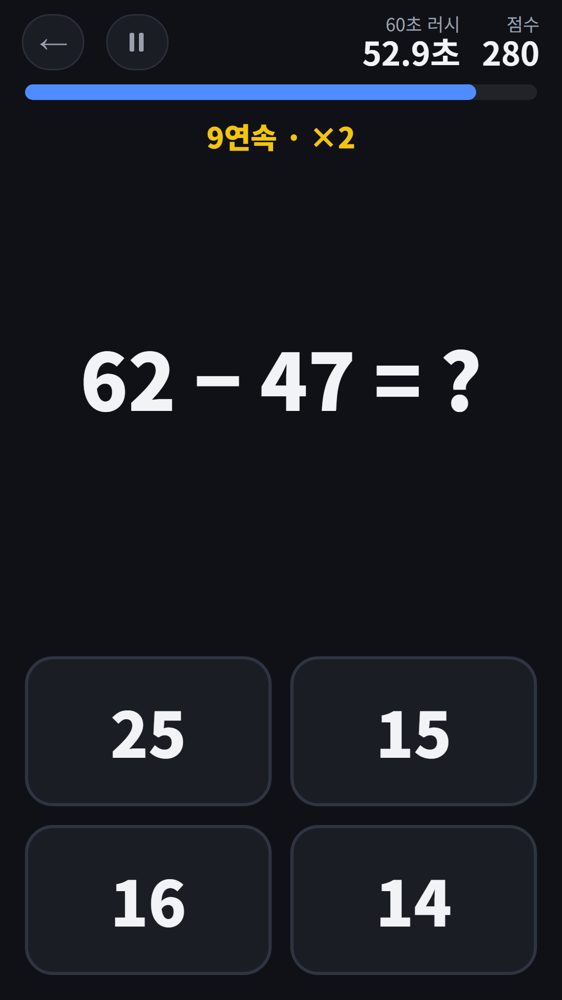
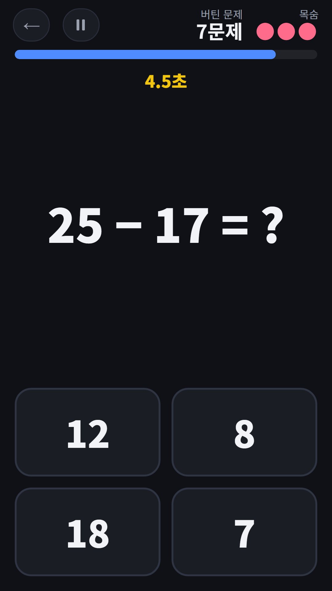
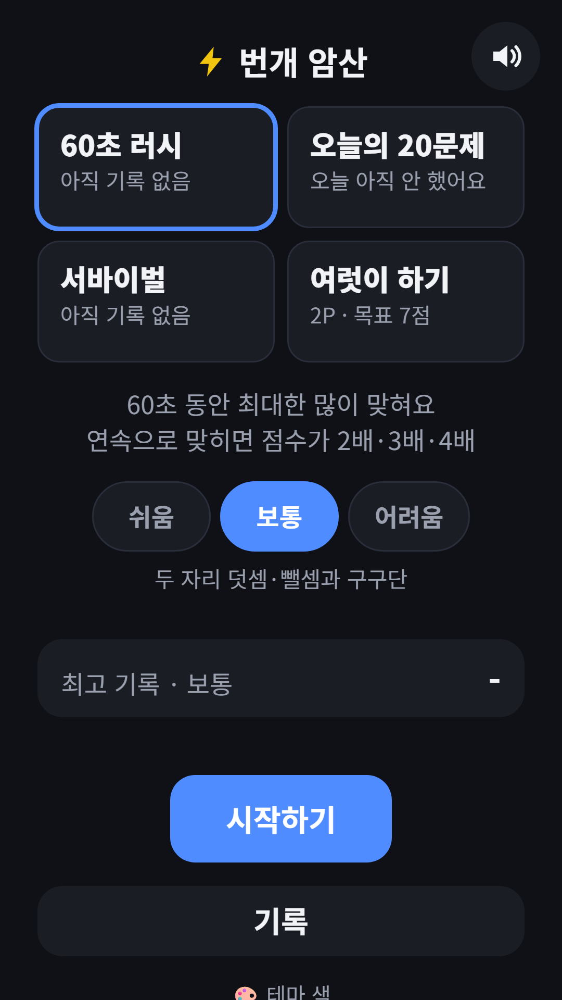
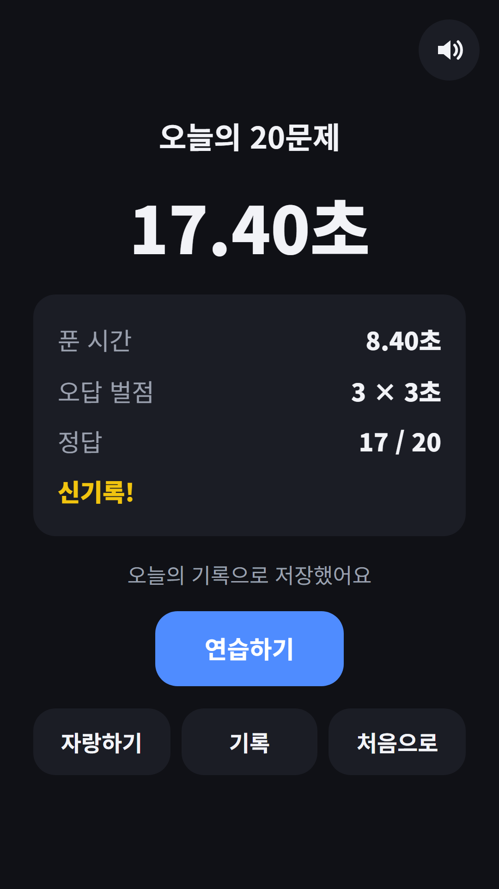
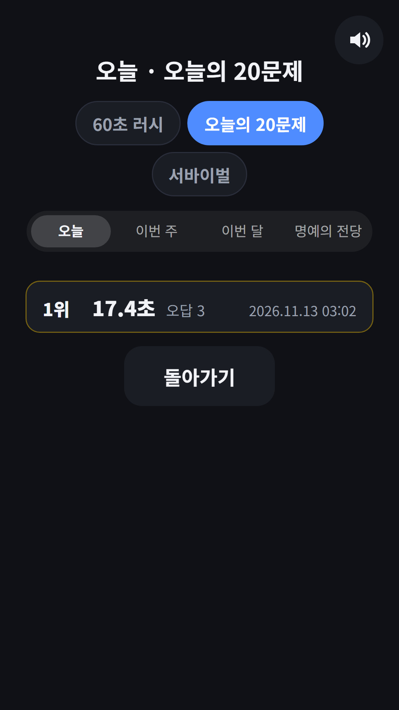

## Info
> **번개 암산** — 보기 4개 중에서 빠르게 고르는 암산 게임이에요. Google Play에서 무료, 광고 포함. 토스에서는 [파동권 뇌나이](/ko/posts/hub-brain/) 안에서 즐길 수 있어요.
{: .prompt-info }

## 이런 게임입니다
가능한 한 빨리 푸는 암산 게임이에요. 문제마다 큰 보기 버튼 4개가 나오니 숫자를 입력할 필요 없이 계산만 하면 돼요. 숫자는 크게 보이고, 오답 보기는 받아올림을 빠뜨린 값처럼 사람들이 흔히 틀리는 수로 만들어져 있어요. 설명이나 학습 단계 없이 빨리 푸는 데만 집중해요.

## 어떻게 하나요
- 혼자 하기: 모드와 난이도를 고르고 보기 4개 중 정답을 눌러요
- 여럿이 하기: 한 폰에서 2~4명을 고르면 화면이 나뉘어 각자 자기 쪽을 봐요. 먼저 맞힌 사람이 1점을 얻고, 틀린 사람은 그 문제가 끝날 때까지 쉬어요. 목표 점수(5·7·10점)에 먼저 닿으면 우승이에요
- 일시정지 버튼이 있고, 앱이 백그라운드로 가면 판이 멈춰요

## 특징
- 혼자 하기 3모드
  - 60초 러시: 연속 정답 배율이 붙어요(5연속 ×2, 10연속 ×3, 15연속 이상 ×4). 오답은 시간이 2초 줄어요
  - 오늘의 20문제: 매일 모두 같은 20문제가 나와요. 기록은 푼 시간에 오답 1개당 3초를 더한 값이고, 하루 첫 판만 기록돼요
  - 서바이벌: 목숨 3개, 맞힐수록 제한 시간이 줄어들어요
- 난이도 3단계: 한 자리 덧셈·뺄셈 → 두 자리 계산과 구구단 → 곱셈·세 항 계산·나눗셈
- 큰 글씨, 소리와 진동 반응, 난이도별 일·주·월 TOP 10 기록
- 새 판을 시작할 때마다 하트가 1개 들어가요. 하루 5개가 채워지고, 다 쓰면 광고를 보고 5개를 받을 수 있어요
- 9개 언어, 회원가입 없이 바로 할 수 있어요

광고가 포함되어 있습니다(배너·보상형).

{: w="360" }
{: w="360" }
{: w="360" }
{: w="360" }
{: w="360" }

## Download
- Google Play: <https://play.google.com/store/apps/details?id=com.fadongkwon.mental_math>
- 토스: [파동권 뇌나이](/ko/posts/hub-brain/) 안의 '번개 암산'

{: w="200" .normal }

## 함께 보면 좋은 앱
- [파동권 뇌나이](/ko/posts/hub-brain/) — 어휘·기억·순서·반응·집중·계산을 짧게 점검하는 두뇌 허브
- [수학 몬스터](/ko/posts/math-monsters/) — 사칙연산 문제를 풀어 몬스터를 잡는 학습 앱

소식은 이 블로그와 [인스타그램(@fadongkwon.soft)](https://www.instagram.com/fadongkwon.soft/)에서 전해드립니다.
