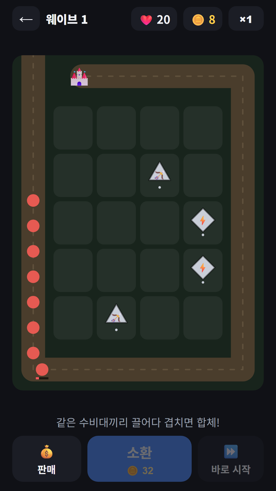
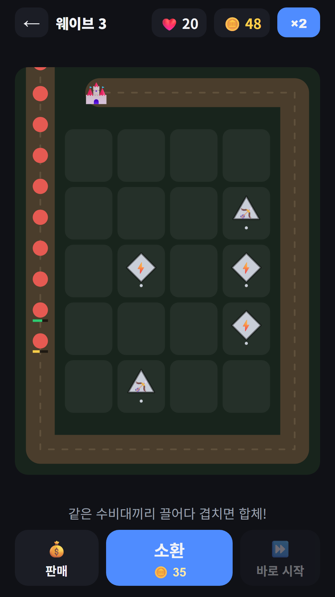
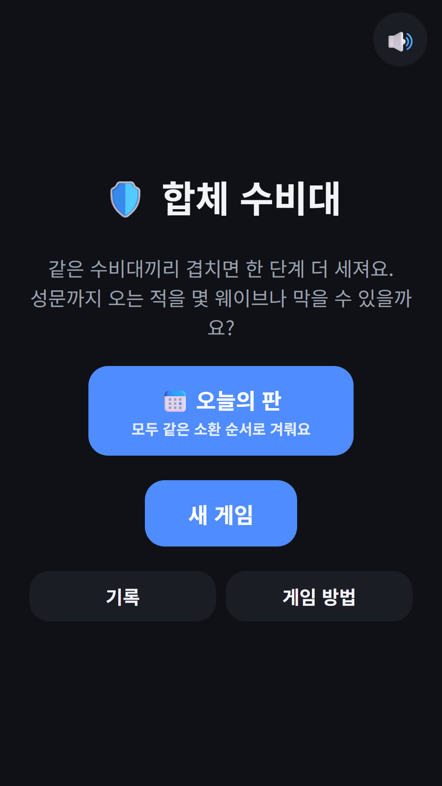
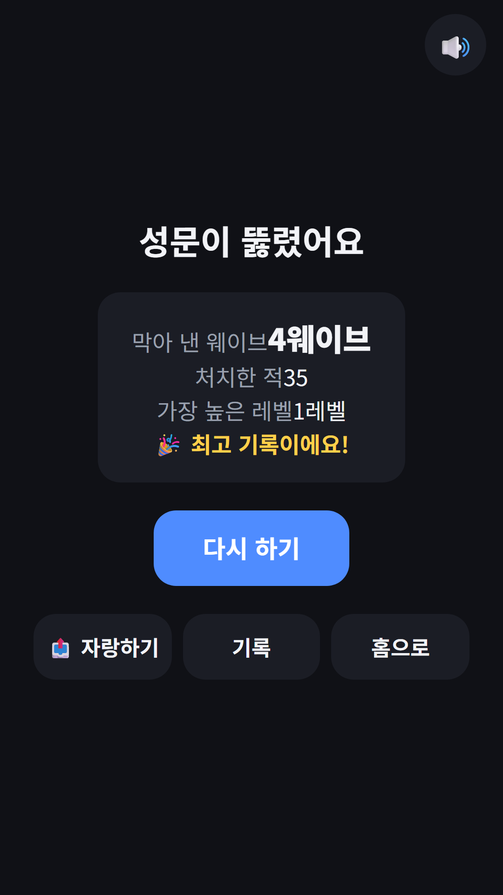
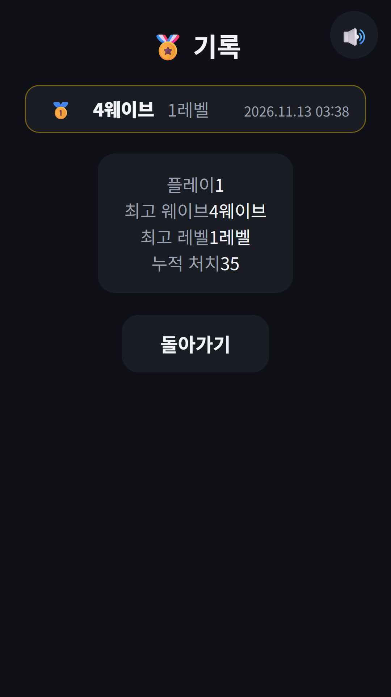

## Info
> **합체 수비대** — 같은 수비대를 합쳐 키우고 구불구불한 길로 오는 적에게서 성문을 지키는 게임이에요. Google Play에서 무료, 광고 포함. 토스에서는 [파동권 오락실](/ko/posts/hub-arcade/) 안에서 즐길 수 있어요.
{: .prompt-info }

## 이런 게임입니다
머지와 타워 디펜스를 섞었어요. 코인을 내고 가운데 칸에 수비대를 소환한 뒤, 같은 종류·같은 레벨 수비대를 끌어다 겹치면 한 단계 더 강한 수비대로 합체해요. 적은 길을 따라 성문으로 몰려오고, 막아 낸 웨이브 수가 곧 기록이에요.

## 어떻게 하나요
- 코인으로 빈 칸에 무작위 1레벨 수비대를 소환해요
- 같은 종류·같은 레벨 수비대 위에 끌어 놓으면 합체해요. 최대 7레벨까지 올라가요
- 다른 수비대 위에 놓으면 자리가 바뀌고, 빈 칸에 놓으면 옮겨지고, 판매 버튼 위에 놓으면 팔아서 코인을 돌려받아요
- 톡 누르면 사거리가 보여요
- 적이 성문에 닿으면 목숨이 줄어요. 목숨은 20개이고, 보스가 닿으면 한 번에 6개가 줄어요
- 졌을 때 원하면 광고를 보고 진 웨이브를 처음부터 다시 할 수 있어요(한 판에 한 번)

## 특징
- 수비대 4종: 빠른 단일 공격의 궁수, 범위 피해의 포병, 적을 느리게 하는 얼음, 적 사이를 튀는 번개
- 보통·빠른·탱크 적과 10웨이브마다 나오는 보스
- 끝없는 웨이브: 막아 낸 웨이브 수로 기록을 겨뤄요. 2배속도 지원해요
- 오늘의 판: 같은 날에는 누구나 같은 소환 순서로 겨뤄요
- 하던 판 이어하기, 최고 기록 TOP 10
- 9개 언어, 회원가입 없이 바로 할 수 있어요

광고가 포함되어 있습니다(배너·보상형).

{: w="360" }
{: w="360" }
{: w="360" }
{: w="360" }
{: w="360" }

## 플레이 영상


## Download
- Google Play: <https://play.google.com/store/apps/details?id=com.fadongkwon.merge_defense>
- 토스: [파동권 오락실](/ko/posts/hub-arcade/) 안의 '합체 수비대'

{: w="200" .normal }

## 함께 보면 좋은 앱
- [파동권 오락실](/ko/posts/hub-arcade/) — 벽돌깨기·뱀 게임·두더지 잡기·합체 수비대 등 짧게 즐기는 오락실 허브
- [머지 팝](/ko/posts/merge-pop/) — 같은 공을 합쳐 더 큰 공으로 키우는 머지 퍼즐

소식은 이 블로그와 [인스타그램(@fadongkwon.soft)](https://www.instagram.com/fadongkwon.soft/)에서 전해드립니다.
