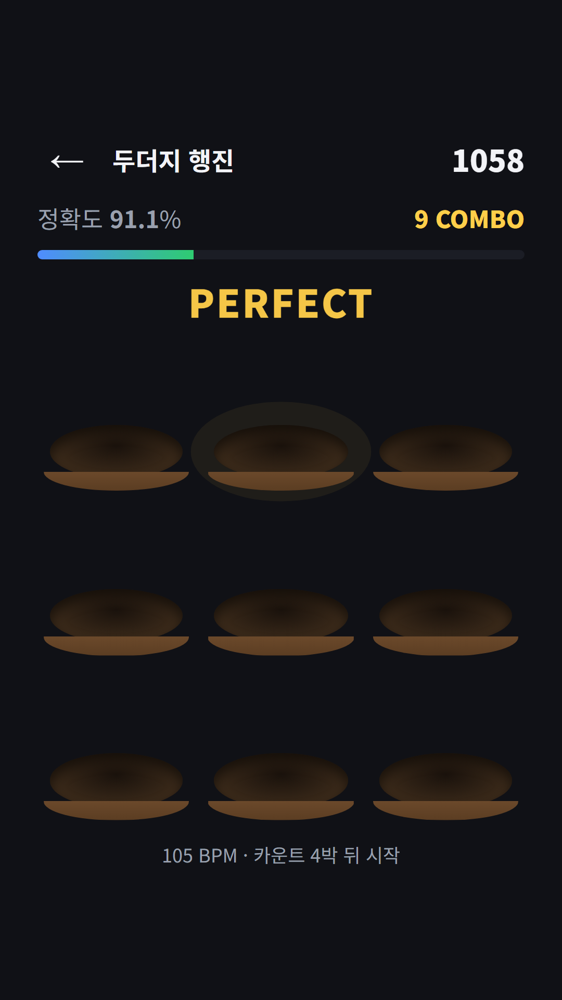
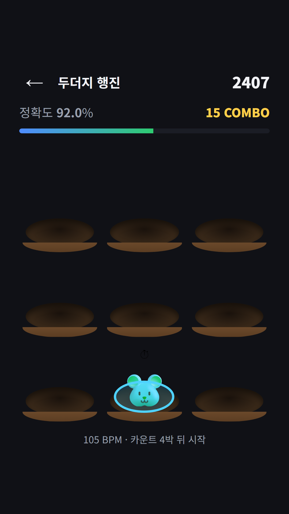
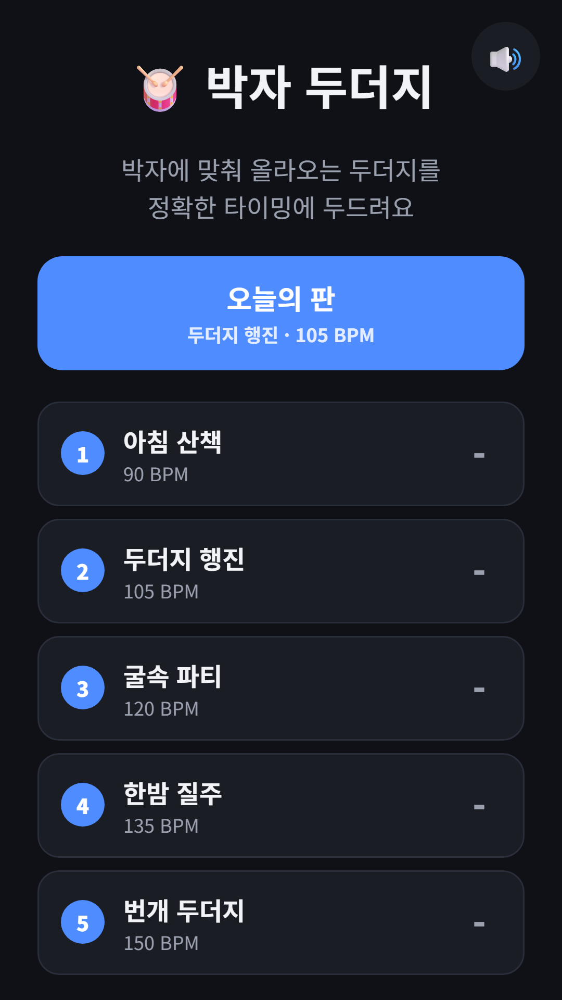
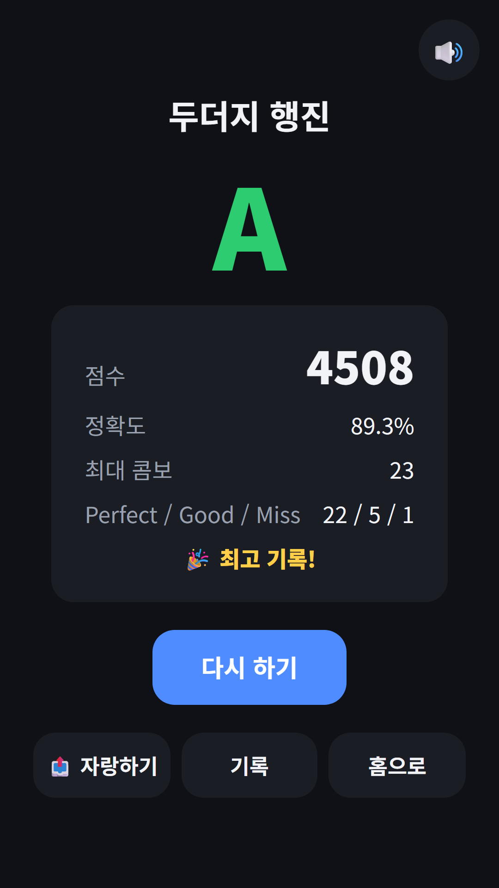
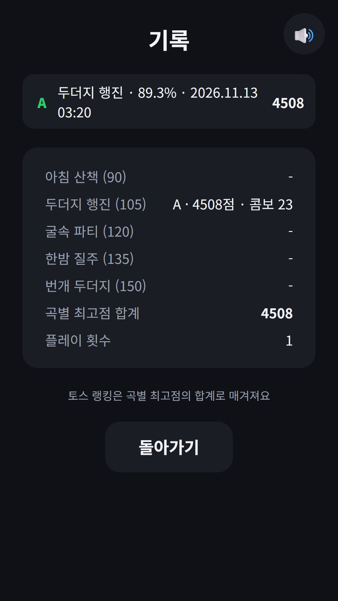

## Info
> **박자 두더지** — 음악 박자에 맞춰 두더지를 두드리는 리듬 게임이에요. Google Play에서 무료, 광고 포함. 토스에서는 [파동권 오락실](/ko/posts/hub-arcade/) 안에서 즐길 수 있어요.
{: .prompt-info }

## 이런 게임입니다
3×3 구멍에서 올라오는 두더지를 음악 박자에 딱 맞춰 눌러요. 구멍 둘레의 고리가 줄어들어 구멍에 딱 맞을 때가 박자예요. 그 순간 구멍을 누르면 점수가 가장 높아요. 곡은 코드로 직접 합성한 오리지널 5곡이고, 여유로운 90 BPM 산책부터 150 BPM 질주까지 이어져요.

## 어떻게 하나요
- 곡이 시작되면 카운트 4박 뒤부터 두더지가 올라와요
- 고리가 구멍에 딱 맞을 때 구멍을 눌러요. Perfect는 ±50ms, Good은 ±110ms 안이고, 그보다 어긋나면 Miss예요
- 황금 두더지는 점수 3배, 꾹 두더지는 누른 채로 두 박 뒤에 떼면 점수 2배예요. 4번째 곡부터는 두 마리가 동시에 올라와요
- 콤보가 쌓이면 점수 배율이 올라가요. 최대 2배까지요
- 정확도 95% 이상 S, 85% 이상 A, 70% 이상 B, 그 아래는 C예요
- C 등급이 나오면 원하는 경우 광고를 보고 같은 곡을 바로 다시 할 수 있어요(한 판에 한 번)

## 특징
- 아침 산책(90 BPM)·두더지 행진(105)·굴속 파티(120)·한밤 질주(135)·번개 두더지(150), 앱에서 만든 오리지널 5곡
- 오늘의 판: 그날의 곡과 채보를 정해 줘요
- 박자 보정: 소리에 맞춰 8번 탭하면 기기의 소리 지연을 알아서 맞춰 줘요. 이어폰을 바꿨을 때도 다시 해 보세요
- 곡별 최고 기록, TOP 10, 5곡 최고점 합계
- 하루 하트 3개로 새 곡을 시작해요. 하트를 다 쓰면 광고를 보고 다시 채울 수 있어요
- 9개 언어, 회원가입 없이 바로 할 수 있어요

광고가 포함되어 있습니다(배너·보상형).

{: w="360" }
{: w="360" }
{: w="360" }
{: w="360" }
{: w="360" }

## 플레이 영상


## Download
- Google Play: <https://play.google.com/store/apps/details?id=com.fadongkwon.rhythm_mole>
- 토스: [파동권 오락실](/ko/posts/hub-arcade/) 안의 '박자 두더지'

{: w="200" .normal }

## 함께 보면 좋은 앱
- [파동권 오락실](/ko/posts/hub-arcade/) — 벽돌깨기·뱀 게임·두더지 잡기·박자 두더지 등 짧게 즐기는 오락실 허브
- [두더지 잡기](/ko/posts/whack-a-mole/) — 올라오는 두더지를 빠르게 잡는 고전 오락실 게임

소식은 이 블로그와 [인스타그램(@fadongkwon.soft)](https://www.instagram.com/fadongkwon.soft/)에서 전해드립니다.
