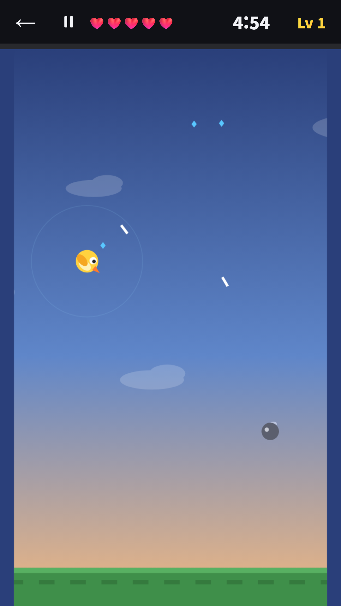
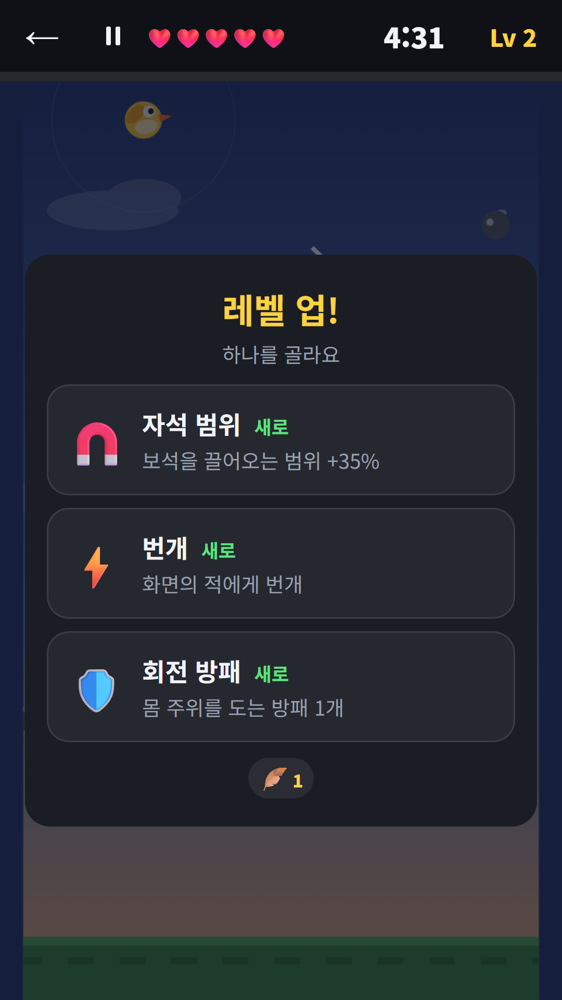
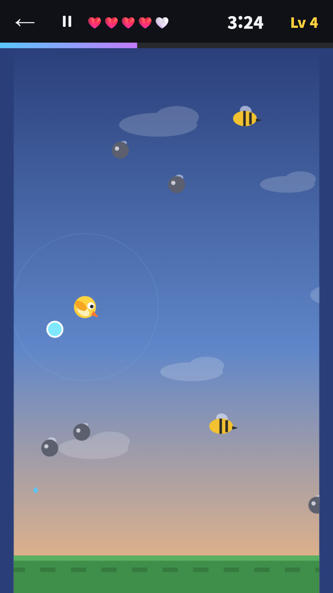

## Info
> **버드 서바이버** — 눌러서 날갯짓하고 공격은 자동으로 나가는 서바이버 게임이에요. Google Play에서 무료, 광고 포함. 토스에서는 [파동권 오락실](/ko/posts/hub-arcade/) 안에서 즐길 수 있어요.
{: .prompt-info }

## 이런 게임입니다
원버튼 비행에 서바이버 장르를 섞었어요. 새는 화면 왼쪽에 고정돼 있고, 플레이어는 높이만 조종해요. 무기는 알아서 발사되고, 오른쪽에서 벌레 떼가 몰려와요. 쓰러뜨린 적이 보석을 떨구는데 보석도 하늘과 함께 왼쪽으로 흘러가서, 높이를 맞춰야 먹을 수 있어요. 피하면서 먹고, 먹어서 강해지는 게 이 게임의 재미예요.

## 어떻게 하나요
- 화면을 누르면 날갯짓, 꾹 누르고 있으면 계속 날갯짓해요. 첫 탭에 시작해요
- 천장은 막혀 있고, 땅에 닿으면 체력이 1 줄어요. 열매를 먹으면 체력이 1 회복돼요
- 보석을 모아 레벨이 오르면 판이 멈추고 강화 3개 중 1개를 골라요
- 4분 30초에 보스 폭풍 독수리가 나타나요. 5분을 버티거나 보스를 잡으면 승리예요
- 시작 전에 원하면 광고를 보고 강화 3개 중 1개를 골라 시작할 수 있어요. 한 판에 한 번이에요

## 특징
- 강화 8종, 각각 최대 5레벨: 깃털 연사·회전 방패·번개·유도탄, 그리고 자석 범위·체력·속도·힘
- 적 4종(날파리·말벌·까마귀·풍선벌레)과 보스 폭풍 독수리. 시간이 지날수록 더 많이, 더 단단하게 몰려와요
- 고르는 강화에 따라 판이 크게 달라져요
- 오늘의 하늘: 같은 날에는 누구나 같은 하늘로 겨뤄요
- 하던 판 이어 하기, 기록 TOP 10
- 9개 언어 지원

광고가 포함되어 있습니다(배너·보상형).

{: w="360" }
{: w="360" }
{: w="360" }
{: w="360" }
{: w="360" }

## 플레이 영상


## Download
- Google Play: <https://play.google.com/store/apps/details?id=com.fadongkwon.survivor_bird>
- 토스: [파동권 오락실](/ko/posts/hub-arcade/) 안의 '버드 서바이버'

{: w="200" .normal }

## 함께 보면 좋은 앱
- [파동권 오락실](/ko/posts/hub-arcade/) — 벽돌깨기·뱀 게임·숫자 뱀·버드 서바이버 등 짧게 즐기는 오락실 허브
- [파닥파닥 새](/ko/posts/tap-bird/) — 탭으로 기둥 사이를 지나는 원버튼 비행 게임

소식은 이 블로그와 [인스타그램(@fadongkwon.soft)](https://www.instagram.com/fadongkwon.soft/)에서 전해드립니다.
