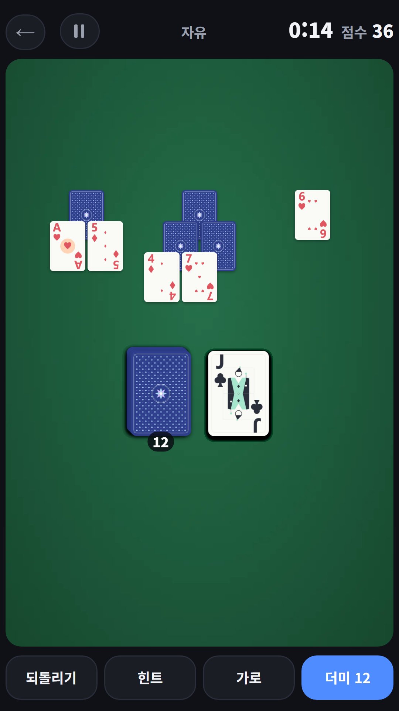
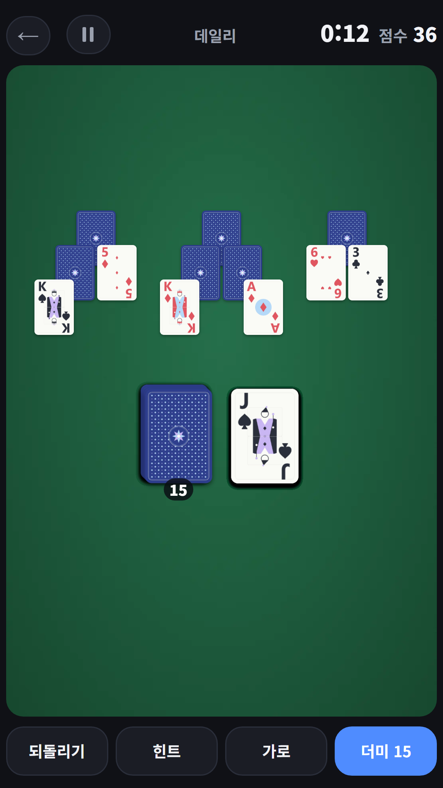
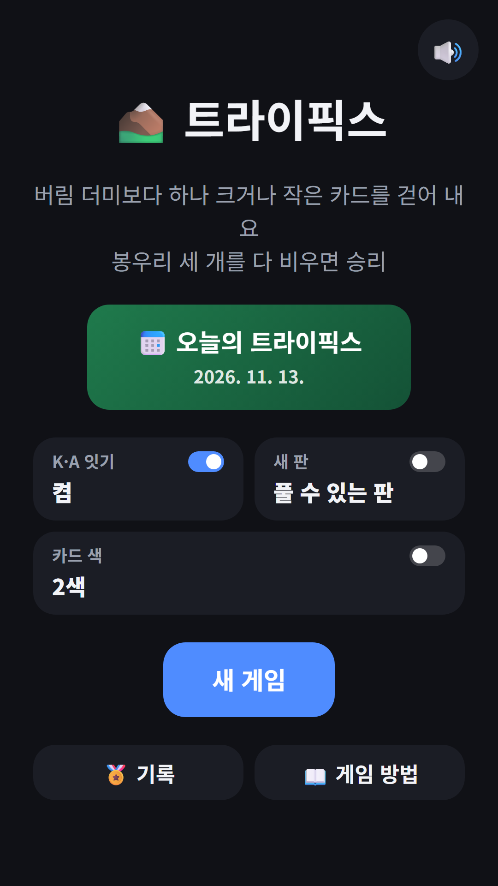
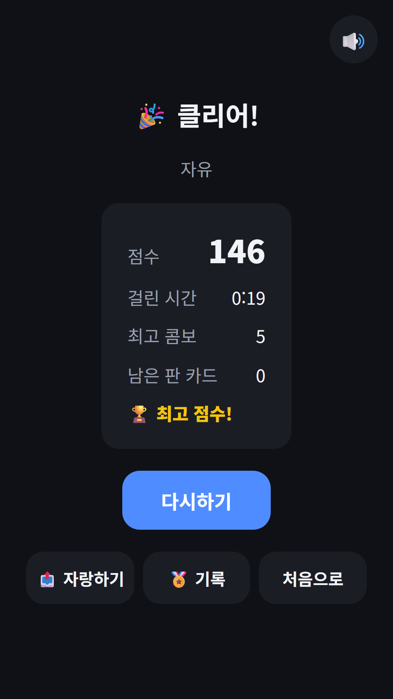
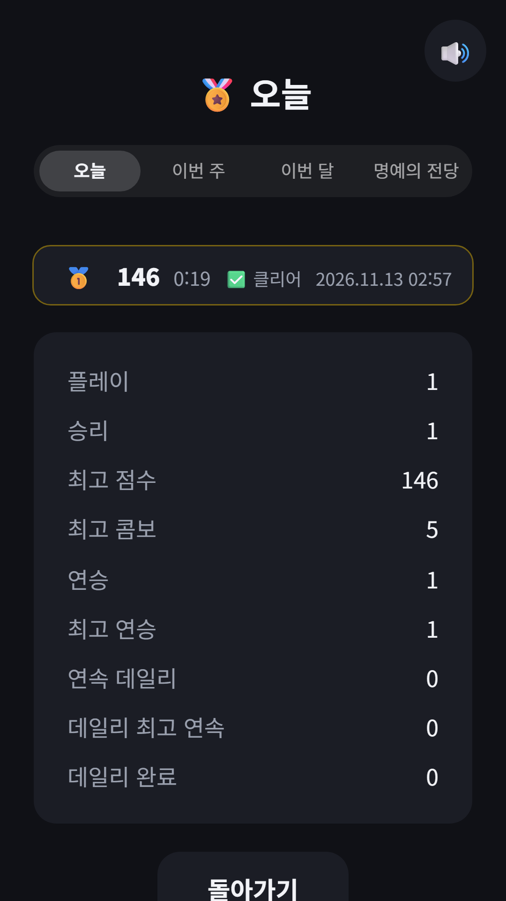

## Info
> **트라이픽스** — 세 봉우리로 쌓인 카드를 한 끗 높거나 낮은 카드로 이어 걷어 내는 솔리테어예요. Google Play에서 무료, 광고 포함.
{: .prompt-info }

## 이런 게임입니다
판에는 카드 28장이 봉우리 세 개로 쌓여 있고, 옆에 뽑을 더미가 하나 있어요. 버림 더미 맨 위 카드보다 숫자가 하나 크거나 작은 카드를 누르면 버림 더미로 올라가요. 무늬는 상관없어요. 이어서 걷을수록 콤보가 길어지고 점수도 커져서, 어느 봉우리부터 열지 고르는 재미가 있어요.

## 어떻게 하나요
- 맨 아래 줄 10장만 앞면이에요. 위 카드는 덮고 있던 아래 두 장을 걷어야 앞면이 돼요
- 앞면 카드가 버림 더미 맨 위와 숫자가 하나 차이면 탭 한 번으로 옮겨 가요
- 둘 곳이 없으면 더미를 눌러 한 장을 넘겨요. 더미는 다시 돌리지 않아요
- K와 A는 기본으로 이어져요(K 다음에 A). 홈의 옵션에서 끌 수 있어요
- 28장을 다 걷으면 승리예요. 더 둘 곳이 없으면 되돌리기·점수 확인·새 판 중에 골라요

## 특징
- 콤보 점수: 이어서 걷을 때마다 1점씩 늘어나고, 더미를 넘기면 콤보가 처음부터 시작돼요. 봉우리 꼭대기를 걷으면 보너스, 28장을 다 걷으면 남은 더미 한 장마다 점수를 더해요
- 풀 수 있는 판만: 오늘의 판과 새 게임은 풀이기로 끝까지 풀리는 판만 나와요. 원하면 무작위 판으로 바꿀 수 있어요
- 오늘의 판: 같은 날에는 누구나 같은 판이에요. 다 걷은 판만 완료로 쳐서 연속 일수가 쌓여요
- 힌트와 되돌리기가 있어요. 판마다 각각 3번까지 무료이고, 그다음부터는 하트를 써요
- 점수 순위, 연승·최고 점수·최고 콤보·통계 기록, 하던 판 이어하기
- 또렷한 카드 그림, 선택할 수 있는 4색 덱, 세로·가로 화면 모두 지원해요
- 9개 언어, 회원가입 없이 바로 할 수 있어요

광고가 포함되어 있습니다(배너·보상형).

{: w="360" }
{: w="360" }
{: w="360" }
{: w="360" }
{: w="360" }

## Download
- Google Play: <https://play.google.com/store/apps/details?id=com.fadongkwon.tripeaks>

{: w="200" .normal }

## 함께 보면 좋은 앱
- [골프 솔리테어](/ko/posts/golf-solitaire/) — 한 끗 높거나 낮은 카드로 35장을 걷어 내는 카드 게임
- [파동권 카드놀이](/ko/posts/hub-card/) — 클론다이크·스파이더·프리셀·트라이픽스 등 솔리테어 카드 게임을 모은 허브

소식은 이 블로그와 [인스타그램(@fadongkwon.soft)](https://www.instagram.com/fadongkwon.soft/)에서 전해드립니다.
