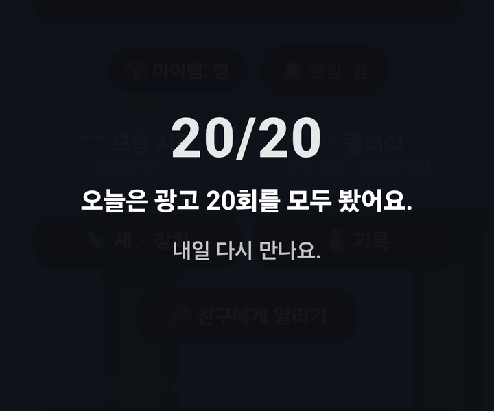
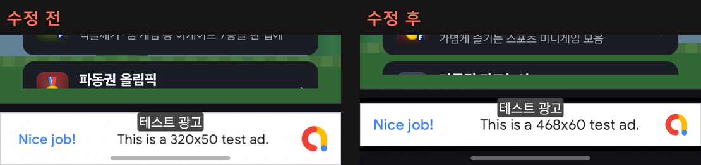

> **11월 19일 덧붙임** — 이의신청이 기각됐습니다. 접수 확인 메일이 온 지 15시간 만인 11월 19일 오후 1시 4분, 사유 설명 없이 계정 복구 불가·추가 지급 없음·새 계정 불가라는 답이 왔습니다. 결과와 그 뒤의 정리는 [다음 글](/ko/posts/google-ads-appeal-rejected/)에 적었습니다.
{: .prompt-info }

> **결과가 없는 글입니다.** 이의신청은 11월 18일 밤에 냈고, 이 글을 쓰는 지금 답은 오지 않았습니다. 접수 확인 메일에는 처리에 1주 이상 걸릴 수 있다고 적혀 있었습니다. 아래의 원인은 모두 제 쪽 데이터로 세운 추정이고, 계정이 복구될지도 모릅니다.
{: .prompt-warning }

11월 18일 오전 8시 3분, 메일 두 통이 같은 시각에 왔습니다. 하나는 "Google 게시자 계정이 사용중지됨", 다른 하나는 그 계정의 결제 계정이 해지됐다는 알림입니다. 사유는 **무효 트래픽 또는 게시자 정책·이용약관을 위반하는 기타 활동**. AdMob을 포함해 이 계정에 연결된 모든 제품에서 광고 게재가 멈췄고, 최종 지급 산정을 위해 30일 지급 보류가 걸렸습니다.

광고 계정이 멈춘 건 두 번째입니다. 8월 26일 첫 정지는 29일 뒤에 풀렸고, 원인은 제 개발용 폰이었습니다. 그 이야기는 [첫 정지 글](/ko/posts/invalid-traffic-suspension/)에 있습니다. 그 뒤로 디버그 빌드는 테스트 광고만, 개발 기기는 테스트 기기로 등록, 에뮬레이터·루팅·디버깅 환경이면 출시 빌드도 샘플 광고만, 출시 빌드에 테스트 ID가 섞이면 빌드를 멈추는 게이트까지 넣었습니다. 그런데도 다시 멈췄습니다.

이번이 첫 정지와 다른 점은 두 가지입니다. 첫째, 기간이 정해진 정지가 아니라 '사용 중지'입니다. 둘째, **이의신청 양식이 있습니다.** 메일은 정책에 맞게 고친 뒤 "무효 활동으로 이어졌다고 추정되는 트래픽과 기타 원인을 종합적으로 분석한 결과"를 양식에 적어 내라고 안내합니다. 동시에 구체적인 계정 활동은 감지 시스템을 우회하는 데 쓰일 수 있어 알려 줄 수 없다고도 적혀 있습니다. 원인은 알려 주지 않고, 원인 분석은 내라는 겁니다.

그래서 그날 하루를 조사에 썼습니다. 이 글은 그 조사와 이의신청서의 기록입니다. 금액은 적지 않습니다. 숫자는 노출·클릭 건수와 앱 수뿐입니다.

## 첫 번째 막힘: API가 닫혔다

평소에는 AdMob 리포트 API로 날짜별·앱별 노출과 클릭을 받아 장부(CSV)에 쌓습니다. 정지 당일 같은 API를 부르자 계정 목록 단계에서 **HTTP 401**이 돌아왔습니다. 게시자를 인증할 수 없다는 메시지입니다. 콘솔도 정지 상태라 세부 화면을 볼 수 없었습니다.

남은 건 장부뿐이었습니다. 마지막 정상 수집은 정지 7시간 전인 11월 18일 0시 44분이라 11월 17일분까지는 들어 있습니다. 다만 장부의 차원은 **날짜 × 앱** 두 개뿐입니다. 국가, OS 버전, 앱 버전, 광고 형식(배너·전면·보상형)은 받아 두지 않았습니다. 이게 이번 조사에서 가장 뼈아픈 점이었고, 끝에서 다시 이야기하겠습니다.

## 장부에서 찾은 이상 구간

같은 날짜·같은 앱이 띄어쓰기만 다른 이름으로 두 번 들어간 행을 정리한 뒤, 8월 정지가 풀려 광고를 다시 켠 9월 27일부터 구간을 나눠 하루 평균을 냈습니다. 구간은 제 쪽에서 무언가를 바꾼 날짜로 끊었습니다.

| 구간 | 그 사이 바뀐 것 | 노출/일 | 클릭/일 | CTR | 노출 있는 앱/일 |
|---|---|---:|---:|---:|---:|
| 9/27~10/23 | 광고 재개 | 349 | 8.3 | 2.36% | 17.4 |
| 10/24~11/02 | 앱 내 1인당 광고 상한 해제 | 718 | 10.1 | 1.41% | 29.2 |
| 11/03~11/05 | 개발 PC 교체 | 885 | 9.7 | 1.09% | 29.7 |
| 11/06~11/13 | 신작 여러 종 출시 | 909 | 14.2 | 1.57% | 31.8 |
| **11/14~11/17** | **바꾼 것 없음** | **1,797** | **84.0** | **4.68%** | **87.5** |

앞의 네 구간은 앱이 늘면서 노출이 완만하게 늘고, CTR은 1~2%대에 머뭅니다. 마지막 구간만 모양이 다릅니다. 일별로 보면 더 분명합니다.

| 날짜 | 11/10 | 11/11 | 11/12 | 11/13 | 11/14 | 11/15 | 11/16 | 11/17 |
|---|---:|---:|---:|---:|---:|---:|---:|---:|
| 노출 | 871 | 1,279 | 1,019 | 722 | 1,547 | 1,149 | 2,336 | 2,155 |
| 클릭 | 7 | 15 | 23 | 7 | 72 | 98 | 69 | 97 |
| 노출 있는 앱 | 32 | 32 | 34 | 39 | 85 | 77 | 91 | 97 |

11월 14일 하루 만에 노출이 생긴 앱이 39개에서 85개로 늘었습니다. 그 뒤 나흘 동안 클릭은 평소의 6~8배였습니다. 이 4일치는 정지 전에 받은 미확정 추정치라 나중에 바뀔 수 있지만, 모양이 바뀔 정도는 아닐 겁니다.

여기서 세 가지 신호를 뽑았습니다.

**1. 깨어난 휴면 앱.** 11월 14~17일에 노출이 생긴 앱은 106개입니다. 그중 **36개는 11월 7~13일 일주일 동안 노출이 한 번도 없던 앱**입니다. 마지막 노출이 10월 초인 앱도 있었습니다. 실제 사용자들이 같은 날 수십 개의 휴면 앱을 동시에 열었다고 보기는 어렵습니다.

**2. 클릭이 노출 이상.** 11월 14~17일에 앱·날짜 단위로 클릭이 노출과 같거나 많은 경우가 7번 나왔습니다. 한 소규모 앱은 하루 노출 14에 클릭 15였고, 다른 소규모 앱은 노출 11에 클릭 13이었습니다. 9월 27일 이후 이런 경우는 모두 10번이었는데, 그중 7번이 이 나흘에 몰렸습니다.

**3. 하루로 끝나지 않았다.** 그 전에도 특정 앱의 CTR이 튄 날은 있었습니다. 광고 재개 첫날인 9월 27일, 10월 21일 같은 날입니다. 다만 모두 한 앱에서 하루로 끝났고, 다음 날 평소로 돌아왔습니다. **여러 앱에서 동시에, 나흘 연속** 이어진 건 이번이 처음입니다.

## 세웠다가 지운 가설 다섯 개

장부의 이상이 무엇 때문인지 찾으려고 먼저 제 쪽 원인부터 의심했습니다. 첫 정지가 제 기기 때문이었으니까요. 의심한 것은 다섯 가지였고, 하나씩 근거를 대고 지웠습니다.

| 가설 | 왜 의심했나 | 지운 근거 |
|---|---|---|
| ① 새 PC의 에뮬레이터 | 11월 3일에 개발 PC를 바꿨다. 새 PC의 에뮬레이터를 테스트 기기로 등록하지 않았을 수 있다 | 새 PC에는 에뮬레이터가 없었다. 가상 기기(AVD) 정의, 시스템 이미지, 실행 흔적이 모두 0개. 있었더라도 출시 빌드는 에뮬레이터를 감지하면 샘플 광고만 요청한다 |
| ② 다른 AI 도구로 옮긴 작업 | 일부 반복 작업을 다른 AI 코딩 도구로 옮겼고, 그쪽 에이전트가 무언가 실수했을 수 있다 | 그 도구의 대화 기록 21개를 시각까지 확인했다. 브라우저로 연 곳은 각종 콘솔과 SNS 관리 화면뿐이고, 광고가 붙은 앱·사이트를 열거나 광고를 누른 기록은 0건. 광고 코드도 읽기만 했다. 그 도구 안에서 작업 모델을 바꾼 시점(11/16)도 이상 시작(11/14)보다 뒤였다 |
| ③ 개발폰 | 첫 정지의 원인이었다 | 폰의 광고 ID가 AdMob 콘솔에 등록된 테스트 기기 값과 그대로 일치했다. 11/14~17에 이 폰에서 실행된 제 앱은 10개뿐이고 대부분 디버그 빌드였다 |
| ④ 방어 코드 약화 | 여러 세션이 같은 저장소를 고치다 보면 무언가 빠질 수 있다 | 테스트 기기 목록, 환경 감지, 출시 게이트 코드를 git 이력으로 확인했다. 9월 이후 약해진 변경은 없었다 |
| ⑤ 10/24 광고 상한 해제 | 앱 안에서 1인당 하루 광고 횟수 상한(보상형 10·전면 8)을 이날 풀었다 | 해제 뒤 CTR은 오히려 2.36%에서 1.41%로 내려갔다. 이상은 그로부터 3주 뒤에 시작됐다 |

②는 조금 더 적어 둡니다. AI 에이전트가 제 브라우저로 콘솔 작업을 하다 보니, 에이전트가 광고를 눌렀을 가능성을 진지하게 의심했습니다. 확인할 수 있었던 건 기록에 남은 도구 호출(주소 이동, 클릭 대상)이 전부라 "기록 안에서는 무관"까지가 결론입니다. 다만 그 기록이 남아 있었기 때문에 하루 안에 지울 수 있었습니다.

③도 데이터로 한 번 더 확인했습니다. 이상이 컸던 앱 몇 개는 Play Console 통계상 **설치된 기기가 단 1대**였고, 그 1대가 제 개발폰이었습니다. 폰의 사용 기록을 보니 그중 두 앱의 마지막 실행은 11월 7일과 10월 10일이었습니다. 11월 14~17일에 그 앱들에서 노출과 클릭이 생겼는데, 설치된 유일한 기기는 그 기간에 그 앱을 켜지 않았습니다.

## 남은 추정: Play 설치로 잡히지 않는 기기

제 쪽 원인을 지우고 나니 남은 질문은 하나였습니다. **그 노출과 클릭은 어느 기기에서 나왔나.**

Play Console 통계를 다시 봤습니다. 조사 시점에는 신규 설치가 11월 15일까지, 설치 사용자 수가 11월 14일까지만 집계돼 있었습니다.

- 조사한 14개 앱 모두 11월 14~15일 신규 설치가 0~2건으로 평소 수준이었습니다.
- 다시 깨어난 휴면 앱 중 5개는 11월 10~15일 신규 설치가 0이었습니다.
- 계정 전체로 봐도 일 신규 설치는 18~37건 범위로 이상이 없었습니다.

광고 활동은 수십 개 앱에서 동시에 뛰었는데 Play 설치는 그대로였습니다. 여기서 내린 추정은 이렇습니다.

> **Play 설치로 집계되지 않는 기기에서, 제 앱 여러 개의 출시 빌드가 실행되며 노출과 클릭을 만들었다.**

Play 판 APK는 기기에서 추출하거나 외부 사이트에서 받아 다른 기기에 설치할 수 있고, 그렇게 설치된 기기는 Play 통계에 잡히지 않습니다. 그런데 거기서 더 나아가지는 못했습니다. 이 트래픽이 구글 쪽 자동 검사(심사나 보안 검사용 기기)인지, 앱 목록을 긁어 가는 제3자의 자동화 도구인지는 **가르지 못했습니다.** 그걸 가를 수 있는 국가·OS 버전·기기 분포가 장부에 없었고, API는 닫혀 있었습니다.

## 이의신청서를 쓰다

양식은 애드센스 도움말의 무효 트래픽 안내 페이지에서 연결되는 AdSense·AdMob 공용 이의신청 양식이었습니다. 정지 메일에는 양식 링크가 없어서 도움말에서 찾아 들어갔습니다.

처음에는 문항별로 한국어·영어 초안을 길게 썼습니다. 그런데 실제 양식을 열어 보니 **칸마다 1000자 제한**이 있었고, 초안에 있던 "추가 정보" 칸은 아예 없었습니다. 긴 초안을 칸에 맞춰 다시 줄였습니다. 칸 구성과 각 칸에 넣은 내용은 이렇습니다.

| 칸 | 넣은 내용 |
|---|---|
| 유입 경로·홍보 | 1인 개발, Play에 앱 약 97종. 유입은 대부분 Play 검색·추천. 홍보는 블로그·인스타그램·쇼츠·스레드 일반 게시물과 자사 앱 간 교차 홍보뿐. 광고 구매·유료 트래픽·보상형 설치를 쓴 적 없음 |
| 과거 위반 이력 | 8월 26일부터 29일간의 정지와 그 원인(개발 기기 자기 노출), 그 뒤 넣은 조치 다섯 가지 |
| 원인 | 11/14 급변 수치, Play 설치 불변, 개발 기기가 아니라는 근거, 추정 결론, 그리고 제 쪽 변경 공개 |
| 개선 조치 | 이미 유지 중인 조치 + 앞으로 할 조치 네 가지 |
| 로그·보고서 | 구간별 일평균 표, 이상이 컸던 앱의 일별 수치, Play 설치 대조. 국가·IP·OS는 API 401로 확인하지 못했다는 사실 |

'원인' 칸에 실제로 넣은 영어 문안입니다. 1000자에 맞추느라 문장이 짧습니다.

```text
My best estimate from the data available to me:
1. The pattern changed abruptly on Nov 14. Apps with impressions per day:
   39 on Nov 13, then 85, 77, 91, 97 on Nov 14-17; 36 of them had no
   impressions since before Nov 7. Daily clicks: average 8-14 before,
   then 72, 98, 69, 97. CTR: 1.57% to 4.68%. Some small apps had more
   clicks than impressions.
2. Play installs did not change: 0-2 new installs per app on Nov 14-15,
   zero for the dormant apps.
3. It was not my device. ...
4. Conclusion: automated traffic from devices not counted as Play
   installs, running release builds across about 90 of my apps.
5. Disclosure: on Oct 24 I removed in-app daily ad caps. CTR then fell;
   the anomaly began 3 weeks later.
```

쓰면서 지킨 원칙이 네 가지 있습니다.

1. **추정은 추정이라고 쓴다.** 첫 줄부터 "제가 볼 수 있는 데이터로 내린 최선의 추정"이라고 밝혔습니다. 출처를 모르는데 안다고 쓰면, 구글 쪽 로그와 어긋나는 순간 나머지 내용까지 의심받습니다.
2. **불리한 변경도 먼저 밝힌다.** 10월 24일 광고 상한 해제는 굳이 말하지 않아도 되는 일이었습니다. 하지만 "1인당 광고를 더 보게 바꿨다"는 건 저쪽 로그에서 보일 수 있는 변화라, 제가 먼저 적고 그 뒤 CTR이 내려갔다는 수치를 붙였습니다.
3. **아직 안 한 일은 '하겠다'로 쓴다.** 조치 중 일부는 그날 밤 코드까지 고쳤지만, Play에 새 버전을 올리기 전까지는 사용자 폰에 아무 효력이 없습니다. 첫 정지 때 배운 바로 그 사실입니다. 그래서 전부 "하겠습니다"로 적었습니다.
4. **지킬 수 없는 약속은 넣지 않는다.** 11월 16~17일 Play 통계가 확정되면 추가 자료를 보내겠다고 쓰고 싶었지만, 양식에는 나중에 자료를 덧붙일 통로가 없습니다. 그 문장은 뺐습니다.

제출 시점도 고민했습니다. Play 통계가 이틀 더 쌓이길 기다릴지, 바로 낼지. 본문을 "11월 15일까지 집계된 시점 기준"으로 써 두면 지금 내도 사실과 어긋나지 않습니다. 오래 끌 이유가 없다고 보고 그날 밤 냈습니다. 접수 화면과 접수 확인 메일까지 받았습니다.

## 약속한 조치 네 가지, 지금 어디까지 왔나

이의신청서의 '개선 조치' 칸에 적은 네 가지와, 이 글을 쓰는 시점의 상태입니다.

| 약속 | 내용 | 지금 상태 |
|---|---|---|
| (a) Play 외 설치본은 샘플 광고만 | 설치 출처가 Play 스토어가 아니면 실광고 대신 구글 샘플 광고만 요청 | 코드 반영, **미배포** |
| (b) 하루 20회 상한 | 1인당 하루 광고 20회(보상형+전면), 화면에 n/20 표시, 20회가 차면 그날은 플레이도 멈춤. Play 판만 적용 | 코드 반영, **미배포** |
| (c) 배너 배치 재점검 | 배너가 실수 클릭을 부르지 않게 전 앱 점검 | 전수 조사 끝, 래퍼 수정 반영, **미배포** |
| (d) 차원별 일일 수집과 급변 알림 | 국가·OS 버전·광고 형식까지 매일 수집, 앱 수·클릭·CTR이 급변하면 경보 → 원인 분석 | 수집·감지 스크립트 작성. 계정이 정지 중이라 **실제 데이터로는 한 번도 돌려 보지 못함** |

(a)는 기존의 환경 감지에 설치 출처 검사를 한 줄 더한 것입니다.

```kotlin
fun untrustedReason(context: Context): String? {
    if (isDebuggable(context)) return "debuggable"
    if (isEmulator()) return "emulator"
    if (isRooted(context)) return "rooted"
    // Play 스토어로 설치되지 않은 실행(adb·APK 직접 설치·다른 스토어)은 실광고를 요청하지 않는다
    val installer = installerPackage(context)
    if (installer != PLAY_STORE_INSTALLER) return "installer=${installer ?: "unknown"}"
    return null   // null 이면 일반 사용자 기기로 본다
}
```

이 함수가 이유를 돌려주면 그 실행은 구글 샘플 광고 단위만 씁니다. 제 추정이 맞다면 11월 14~17일의 트래픽은 이 한 줄로 막혔을 겁니다. 틀렸다면 막지 못합니다. 어느 쪽이든 Play 밖으로 퍼진 APK가 제 계정에 노출을 쌓는 길은 닫힙니다.

(b)는 상한을 '되살리는' 대신 숫자를 정하고 화면에 보이게 했습니다. 상한에 도달하면 이런 화면이 나옵니다(개발폰의 디버그 빌드, 테스트 광고).


_오늘 본 광고가 20회가 되면 그날은 광고도 플레이도 멈춘다_

토스 앱인토스 판은 이 상한을 걸지 않았습니다. 이번 일은 AdMob 계정의 일이고, 토스 쪽 광고는 별도의 플랫폼 정책 아래에 있어서 적용 범위를 Play 판으로 한정했습니다.

## 배너 125개 전수 조사에서 나온 것

(c)는 조사부터 했습니다. 실광고가 붙는 Android 빌드 변형(flavor) 125개를 소스로 하나씩 열어, 게임플레이 화면에서 **배너 바로 위에 무엇을 누르는지**와 그 거리를 쟀습니다.

| 위험도 | 개수 | 대표적인 모양 |
|---|---:|---|
| 높음 | 20 | 캔버스나 터치 영역이 화면 바닥까지 내려와 배너와 거리 0px, 또는 계속 누르는 버튼이 바닥에서 9~16px 안 |
| 중간 | 49 | 도구 줄·탭바·고정 하단 버튼이 배너에 가깝지만 자주 누르지는 않음 |
| 낮음 | 52 | 하단 여백이 충분하거나 하단에 누를 것이 없음 |
| 배너 없음 | 4 | 공성전 계열(전면·보상형만) |

구조적인 문제도 하나 확인했습니다. 래퍼가 앱 시작 때 배너를 한 번 만들어 **모든 화면에 계속 띄웁니다.** 게임플레이 중에도 그렇고, 웹 쪽에서 화면별로 배너를 숨길 방법이 없었습니다. 제가 읽은 바로는, AdMob 배너 가이드라인은 사용자가 계속 상호작용하는 게임플레이 화면의 배너와 버튼·탐색 요소 바로 옆의 배너를 바람직하지 않은 구현으로 듭니다. 게임 앱 전부가 이 기준에 걸릴 수 있는 구조였습니다.

소스만으로는 확신할 수 없던 항목이 하나 있었는데, 실기기에서 바로 확인됐습니다. **배너가 하단 제스처 내비게이션 바와 겹치고 있었습니다.** targetSdk 36에서는 화면이 시스템 바 밑까지 그려지는데, 래퍼 루트에 하단 인셋 처리가 없었습니다. 그래서 홈으로 나가려고 화면 아래를 쓸어 올리는 손가락이 배너 위를 지나가는 배치였습니다.


_왼쪽은 제스처 막대가 배너 위에 얹혀 있고, 오른쪽은 배너가 막대 위로 올라가 있다(디버그 빌드, 테스트 광고)_

8월 첫 정지 때 배너가 콘텐츠 위로 겹치던 것은 고쳤습니다. 이번에는 시스템 바 쪽이었습니다. 언제부터 이 상태였는지는 확인하지 못했습니다. 래퍼에는 세 가지를 넣었습니다.

- 시스템 내비게이션 바만큼 하단 인셋을 주어 배너를 그 위로 올림
- 웹뷰와 배너 사이에 눌러도 반응하지 않는 **10dp 여백 띠**를 넣음(윗변에 1dp 구분선)
- 배너가 로드되기 전부터 배너 높이를 확보해, 로드되는 순간 화면이 밀리며 오탭이 나지 않게 함

다만 이 조사로 "배너 배치가 원인이었다"고 말할 수는 없습니다. 장부의 노출·클릭은 배너·전면·보상형을 합친 값이라 형식을 가를 수 없고, 배너가 아예 없는 앱도 소규모 표본에서 CTR이 크게 튄 적이 있습니다. 위험도가 '높음'인데 평소 CTR은 평균 수준인 앱도 여럿이었습니다. 배너 재점검은 원인 규명이 아니라, 원인이 무엇이든 고쳐야 할 결함을 찾은 일입니다.

## 구글 문서에서 읽은 것

이의신청을 낸 뒤 애드센스·AdMob의 무효 트래픽 관련 도움말을 다시 읽었습니다. 제가 읽은 바로는 이렇습니다. 원문 표현이 아니라 제 요약입니다.

- **제3자가 만든 트래픽도 게시자 책임입니다.** 누가 만들었든 계정에 쌓인 무효 트래픽은 게시자가 관리해야 하는 대상입니다. "제가 한 게 아닙니다"는 면책 사유가 아니라 출발점일 뿐입니다.
- **이의신청이 기각되면 그 결정은 최종입니다.** 그래서 한 번에 낼 수 있는 가장 정확한 내용을 내야 했습니다.
- **리포트를 앱·광고 단위·국가별로 세분해 보라고 권합니다.** 평소에 그렇게 보고 있었다면 이번 이상을 나흘이 아니라 하루 만에 알았을 겁니다.

## 가장 뼈아팠던 것: 차원을 받아 두지 않았다

이번 조사의 한계는 거의 전부 한 가지에서 나왔습니다. **국가·OS 버전·기기·광고 형식 차원을 평소에 받아 두지 않았다**는 것입니다.

그 차원이 있었다면 가를 수 있었던 것들입니다.

- OS 버전이 한두 개로 몰렸는지 → 자동화 기기인지 사람인지
- 국가가 어디였는지 → 구글 인프라 쪽 검사인지 다른 곳인지
- 배너 클릭인지 전면·보상형 클릭인지 → 배너 배치가 관련 있는지

전부 정지되고 나서야 필요해졌고, 그때는 API가 닫혀 있었습니다. 데이터는 문제가 생긴 뒤에 받으려고 하면 이미 늦습니다. 그래서 (d)의 수집 스크립트는 날짜×앱에 더해 국가·OS 버전·광고 형식 조합을 매일 받고, 노출 있는 앱 수·클릭·CTR이 전 구간보다 크게 뛰면 경보를 띄우게 만들었습니다. 지난 장부로 11월 17일을 기준일 삼아 돌려 보니 경보가 났습니다(노출 있는 앱 97개, 앞 28일 기준선 30개). 다만 8월 개발폰 사고처럼 작은 규모의 자기 노출은 '주의' 수준으로만 잡혀서, 감지기가 모든 유형을 잡지는 못한다는 한계도 같이 확인했습니다.

이번 장부를 보면 11월 14일부터 이상했는데, 제가 안 건 정지 메일이 온 18일 아침이었습니다. 나흘 동안 아무도 장부를 들여다보지 않았습니다.

## 남은 것

- **이의신청 결과.** 접수 확인 메일에는 1주 이상 걸릴 수 있다고 적혀 있었습니다. 복구되든 기각되든 결과가 나오면 이 글에 덧붙이겠습니다.
- **(a)(b)(c)의 배포.** 코드는 고쳤지만 Play에 새 버전을 올리기 전까지는 효력이 없습니다. 광고가 정지된 지금은 배포해도 막을 대상이 없지만, 복구된다면 광고가 다시 나가기 전에 배포가 끝나 있어야 합니다. 첫 정지 때 셈에 넣지 못했던 바로 그 순서입니다.
- **출처 확인.** 계정이 복구되면 첫날 11월 10일부터 차원별 데이터를 소급해 받아 볼 생각입니다. 11월 14~17일 트래픽의 국가·OS 분포를 처음으로 볼 수 있는 기회입니다.

## 따라 할 수 있는 교훈

1. **광고 리포트는 날짜×앱만으로 쌓지 말고 국가·OS 버전·광고 형식까지 받아 둔다.** 정지되면 API가 닫힌다. 그때는 늦다.
2. **노출 있는 앱 수를 지표로 본다.** 이번 이상은 클릭보다 '노출이 생긴 앱 수'에서 먼저, 가장 크게 보였다. 앱이 많은 개발자에게는 이 숫자가 가장 싼 경보다.
3. **설치 출처를 확인한다.** Play 판 APK는 Play 밖으로 퍼질 수 있다. Play로 설치되지 않은 실행에서 실광고를 요청할 이유가 없다.
4. **배너는 실기기에서, 제스처 내비게이션으로 확인한다.** 소스와 에뮬레이터로는 시스템 바 겹침이 안 보였다.
5. **이의신청서에는 추정을 추정으로, 불리한 변경을 먼저, 안 한 일은 '하겠다'로 쓴다.** 저쪽은 로그를 갖고 있고, 저는 갖고 있지 않다.
6. **AI 에이전트가 브라우저를 다루게 했다면 도구 호출 기록을 남겨 둔다.** 이번에 의심 하나를 하루 안에 지울 수 있었던 건 기록이 있어서였다.

이 글은 결과가 없는 글입니다. 원인도, 복구 여부도 아직 모릅니다. 다만 무엇을 보고 무엇을 지웠고 무엇을 냈는지는 지금 적어 두는 게 맞다고 생각했습니다. 출시 과정에서 밟은 다른 사고들은 [출시 사고 21건 회고](/ko/posts/launch-incidents/)에 정리해 두었습니다.

만든 앱들은 [GAMES](/ko/games/)와 [APPS](/ko/apps/)에 있고, 일부는 [브라우저에서 바로](/ko/play/) 해볼 수 있습니다. 소식은 이 블로그와 [인스타그램(@fadongkwon.soft)](https://www.instagram.com/fadongkwon.soft/)에서 전해드립니다.

> 무효 트래픽 판정의 근거는 플랫폼이 공개하지 않습니다. 이 글의 원인 분석은 제 계정의 장부와 Play 통계로 세운 추정이며, 구글의 판단이나 이의신청 결과를 뜻하지 않습니다.
{: .prompt-info }
