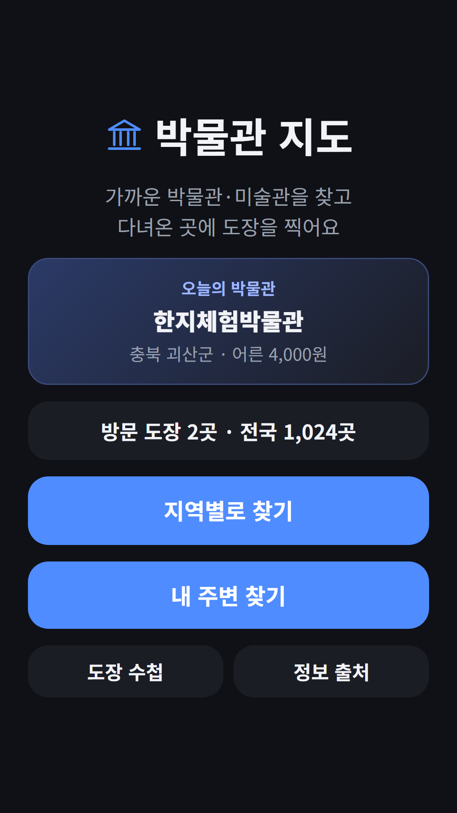
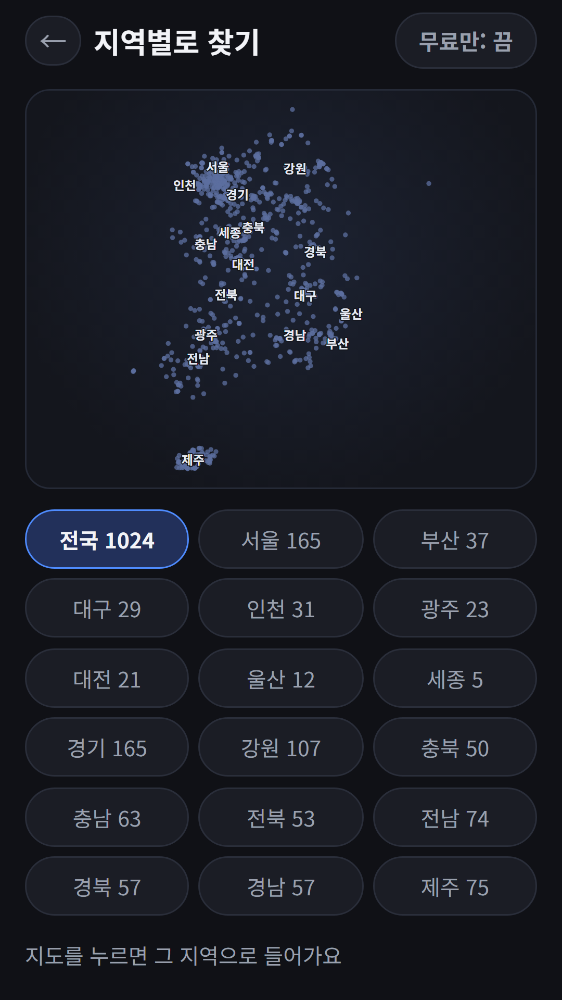
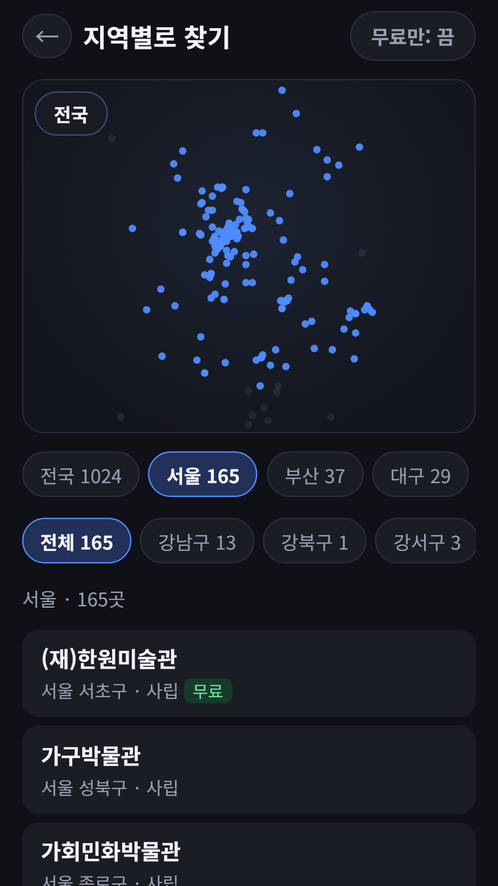
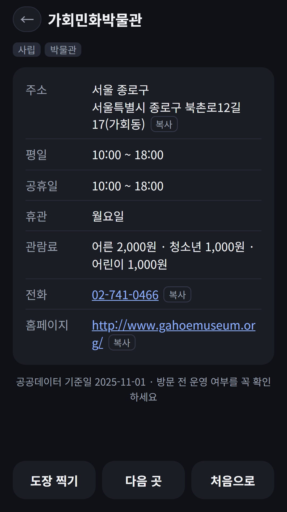
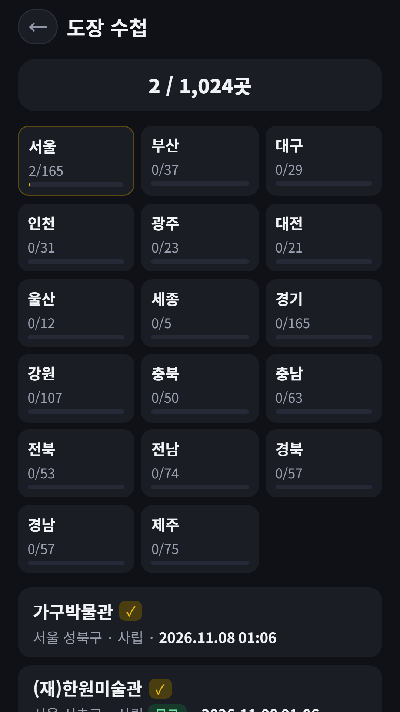

## Info
> **박물관 지도** — 전국 박물관·미술관을 지역별로, 또는 내 주변에서 찾아 주소·운영시간·관람료를 확인하고 다녀온 곳에 도장을 찍는 앱이에요. Google Play에서 무료, 광고 포함. 토스에서는 [파동권 주말생활](/ko/posts/hub-weekend/) 안에서 쓸 수 있어요.
{: .prompt-info }

## 이런 앱입니다
공공데이터포털의 「전국박물관미술관정보표준데이터」 1,070건에서 같은 시설을 합쳐 1,024곳을 담았어요. 시설마다 주소·운영시간·휴관일·관람료를 볼 수 있고, 관람료가 무료로 적힌 571곳만 골라 볼 수도 있어요. 지도는 외부 지도 서비스 없이 시설 위치를 점으로 찍어 그려서, 점들이 모여 국토 모양이 돼요.

## 어떻게 쓰나요
- 지역별로 찾기: 지도에서 시·도를 누르면 그 지역으로 들어가고, 시·군·구로 더 좁힐 수 있어요
- 내 주변 찾기: 버튼을 누를 때만 위치를 묻고, 가까운 곳을 거리순으로 보여 줘요. 위치는 기기 안에서 거리 계산에만 쓰고 저장하거나 보내지 않아요
- 상세 정보: 구분, 주소, 평일·공휴일 운영시간, 휴관일, 관람료와 요금 안내, 편의시설, 교통, 전화, 홈페이지
- 도장 수첩: 다녀온 곳에서 도장을 찍으면 방문한 날이 남고, 수첩에서 모아 볼 수 있어요
- 오늘의 박물관: 날짜마다 한 곳을 추천해 줘요
- 상세 화면의 다음 곳 버튼으로 보던 목록을 이어서 넘겨 봐요

## 특징
- 시설 정보는 앱 안에 담겨 있어서 첫 화면이 바로 떠요
- 시설마다 데이터 기준일을 보여 주고, 방문 전에 운영 여부를 확인하라고 안내해요
- 전시(기획전) 정보와 시설 소개 글은 담지 않았어요
- 화면 문구는 한국어예요. 회원가입 없이 바로 쓸 수 있어요
- 오늘의 박물관 알림을 켜 둘 수 있어요

광고가 포함되어 있습니다(배너·전면). 광고를 보지 않아도 모든 정보를 볼 수 있어요.

{: w="360" }
{: w="360" }
{: w="360" }
{: w="360" }
{: w="360" }

## 플레이 영상


## Download
- Google Play: <https://play.google.com/store/apps/details?id=com.fadongkwon.museum_map>
- 토스: [파동권 주말생활](/ko/posts/hub-weekend/) 안의 '박물관 지도'

{: w="200" .normal }

## 자료 출처
공공데이터포털(data.go.kr) 전국박물관미술관정보표준데이터(제공: 지방자치단체, 2026년 11월 내려받음). 데이터 기준일은 시설마다 달라 운영시간·휴관일·관람료가 바뀌었을 수 있어요.

## 함께 보면 좋은 앱
- [파동권 주말생활](/ko/posts/hub-weekend/) — 여행 시기·박물관·홈트 생활 도구를 한 앱에 모은 허브

소식은 이 블로그와 [인스타그램(@fadongkwon.soft)](https://www.instagram.com/fadongkwon.soft/)에서 전해드립니다.
