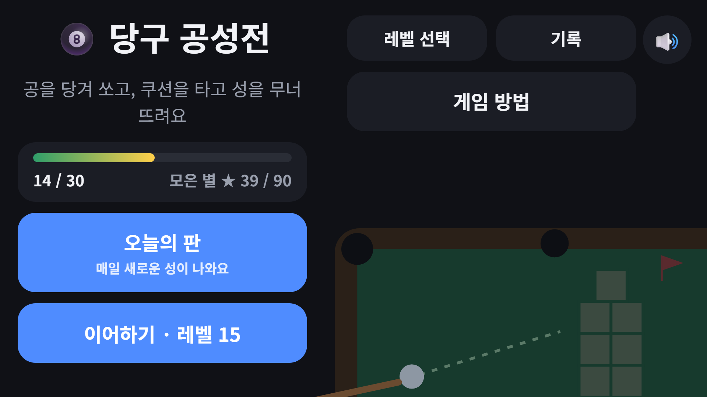
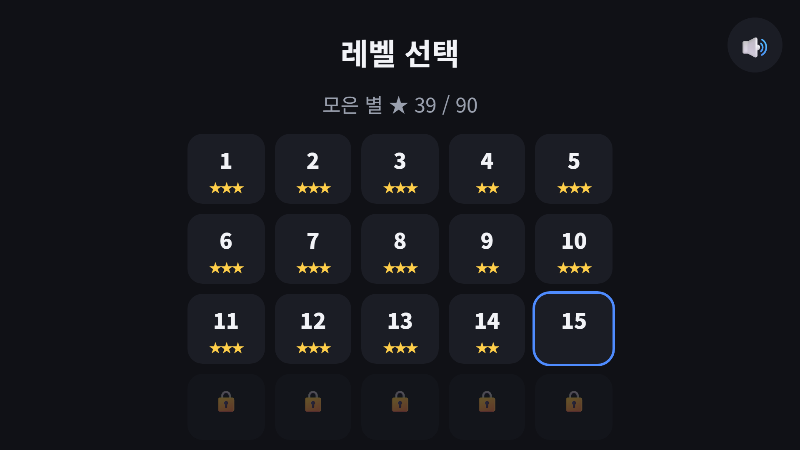
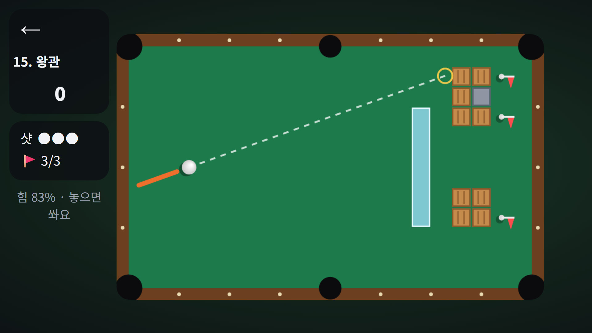
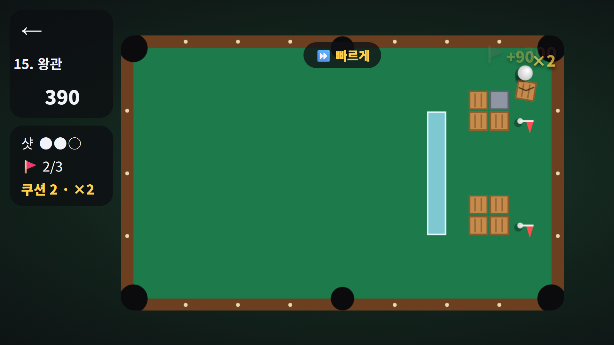
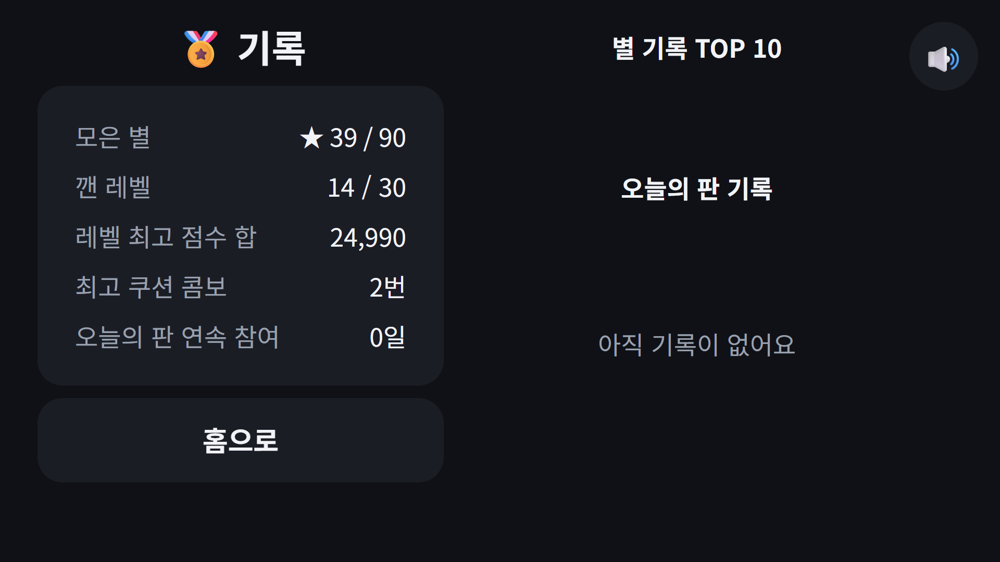
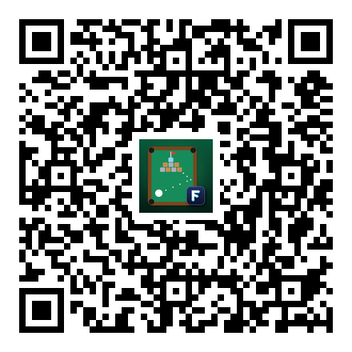

## Info
> **당구 공성전** — 수구를 당겨 쏴서 쿠션에 튕겨 블록 성을 무너뜨리고 깃발을 쓰러뜨리는 가로 화면 물리 퍼즐이에요. Google Play에서 무료, 광고 포함(배너 없음).
{: .prompt-info }

## 이런 게임입니다
당구의 쿠션 뱅크 샷과 공성전 블록 파괴를 합친 가로 화면 물리 퍼즐입니다. 한 샷 안에서 쿠션을 여러 번 탈수록 배율이 올라가고, 3쿠션에 성공하면 추가 샷도 얻습니다.

## 어떻게 하나요
- 화면을 누른 채 뒤로 당겨 조준해요. 길게 당길수록 세게 쏘고, 조준선은 첫 쿠션에서 한 번 꺾여요
- 유리·나무·돌 블록이 저마다 다르게 부서지고, 회색 기둥은 부서지지 않아요. 포켓에 빠진 블록도 점수가 돼요
- 한 샷에서 쿠션에 맞을 때마다 배율이 올라 최대 3배예요. 한 샷에 쿠션 3번이면 한 발이 더 생겨요
- 레벨 30개(별 최대 3개)와 매일 바뀌는 '오늘의 성'이 있어요

## 특징
- 원할 때만 보는 보상형 광고로 레벨마다 한 번 샷을 더 받을 수 있어요
- [파동권 공성전](/ko/posts/hub-siege/) 허브에서도 함께 즐길 수 있어요
- 9개 언어로 즐길 수 있으며 화면을 가리는 하단 배너 광고가 없어요

무료로 즐길 수 있으며 광고가 포함되어 있습니다(원할 때만 보는 보상형 광고 포함).

{: w="560" }
{: w="560" }
{: w="560" }
{: w="560" }
{: w="560" }

## Download
- Google Play: <https://play.google.com/store/apps/details?id=com.fadongkwon.billiards_castle>

{: w="200" .normal }

소식은 이 블로그와 [인스타그램(@fadongkwon.soft)](https://www.instagram.com/fadongkwon.soft/)에서 전해드립니다.
