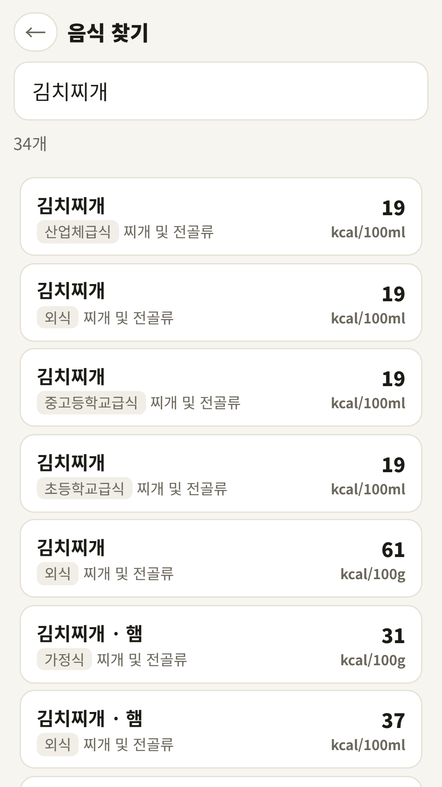
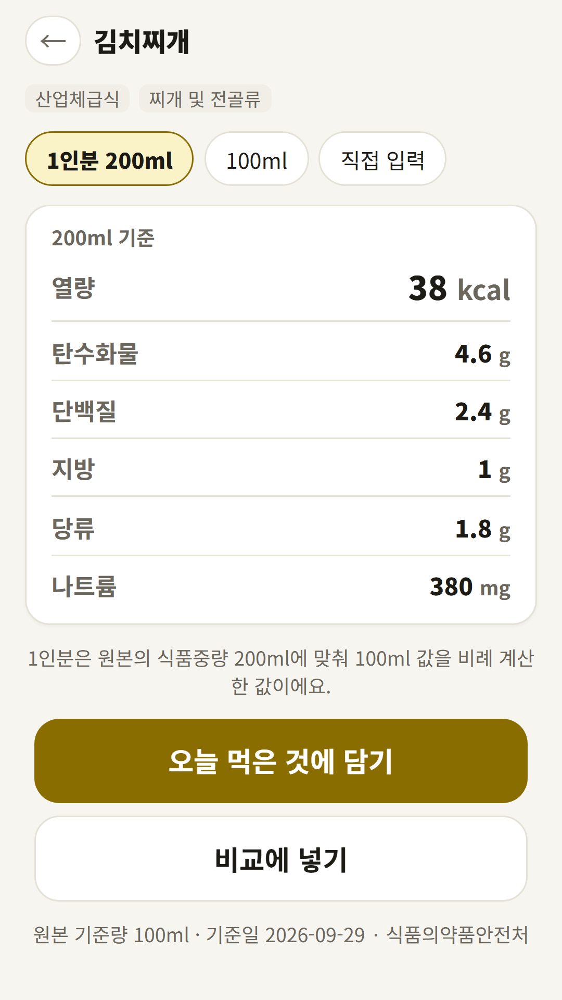
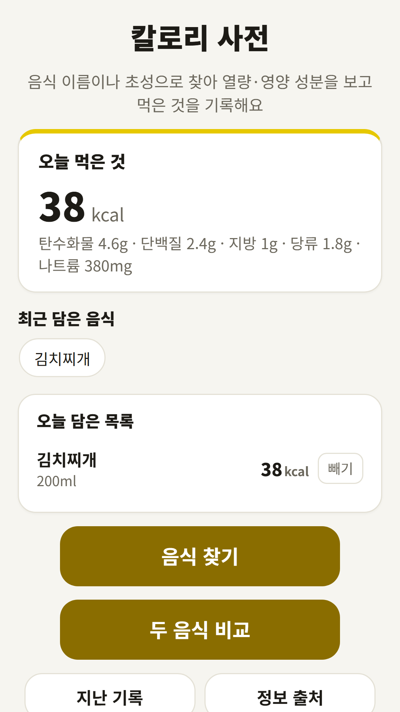
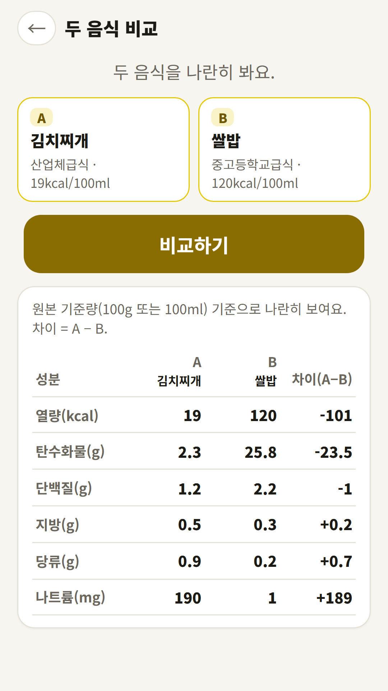

## Info
> **칼로리 사전 · Korean Food Calorie Guide** — 음식 4,344가지를 이름·초성으로 찾아 열량과 6가지 영양성분을 확인하고, 두 음식을 비교하거나 오늘 먹은 합계를 기록하는 앱이에요. Google Play에서 무료, 광고 포함(배너·보상형).
{: .prompt-info }

## 이런 앱입니다
식품의약품안전처 공공데이터포털 「전국통합식품영양성분정보(음식) 표준데이터」에서 외식 브랜드 메뉴를 제외한 4,344가지 음식을 담았어요. 음식 데이터가 앱 안에 들어 있어 '김치찌개'처럼 이름으로도, 'ㄱㅊㅉㄱ'처럼 초성만으로도 바로 찾을 수 있어요.

## 어떻게 쓰나요
- **이름·초성 즉시 검색**: 4,344종 음식의 열량(kcal)과 탄수화물·단백질·지방·당류·나트륨 6가지 영양성분을 빠르게 확인해요
- **기준량 전환**: 1인분(원본 식품중량 기준), 100g/100ml, 직접 무게 입력을 한 번의 터치로 바꿔 볼 수 있어요
- **두 음식 비교**: 두 음식을 나란히 놓고 열량과 영양성분 차이를 비교해요
- **하루 합계와 지난 기록**: 오늘 먹은 음식을 담아 합계를 보고, 연속일과 최근 30일 기록을 기기 안에만 저장해요

## 특징
- 회원가입 없이 무료로 바로 쓸 수 있어요. 기록은 기기 안에만 저장하며 서버나 외부로 보내지 않아요
- 화면 문구와 음식 목록은 한국어 전용이에요
- 이 앱은 의료기기가 아니며 질병의 진단·치료를 위한 것이 아니에요. 영양 정보는 공공데이터 기반 참고값이라 조리법과 양에 따라 실제와 다를 수 있어요

광고가 포함되어 있습니다(배너·보상형). 검색·상세 보기·하루 기록은 광고 없이 바로 쓸 수 있어요.

{: w="360" }
{: w="360" }
{: w="360" }
{: w="360" }

## 플레이 영상


## Download
- Google Play: <https://play.google.com/store/apps/details?id=com.fadongkwon.food_calorie>

{: w="200" .normal }

## 자료 출처
공공데이터포털(data.go.kr) 「전국통합식품영양성분정보(음식) 표준데이터」(제공: 식품의약품안전처, 2026년 11월 내려받음).

## 함께 보면 좋은 앱
- [파동권 건강생활](/ko/posts/hub-health/) — 홈트 카운터·스트레칭 루틴·칼로리 사전을 한 앱에 모은 허브
- [스트레칭 루틴](/ko/posts/stretch-routine/) — 부위별 3~5분 스트레칭을 그림·음성으로 따라 하는 앱

소식은 이 블로그와 [인스타그램(@fadongkwon.soft)](https://www.instagram.com/fadongkwon.soft/)에서 전해드립니다.
