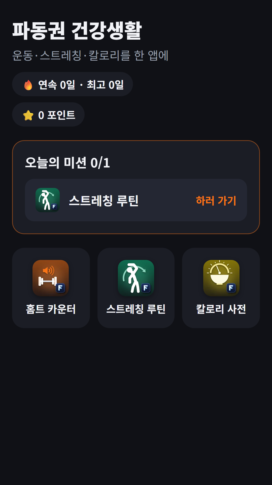
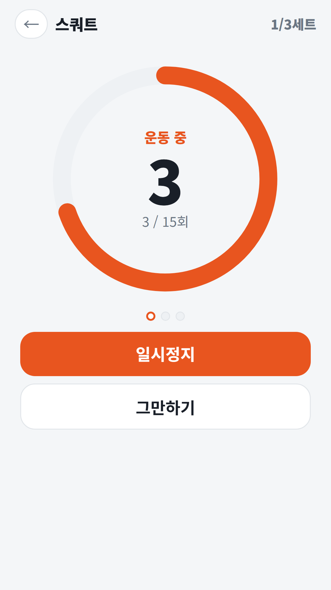
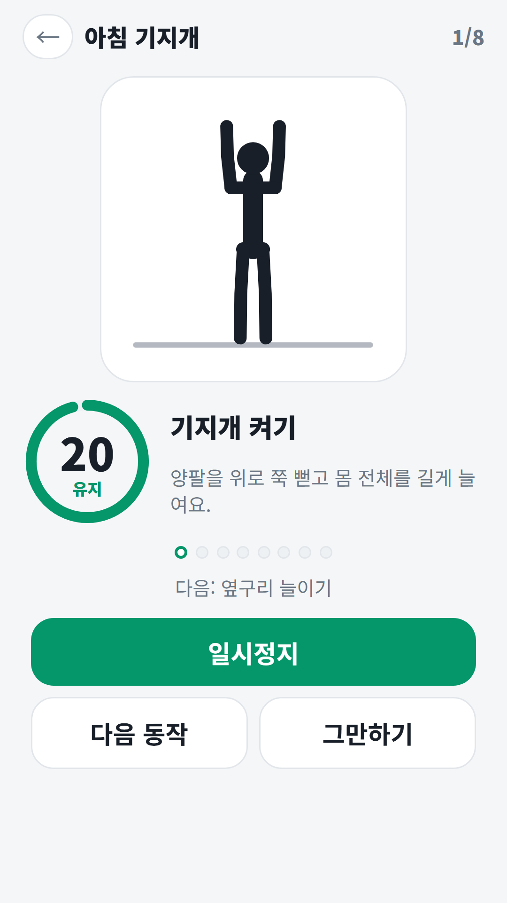
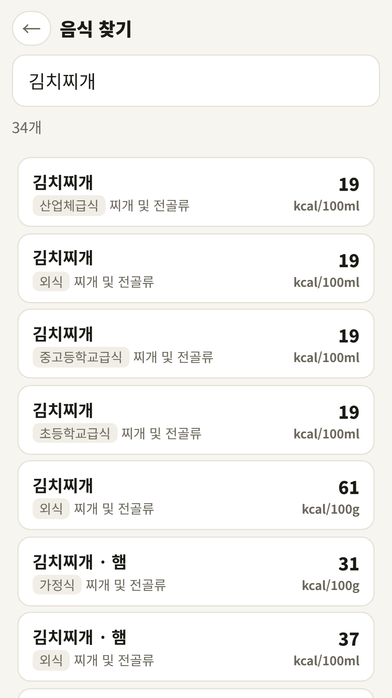

## Info
> **파동권 건강생활 · Health Life** — 홈트 카운터, 스트레칭 루틴, 칼로리 사전 세 가지 건강·생활 도구를 한 앱에 모은 허브예요. Google Play에서 무료, 광고 포함(배너·보상형).
{: .prompt-info }

## 이런 앱입니다
몸을 움직이고 먹은 것을 기록하는 생활 도구 세 가지를 한 앱에 모은 허브 앱이에요. 홈에서 세 도구를 바로 열고, 뒤로가기를 누르면 다시 허브 홈으로 돌아와요. 매일 오늘의 할 일을 마치면 연속 기록이 쌓여요.

## 수록 앱 3종
- **[홈트 카운터](/ko/posts/exercise-count/)**: 스쿼트·팔굽혀펴기·플랭크 등 9가지 운동의 횟수, 세트, 휴식 시간을 9개 언어 목소리로 세어 줘요
- **[스트레칭 루틴](/ko/posts/stretch-routine/)**: 목·어깨·허리·손목·다리·전신 6개 부위별 3~5분 루틴 14종을 동작 그림과 음성 안내(한국어·영어)로 따라 해요
- **[칼로리 사전](/ko/posts/food-calorie/)**: 식품의약품안전처 공공데이터의 음식 4,344가지를 이름과 초성으로 찾아 열량·영양성분을 보고, 두 음식을 비교하거나 하루 합계를 기록해요

## 특징
- 매일 오늘의 미션 하나가 나오고, 마치면 연속 기록과 포인트가 쌓여요
- 회원가입 없이 무료로 바로 쓸 수 있고, 모든 기록은 기기 안에만 저장돼요
- 의료기기가 아니며 질병의 진단·치료를 위한 것이 아니에요. 영양 정보는 공공데이터 참고값이라 조리법과 양에 따라 실제와 다를 수 있어요

광고가 포함되어 있습니다(배너·보상형).

{: w="360" }
{: w="360" }
{: w="360" }
{: w="360" }

## Download
- Google Play: <https://play.google.com/store/apps/details?id=com.fadongkwon.hub_health>

{: w="200" .normal }

## 함께 보면 좋은 앱
- [파동권 주말생활](/ko/posts/hub-weekend/) — 여행 시기·박물관 지도·홈트 카운터를 한 앱에 모은 허브

소식은 이 블로그와 [인스타그램(@fadongkwon.soft)](https://www.instagram.com/fadongkwon.soft/)에서 전해드립니다.
