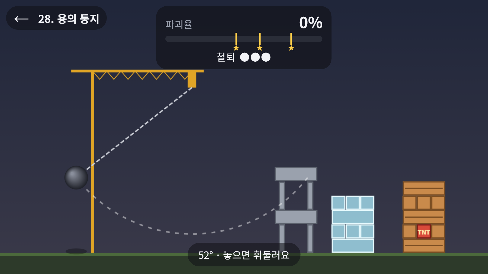
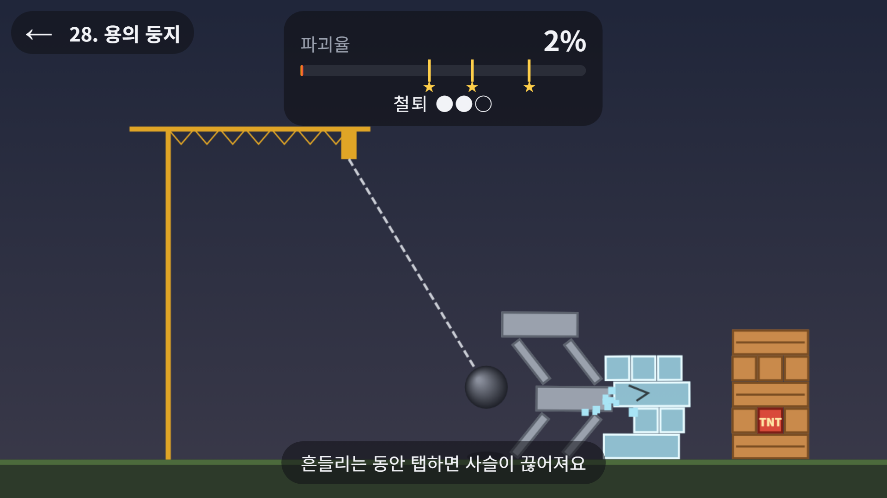
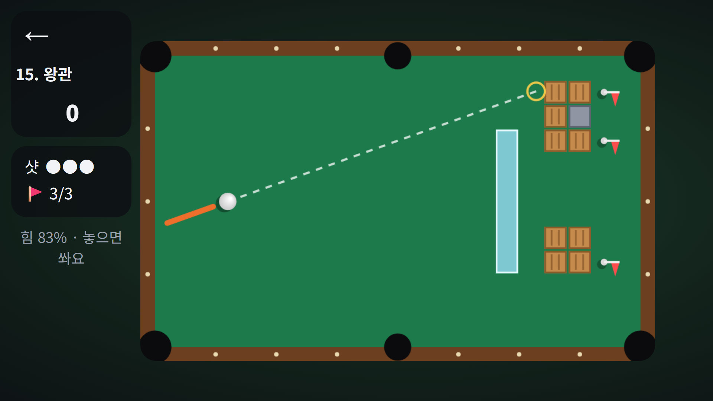
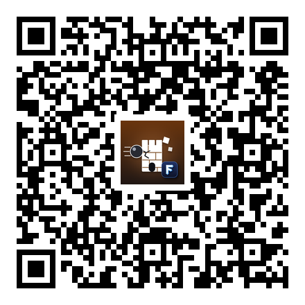

## Info
> **파동권 공성전** — 대포, 당구 수구, 크레인 철퇴로 성을 무너뜨리는 가로 화면 물리 게임 3종을 한 앱에 모은 허브예요. Google Play에서 무료, 광고 포함(배너 없음).
{: .prompt-info }

## 수록 게임 3종
- **파괴왕 공성전**: 대포를 조준해 탑과 성벽을 무너뜨려요. 나무·돌·얼음·TNT 블록이 저마다 다르게 부서져요
- **[당구 공성전](/ko/posts/billiards-castle/)**: 수구를 당겨 쿠션에 튕겨 블록 성을 무너뜨리고 깃발을 쓰러뜨려요
- **[철퇴 공성전](/ko/posts/wrecking-siege/)**: 크레인 철퇴를 진자처럼 휘두르고 사슬을 끊어 던져 파괴율을 올려요

## 특징
- 매일 두 게임이 오늘의 미션으로 정해지고, 미션을 채우면 연속 기록이 쌓여요
- 휴대폰을 가로로 돌려 넓은 화면에서 플레이하며, 화면을 가리는 하단 배너 광고가 없어요
- 9개 언어로 즐길 수 있어요

무료로 즐길 수 있으며 광고가 포함되어 있습니다(원할 때만 보는 보상형 광고 포함).

{: w="560" }
{: w="560" }
{: w="560" }
{: w="560" }

## Download
- Google Play: <https://play.google.com/store/apps/details?id=com.fadongkwon.hub_siege>

{: w="200" .normal }

소식은 이 블로그와 [인스타그램(@fadongkwon.soft)](https://www.instagram.com/fadongkwon.soft/)에서 전해드립니다.
